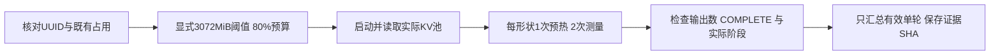

# 王服务器共享卡最小试跑：2026-10-13

用户同意尝试那几张占约2GB、利用率为0的卡。本次实际使用alpha-wang的GPU0，Qwen3-8B BF16、TP1、vLLM0.11.0 eager；成功加载、生成、计时及正常退出。这是硬件smoke实测，不是完成耗时校准或发布可靠profile。

## 运行条件

启动前三次检查（间隔3秒），GPU0–3各2441MiB、利用率0%；GPU4/5在使用。选择GPU0，显式允许已有显存不超过3072MiB，仍要求启动检查时利用率0。利用率0不保证其他任务一直不计算；没有清理显存或终止他人进程。

显存预算从默认90%改为80%，约19.2GiB，给已有占用及余量留空间。其他条件：max_model_len4096、max_num_seqs8、max_num_batched_tokens4096、block16，请求禁用prefix caching/chunked prefill/CUDA Graph。2026-10-14复查日志确认V1实际启用了chunked prefill，之前把请求值当有效值不准确；本次小smoke按实际工作量记录，结果仍保留。独立环境和缓存仍在/data/llm-serving-lab-calibration。



## 结果

| 观测 | 本次结果 |
| --- | --- |
| 权重VRAM | 16394201088 bytes，约15.2683GiB |
| 引擎KV可用预算 | 3332999987.2 bytes，约3.10GiB |
| 实际KV池 | 1412块×16 token = 22592 token |
| Prefill B1 / 128输入token | 有效2轮；中位24.0518ms，范围23.7817–24.3218ms |
| Decode B1 / 每轮1 token | 有效4轮；中位18.3172ms，范围18.2714–18.4665ms |
| Decode实际上下文 | 128或129 token，不同轮次保留真实值 |

最小矩阵只含两个形状，每形状一次预热、两次重复。Prefill实验每请求生成1token；Decode实验每请求生成3token，因此先执行Prefill再执行2轮Decode。共6次生成、12条Worker记录，均核对实际输出长度。统计Decode时排除它的输入Prefill，统计双方时排除预热；不能把整个生成时间当Decode单轮时间。

计时scope=worker_execute_wall：perf_counter包围Worker.execute_model，前后CUDA同步，包含预处理/forward/sampling/输出，不含Engine Scheduler、RPC、HTTP和分词。它不是纯GPU kernel时间，也不是端侧TTFT；同步和eager运行会扰动生产服务执行方式。统计是少量观测，没有置信区间或独占干扰保证，不用于正式拟合。

1412是80%显存预算下实际分配的块数。旧容量示例1972使用90%和假设2GiB预留，条件不同，不直接比较二者误差；尚未修改默认容量profile。退出后GPU0回到2441MiB，采集进程正常结束。

## 代码、证据与复现

原始文件在output/calibration/wang-qwen3-8b-eager-shared-smoke-20261013-03（不提交Git），远端同名runs目录保存一份。可提交摘要是measurements/wang-shared-smoke-20261013.json：保留条件、模型身份、容量、统计及原始文件SHA，fit_performed=false。

| 代码/字段 | 作用 |
| --- | --- |
| batch_records.select_device | 默认64MiB保护；显式试跑可传3072，但仍拒绝非零利用率 |
| launch_remote.py参数 | 将显存比例、占用阈值和UUID传给采集器，保留命令/退出码 |
| collect_batches.py | GPU检查先于模型启动，metadata保存shared_gpu_trial及实际预算 |
| worker_probe.TimedWorker | 实际容量及逐轮同步计时，smoke已通过真实运行 |
| summarize_smoke.py | 验收完整记录、输出数、实际阶段；剔除预热及Decode实验的输入Prefill |

服务器入口（再次运行必须用新的run-id，并重新核对GPU占用）：

```bash
/data/llm-serving-lab-calibration/venv/bin/python \
  /data/llm-serving-lab-calibration/launch_remote.py \
  --run-id wang-qwen3-8b-eager-shared-smoke-20261013-03 \
  --smoke --gpu-memory-utilization 0.8 --max-existing-memory-mib 3072
```

本地重新验收（输出文件必须不存在）：

```bash
python3 calibration/scripts/summarize_smoke.py \
  --run output/calibration/wang-qwen3-8b-eager-shared-smoke-20261013-03 \
  --output output/calibration/smoke-summary-new.json
```

5个本地采集测试通过，覆盖UUID映射、默认拒绝/显式共享/忙卡拒绝、阶段上下文、预热与输入Prefill过滤、缺COMPLETE/错误输出长度拒绝。基础事件模拟器未改；接下来才是完整fit/validation矩阵、共享干扰检查和独立验证，本轮不自动发布实测系数。
