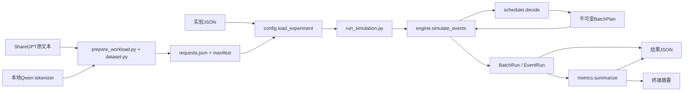

# 当前架构与代码契约

本文件是当前实现地图，供用户和后续 AI 快速定位。日期2026-10-13；历史阶段见 LEARNING_LOG，不以旧记录替代当前契约。每次机制变动同步更新本页、对应章节和 HANDOFF。

## 模块地图



| 文件 | 权责 | 不应做的事 |
| --- | --- | --- |
| simulator/models.py | 不可变Request/Timing/Event/Result/BatchStep/BatchRun及输入校验 | 不保存事件执行队列 |
| simulator/dataset.py | 单轮提取、分词长度、到达计划、文件摘要 | 不参与运行时调度 |
| prepare_workload.py | 校验准备配置、发布负载和manifest | 不加载模型权重或执行GPU |
| simulator/config.py | 校验实验JSON、读取标准负载、核对manifest | 不修改请求进度 |
| simulator/scheduler.py | SchedulerConfig、快照、计划、只读选批、轮转纯函数 | 不分配KV、不生成token、不推进时间 |
| simulator/engine.py | 持有队列与进度、提交计划、处理事件与完成 | 不解析原始文本或拟合真实耗时 |
| simulator/metrics.py | 从完成结果计算摘要 | 不改变事件/调度状态 |
| run_simulation.py | 连接加载、执行、统计、输出 | 不实现第二套调度机制 |

## 状态所有权与不可变边界

Request 记录输入参数；实际最终输出长度只供内核判断完成，不放入 Scheduler 快照。ReadyTask 的候选 token_count 是待处理工作量；BatchPlan 内的 token_count 是这轮实际执行工作量。

engine 的局部可变状态为 future 最小堆、waiting deque、active列表、prefill_done字典、token_times/records/starts字典、busy/wakeup_pending与时钟。没有全局运行状态，每次 simulate_events 独立。

未来事件 _ScheduledEvent 按(time_ms, priority, sequence)排序，priority为arrival=0、complete=1、wakeup=2。事件优先级不是阶段优先级；同刻全部到达/完成发生后才选批。complete携带启动时的BatchPlan，不重新选人。

## 当前配置契约

实验顶层为workload/scheduler/timing，必填字段和未知字段严格校验。scheduler.policy必填；max_batch_requests/max_tokens_per_batch/prefill_chunk_tokens可选正整数或null，省略/null为不限制。字段名字以配置为准，不与师兄配置接口混用。

workload.path相对配置目录；CLI的--config和--output相对cwd。generated负载有同名manifest时验证SHA-256及数量。标准模型数据准备外的基础模拟只用标准库。

## 执行契约与必须保持的不变量

1. 单GPU执行区间不重叠；busy时到达只排队，不抢占。
2. Scheduler.decide不改变快照或队列，计划每轮同一阶段；Prefill一次一个请求，Decode轮转。
3. 每计划成员数不超过人数上限，token_count总和不超过token上限；Prefill还不超过chunk。
4. Prefill范围连续且恰好覆盖完整输入；prefill_done仅在完成事件累加。
5. 非最终Prefill块不生成输出、不进入active；最终块生成首token，单输出请求直接完成。
6. starts记录第一块开始，不能被后续块覆盖；waiting包含未開始或未完成输入，但不包含未来未到达请求。
7. Decode每成员一次产生一个输出，完成者退出；未完成已服务者移到轮转尾部。
8. 模拟结束后每个请求输出数量等于目标，token时间递增；不暴露目标长度给选批策略。
9. 时间只在取事件时前进；启动只安排未来complete。
10. 未设置新预算时保留原A/B与ShareGPT请求结果和执行区间；trace和plans可增加说明字段。

## 耗时与统计假设

Prefill块耗时为本轮输入数×教学系数；Decode整轮固定耗时，无batch/上下文变化、无分块启动开销。TTFT包含全部输入块与期间等待。统计P50/P95用最近秩，ITL按所有间隔，吞吐窗口首到达至末完成含空闲，空样本null。

输出schema_version仍为1，新增scheduler字段和计划range_start为扩展；旧结果保持可读，但不能当作启用了新约束。plans[i]对应steps[i]。

## 明确尚未实现

KV容量/页分配、容量阻塞、抢占恢复、混合P/D batch、阶段交替、SLO优化、多卡/传输、真实模型执行、4090校准、失败/取消/截止终止。分块本身不会自动让Decode获得运行机会。

## 验证与交接入口

```bash
python3 -m unittest discover -s tests -q
python3 run_simulation.py --config configs/token_budget.json --output output/token_budget.json
```

test_token_budget.py检查范围、首token、限制与进度；test_scheduler.py检查只读选批与轮转；test_engine.py检查事件边界/互斥；test_config/test_dataset/test_metrics分别守住输入、分词和口径。依赖缺失的分词集成明确skip。

下一AI先确认git status，读取HANDOFF和本页，再看对应实现/测试；保留用户修改。当前用户学习第8章，确认理解后再选择下一机制，不自行扩为完整系统。只在本教学项目工作，不修改相邻师兄项目或全局环境。资产和生成结果被Git忽略，本地存在不代表新机器能直接取得。
