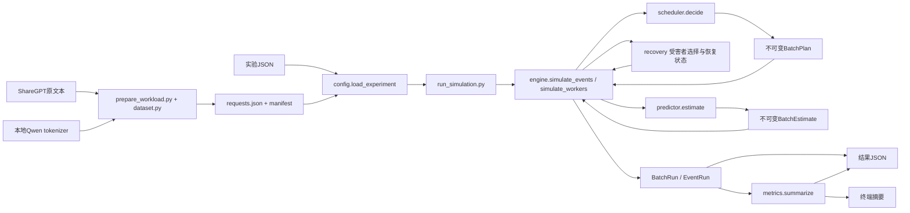

# 当前架构与代码契约

本文件是当前实现地图，供用户和后续 AI 快速定位。更新日期2026-10-15。当前支持多个独立Mix worker及固定1P1D/FIFO链路，学习说明见第21/22章，路线见ROADMAP.md。单卡旧接口保留；目标容量不足的交接等待协议尚未实现。第15章以后的补充按历史阶段追加，早期未实现说明以最新章节为准；实测范围见第18/20章及摘要报告。

## 模块地图



| 文件 | 权责 | 不应做的事 |
| --- | --- | --- |
| simulator/models.py | 不可变Request/Timing/Event/Result/BatchStep/BatchRun及输入校验 | 不保存事件执行队列 |
| simulator/dataset.py | 单轮提取、分词长度、到达计划、文件摘要 | 不参与运行时调度 |
| prepare_workload.py | 校验准备配置、发布负载和manifest | 不加载模型权重或执行GPU |
| simulator/config.py | 校验实验JSON、读取标准负载、核对manifest | 不修改请求进度 |
| simulator/scheduler.py | SchedulerProfile、约束、快照、计划、只读选批、完成反馈、轮转纯函数 | 不分配KV、不生成token、不推进时间 |
| simulator/engine.py | 持有队列与进度、提交计划、处理事件与完成 | 不解析原始文本或拟合真实耗时 |
| simulator/worker.py | 不可变WorkerConfig、独立卡身份和资源输入校验 | 不保存动态队列、不路由、不传输KV |
| simulator/handoff.py | 固定PD角色/链路配置、FIFO传输与目标KV提交/源释放 | 不替代Scheduler、不做目标容量等待/PD抢占或带宽竞争 |
| simulator/memory_budget.py | 设备/模型/预留参数、KV字节及整块容量换算 | 不连接服务器、不部署模型、不管理块生命周期 |
| simulator/kv_cache.py | KVConfig/Block/Table/Reservation、单GPU池、只读准入、事务与冻结快照 | 不选原始候选、不计算token内容、不进行网络传输 |
| simulator/recovery.py | 独立策略配置、只读受害者选择、暂停/FIFO恢复与进展保护状态 | 不分配KV、不预测耗时、不决定最终输出长度 |
| simulator/predictor.py | 不可变工作描述、模型/硬件/修正参数、教学或roofline估算 | 不选批、不分配KV、不修改进度或时钟 |
| simulator/metrics.py | 从完成结果计算摘要 | 不改变事件/调度状态 |
| run_simulation.py | 连接加载、执行、统计、输出 | 不实现第二套调度机制 |

## 状态所有权与不可变边界

Request 记录输入参数；实际最终输出长度只供内核判断完成，不放入 Scheduler 快照。ReadyTask 的候选 token_count 是待处理工作量；BatchPlan 内的 token_count 是这轮实际执行工作量。

engine._drive_workers持有本次运行唯一future最小堆、sequence和全局启动顺序；各_WorkerRuntime独占waiting deque、active列表、prefill_done、token_times/records/starts、busy/wakeup_pending、Scheduler/Predictor/BlockPool/RecoveryController。所有运行状态均在一次调用内新建，不跨实验共享。runtime.now_ms只复制本次收到事件的时间，唯一时间来源是全局堆。

每次运行创建独立 Scheduler，记录 last_completed_phase。decide 仍只读候选与阶段状态；完成事件通过 on_batch_completed 更新该实例的上轮阶段。配置方案不可变，可复用方案但不共享 Scheduler 的运行状态。

未来事件_ScheduledEvent携带worker_id，按(time_ms, priority, sequence)排序；arrival=0，complete/transfer_complete=1，wakeup/transfer_start=2；worker_id不参与排序。同刻所有卡的全部到达/完成发生后才选批或启动传输。complete携带启动时的BatchPlan和本卡KVReservation，不重新选人，不修改其他卡busy。transfer_start仅唤醒链路，FIFO决定真正传输成员。

## 当前配置契约

推荐实验顶层为workload/timing/scheduler_profiles/workers；独立多Mix另含routing，固定1P1D另含pd。方案含prefill_algorithm、decode_algorithm、mix_algorithm和constraints；支持fcfs_chunked、round_robin与prefill_first/decode_first/alternating/mixed_decode_first。约束max_batch_requests/max_tokens_per_batch/prefill_chunk_tokens为可选正整数或null。无pd时仅接受Mix；pd必须恰好一P一D、不同GPU，两端独立KV且recovery=block。P/D只要求对应阶段算法槽，不要求Mix槽。

多个worker时gpu_id必填且各卡唯一，worker.id也唯一。worker可设置自己的timing/predictor/kv_cache/recovery；顶层耗时作为默认，子级timing替换父级predictor，子级roofline替换父级timing。多卡禁止顶层KV/recovery，必须逐卡指定；KV.gpu_id必须与worker.gpu_id一致。每卡可人工设块数或引用独立显存profile，路径与结构校验复用原逻辑。未启用KV就无容量约束。

routing只支持policy=fixed与assignments对象，恰好覆盖所有请求并引用有效worker。独立多Mix不配置routing明确报错；单卡省略时全部归唯一worker。固定归属不会自动迁移或负载均衡。Experiment保留旧单卡字段为首worker兼容视图，多卡执行必须读取workers/assignments，PD还需读取pd_config。

pd={prefill_worker,decode_worker,link}与routing互斥，全部请求自动先到P。link={bandwidth_bytes_per_s,latency_ms,kv_bytes_per_token}，带宽/载荷正、延迟非负。roofline与显存profile存在时核对KV字节数/结构，两端roofline模型需相同。simulate_pd使用同一个_drive_workers事件内核，不另建事件循环。

PD交接后D接收原请求信息/首开始/已完成输入，继续引用原token_times和records历史；P用departed排除已移交请求的完整结果，不再参与P的候选。最终完整Result只在D（或单输出时P）汇总一次。每卡队列和资源仍独立，不共享Scheduler/Predictor/KV状态。

旧 workload/scheduler/timing JSON 仍兼容，scheduler.policy 转换为 Mix 槽；新旧写法禁止混用，constraints 不允许 policy。Python 的 SchedulerConfig.policy 保留作兼容入口，提供 profile 后阶段选择以 profile.mix_algorithm 为准。未知字段/算法、错误引用均报错，不静默降级。第9章有完整配置与选批流程。

workload.path相对配置目录；CLI的--config和--output相对cwd。generated负载有同名manifest时验证SHA-256及数量。标准模型数据准备外的基础模拟只用标准库。

## 执行契约与必须保持的不变量

1. 同一GPU执行区间不重叠，不同独立GPU允许重叠；busy时本卡到达只排队，不抢占。
2. Scheduler.decide不改变快照或队列，计划可单阶段或Mixed；Prefill最多一个请求的输入块，Decode轮转。普通选批成员阶段仍为Prefill/Decode，批级Mixed标签不用于更新请求状态。
   Mix 槽仅在 P/D 都就绪时决定阶段；alternating 依据上轮完成阶段选择另一阶段，初始选 P。仅一阶段就绪时不空转，只有完成事件改变交替状态。mixed_decode_first先选Decode，再用剩余人数槽与token预算加入队首Prefill块；空间耗尽则仅Decode，不预留Prefill额度。
3. 每计划成员数不超过人数上限，token_count总和不超过token上限；Prefill还不超过chunk。
4. Prefill范围连续且恰好覆盖完整输入；prefill_done仅在完成事件累加。
5. 非最终Prefill块不生成输出、不进入active；最终块生成首token，单输出请求直接完成。
6. starts记录第一块开始，不能被后续块覆盖；waiting包含未開始或未完成输入，但不包含未来未到达请求。
7. Decode每成员一次产生一个输出，完成者退出；未完成已服务者移到轮转尾部。
8. completed请求输出数量等于目标，token时间递增；blocked时保留未完成进度。路由与Scheduler不读取最终输出目标作选择。
9. 时间只在取事件时前进；启动只安排未来complete。
10. 默认teaching且未设置新预算时保留原A/B与ShareGPT请求结果和执行区间；trace/plans/estimates可增加说明字段。选择roofline会改变事件时间，可能进一步改变下一轮就绪候选。

## 耗时与统计假设

耗时统一通过 Predictor.estimate(tuple[PredictorItem]) 返回 BatchEstimate。内核在提交前提供本轮新token、上下文、阶段、是否产出token。Prefill上下文是range_start；Decode是input_tokens+已产出输出数-1。预测不暴露未来输出目标。内核校验正数、有限耗时以及完成时间能推进；estimates与plans/steps同序保存。

默认teaching复用旧timing：Prefill按输入数线性，Decode整轮固定，无上下文/人数负担；Mixed为Prefill部分加一次Decode时间，整批同一完成屏障。可选roofline用dense/SwiGLU/GQA简化模型分矩阵组、Attention组；每组max计算时间与访存时间，再相加与batch开销。系数乘时间，权重每batch按读取一次估计，KV读写为粗略近似。未支持MoE/MLA、实际内核/缓存效率，也未校准，来源标记uncalibrated_roofline。

顶层predictor可省略（teaching）或显式配置kind。teaching要求timing且不允许model/device/calibration；roofline必须含这三个对象且禁止同时设置timing。模型维度和字节数是正整数，头数需整除；硬件算力/带宽与系数为有限正数，batch开销有限非负；未知字段报错。roofline没有显存容量准入；当前Scheduler不使用预测来选择成员。公式、单位、假设、手算见第10章。

TTFT包含全部输入块与期间等待。统计P50/P95用最近秩，ITL按所有间隔，吞吐窗口首到达至末完成含空闲，空样本null。

单卡输出schema_version=1保持原样。多卡输出schema_version=2，steps含worker_id/gpu_id，requests带归属，workers分别保存资源/局部summary/KV/恢复，routing保存固定映射。全局steps/plans/estimates按启动顺序一一对应；trace按实际全局事件处理顺序记录。全局summary从全部已完成请求汇总，不相加每卡时长或局部吞吐；blocked时仅统计完成请求。各卡busy_time_ms为自身区间和，不是集群耗时。

第10章新增predictor配置与estimates明细。teaching的timing_source/timing维持原值；roofline来源uncalibrated_roofline、timing为null，不将内部兼容Timing默认值展示成启用参数。

## 明确尚未实现

共享KV/COW/通用传输pin、模拟容量公式与实际池大小的系统对齐、CPU交换、SLO优化、交接目标容量等待/PD抢占、多P多D、动态路由、TP/PP、失败/取消/截止终止。已有最小固定1P1D传输，但未模拟共享带宽或真实链路争用；多卡请求级精度未验证。真实模型执行仅用于独立采集工具。分块本身不会自动让Decode获得运行机会，需要启用交替等策略。

## 验证与交接入口

```bash
python3 -m unittest discover -s tests -q
python3 run_simulation.py --config configs/token_budget.json --output output/token_budget.json
```

test_profiles.py检查方案/角色绑定、交替状态、手算时间与旧配置兼容；test_token_budget.py检查范围、首token、限制与进度；test_scheduler.py检查只读选批与轮转；test_engine.py检查事件边界/互斥；test_config/test_dataset/test_metrics分别守住输入、分词和口径。依赖缺失的分词集成明确skip。

下一AI先确认git status，读取HANDOFF/本页/ROADMAP/第22章。当前完成路线第2阶段，用户理解尚未确认，不自动继续目标容量等待。test_pd验证交接/载荷/复制计算重叠/边界，test_multi_worker验证独立卡，test_predictor验证公式。只在教学项目工作，不修改师兄项目或全局环境。资产/生成结果被Git忽略。

## 第11章混合执行补充

提交遍历items，仅取走Prefill成员。完成按item.phase更新；中间输入块返回waiting、最终输入块才产首token。只轮转本轮Decode成员，新Prefill进入active不算已服务Decode。每轮仍一个完成事件，执行期间到达不得插入。roofline整体估算Mixed成员，权重/开销按整批一次；教学相加规则只作近似。test_mixed.py验证预算、完成/轮转、上下文、手算与到达边界。混合轮可减少次数，但不保证延迟/吞吐改善。详见第11章。

## 第12章：KV块契约

可选顶层kv_cache要求gpu_id/block_tokens，必须且只能另选total_blocks或memory_profile。前者直接配正整数块数，后者按独立profile换算。省略禁用，null不合法。一池一个GPU，解析后KVConfig仍是设备身份/正整数块数/块token数。

BlockPool独占活块、已提交请求块表、在途事务和ID。KVBlock保存设备/块ID、逻辑页序号、有效范围、Reserved/Populating/Ready、request_refs和execution_owner；记录冻结且替换更新。块ID单调不复用，GPU+ID一起解释身份。当前每块仅一个请求引用，无共享/COW；第22章控制器通过两个独立池实现最小跨卡复制，单池本身不管理源/目标副本映射。

admit只读删减候选，先留可增长Decode，剩余空间缩小Prefill。无成员时内核尝试可增长Decode回退；不跳过FCFS Prefill队首。reserve先全量校验，创建新块并保护写尾块；begin_populating启动填充；complete才提交范围/请求表并解除保护；完成请求释放引用。rollback只还原本笔事务。第22章允许同池不同请求并行事务，以支持拷入B与计算A；同一请求重叠写入在分配前拒绝。单卡执行仍一次一个batch，不因此产生同卡计算重叠。

必须保持：活块数不超过total_blocks，空闲数不负；已提交表中的块存在/有请求引用，逻辑范围覆盖cached_tokens；未完成事务不增加cached_tokens；释放执行中的请求报错。Reserved/Populating映射在reservation.writes中，快照同时导出reservations。碎片仅统计Ready块的尾部空位，峰值包括曾预留块。

无准入计划时不制造无进展事件，等待已有未来事件；事件耗尽且有未完成请求则status=blocked。结果保留pending_progress与KV快照；requests/summary仅统计完成请求，summary_scope明确completed_requests_only；CLI保存JSON再返回2。成功返回0。历史每个KV动作保存完整冻结快照，旧配置禁用时kv_final=null/kv_records为空。schema_version仍1，扩展status/pending/kv字段。

KV分配与状态变化无独立耗时，未模拟张量/地址/外部空洞布局、共享/COW、未来增长预留；可选抢占恢复见第14章。第12章与test_kv_cache.py是阅读/验证入口。用户明确希望支持后续多卡多状态，不回退为只计总token的模型；扩展机制逐步实现。

## 第13章：独立显存预算profile

kv_cache.memory_profile路径相对实验配置目录；profile严格解析device（name/memory_capacity_bytes）、model（name/num_layers/num_kv_heads/head_dim/kv_bytes_per_element/weight_bytes）、memory（utilization/runtime_reserve_bytes；可选block_metadata_bytes/block_alignment_bytes）、可选provenance对象。比例在(0,1]，容量/模型正整数，预留/元数据非负，对齐正整数；预算不足或不足一整块在启动前报错。

memory_budget.resolve_budget计算floor容量×比例，再扣显式权重/运行预留；单卡dense/GQA每token KV=2×层×KV头×head_dim×元素字节，整页payload加元数据再对齐，KV预算除页大小取floor。MemoryBudget冻结且导出每步计算/配置/余量；provenance只作来源说明。启用roofline时检查KV结构/精度与容量profile一致；不代表模型耗时已校准。BlockPool不读取profile，只接收已解析KVConfig。

2026-10-13服务器只读：6张4090每卡24564MiB，使用单卡容量25757220864字节；现有Qwen3-8B为36层/8KV头/head_dim128/BF16，权重metadata.total_size=16381470720。当前例子比例0.9、运行预留2GiB、KV2字节、16token一块、元数据0/对齐1均可配置，其中预留及比例未实测。算得每token147456字节、每块2359296字节、KV预算4652544409字节、1972块/余12697字节。现有Qwen2.5-7B服务器目录未找到，明确选择Qwen3例子；没有更改原负载/tokenizer。

结果新增memory_budget/memory_provenance扩展字段，schema_version仍1。当前teaching耗时不变；容量示例不是4090性能benchmark。未测实际权重VRAM/运行时峰值、未做vLLM部署/耗时校准、多卡分片或MLA/滑窗模型。第13章和test_memory_budget.py验证手算、路径/互斥、服务器配置及结构冲突。

## 第14章：抢占与重算契约

顶层recovery含必填capacity_policy（block/preempt）、可选victim_policy（fewest_generated/newest，默认前者）、recovery_action（只支持recompute）。整个对象省略时block；preempt必须有KV。字段/算法严格校验。容量规则、受害者选择与恢复动作分别配置，不等同于复现师兄完整ksana/sglang策略。

正常准入及可增长Decode回退均失败、GPU空闲时，engine.try_preempt选择受益者与受害者。受害者必须在普通队列、有已提交KV且无执行保护；按当前单引用可释放块数检查是否足够让受益者处理至少1token。候选只有当前生成数和到达序号，无最终长度。释放请求引用后记录保存的cached_tokens并移出普通队列。focus受益者直到完成，不让其他请求重新抢空间；不能自我抢占。容量过小仍报告blocked。

RecoveryController独占FIFO暂停队列、restoring目标、focus和动作记录。普通驻留请求耗尽且无focus时开始FIFO恢复；恢复请求受保护到完成。Recompute是内核专用单成员批级/成员阶段，正常Scheduler快照不含此阶段，不能与P/D混批。范围从0连续重建至暂停前已提交缓存长度，受token/chunk/容量约束；同样reserve/populating/complete，经Predictor预测。无新输出且roofline不含LM head，teaching按每token Prefill成本；不更新原prefill_done、starts、token_times或Scheduler交替状态。恢复后根据是否已有输出回active或waiting。

cached_tokens与生成输出数分别保存；Decode当前最后一个输出尚未处理，不必加入重建。暂停的普通请求进度保持原值，KV表从0恢复，因此不得把prefill_done当恢复游标，游标来自BlockPool已提交cached_tokens。Recompute只构造历史长度/工作量，没有真实token内容或张量。

EventRun/JSON扩展recovery_records、recovery_pending（未恢复目标）和recovery_summary（抢占次数、重算token），schema_version仍1。逻辑输入/输出统计不重复计重算，batch步数包含重算。默认block无恢复记录；ShareGPT requests/steps/summary/estimates保持不变。第14章和test_recovery.py核对时序、历史输出/部分输入、预算、FIFO、失败及预测边界；这是保守进展保护，不是SLO/公平优化。

## 第15章：校准材料与运行时边界

calibration/plan.json是建议实验矩阵，templates/是metadata/capacity/batches/requests/comparison空白记录；不属于load_experiment配置、不被simulate_events加载，无新运行接口。record_status=template不表示实测；原始数据放忽略的output/calibration/<run_id>。时间ms、容量bytes，batch.items沿用PredictorItem；engine_iteration_wall与gpu_forward、request_end_to_end等边界不可混用。请求输出事件只有可靠逐token映射才能和模拟ITL直接比较。

当前仍uncalibrated_roofline/teaching_assumption，无自动采集、拟合/记录校验或校准profile发布能力。下一阶段容量报告先用显式total_blocks核对，耗时按fit/validation分形状独立验证，实际模型/版本和计时边界要先核对。首轮计划不覆盖Mixed/Recompute；详见第15章。

## 服务器环境准备补充

用户当前暂停实际校准，仅准备依赖。requirements-server.txt固定vLLM/torch/transformers；scripts/check_environment.py是独立服务器工具，与事件模拟器无依赖关系，禁用可见GPU、核对sys.prefix及包依赖、导出精确版本。environments/保存可复现依赖报告，dependencies_ready不等于已测真实推理。无采集/拟合/新Predictor来源；不得自动运行模型。环境说明见calibration/server-environment.md。

## 第16章：离线参照与真实采集边界

calibration/scripts是离线工具，不改变Scheduler/Engine/KV执行契约。run_senior_reference.py接收固定scenario，只读加载师兄已有native，先跑单请求DES并验收schema/SHA/数量，再replay固定纯P/D形状；使用相同PredictorItem，12fit/4validation。结果显式标synthetic_simulator_reference_not_hardware_calibration、hardware_measured=false及二进制来源；源HEAD与binary报告commit分开，当前不同。NumPy/YAML等来自师兄已有环境，事件模拟标准库依赖不变。

configs/reference_senior.json是显式可选参照系数，设备速度假设100TFLOP/s/1TB/s，原默认配置不变，Predictor来源仍uncalibrated_roofline。不能用TTFT拟合执行时间；完整DES示例另记调度周期及小Prefill等待条件。不覆盖Mixed/恢复/容量精度。

真实采集入口collect_batches.py/worker_probe.py只针对vLLM0.11.0单卡eager，Worker前后CUDA同步计时worker_execute_wall，不称engine_iteration或gpu_forward。batch_records从实际Scheduler输出提取上下文与工作量，拒绝抢占恢复和多token Decode；UUID核对后数字卡号映射及显存/利用率检查先于vLLM初始化。metadata.started与measured分开，当前启动未成功、无有效实测数据；独立环境依赖ready不代表GPU计时已验证。第15章初始“未实现采集器”描述为历史阶段，当前工具已准备。

## GPU0共享卡smoke补充

select_device新增显式max_existing_memory_mib阈值，默认64；共享试跑用3072且仍要求利用率0。collect_batches/launch_remote显式传显存使用比例，默认0.9不变，本次0.8，metadata保存shared_gpu_trial及阈值。授权只表示允许共享试跑，利用率0不构成独占保证。

TimedWorker在Qwen3-8B/vLLM0.11.0真实smoke已运行成功，读取实际1412块/16token和Worker计时。summarize_smoke只接受完整两形状试跑，过滤预热与Decode样本中的输入Prefill，提交摘要和证据SHA；不改运行时、Predictor来源或默认容量profile。完整拟合/验证仍未执行，不能用少量共享smoke发布可靠性能profile。

## 第17章：已有模型的完整实测对照

launch_remote支持显式--model，独立采集器不绑定Qwen3名称。Worker容量RPC返回effective_engine，metadata将请求/实际参数分开；V1实际chunk=True，即使请求False。旧王机smoke的请求参数不能当有效参数。核心事件模拟器仍无外部依赖或执行语义变化。

compare_measured.py读取完整matrix及显式load_experiment roofline配置，检查模型结构与实测一致、400生成输出数、16形状各20有效重复。纯目标阶段/完整人数筛选后，逐轮实际PredictorItem送estimate，按一次生成的轮次中位数、再20重复中位数对照；排除计数/上下文范围和原始SHA保存。16组等权误差不代表TTFT/ITL或逐token加权误差。compare脚本不使用其配置Scheduler生成batch，batch来自真实vLLM记录。

configs/measure_qwen25_3b.json只改模型结构、速度仍假设100TFLOP/s/1TB/s、系数1/1/开销0，不影响默认。杜机单4090/已有Qwen2.5-3B、50%预算完成硬件矩阵，平均绝对误差54.39%；fit_performed=False。有效chunk配置、eager/同步计时、其他主机任务等限制见第17章，不跨模型/硬件移植误差或系数。

## 同一实测的师兄估算契约

compare_senior_measured.py复用compare_rows筛选/重复汇总，原始文件SHA与现有基线报告绑定；逐组断言相同实测/有效轮次/排除/context范围。replay_requests把实际PredictorItem映射到纯P/D范围，prompt_end保存原输入，context与range随Decode增长；按完整工作量缓存，不按请求ID缓存。官方replay_shape只读native估算，无DES/在线Python状态镜像，不能产生或冒充schema8请求输出。默认解析参数、同一速度假设，未拟合、未改核心配置；来源与范围限制见第17章新增三方表。

## 第18章：离线拟合与冻结profile验证契约

fit_timing只从旧split=fit形状构造训练基函数，相对平方误差等权、两个factor>0/开销>=0；profile SHA写入训练报告，之后先评估原validation再采新测试，不回流新数据。compare_rows的逐轮details增加basis_ms以支持解释/拟合，核心事件模拟结果不变。

collector/launch_remote新增可选--matrix，矩阵schema1固定16纯P/D、一半repeat一半novel，配置warmups/repeats/seed/token_base及记录SHA；不传时保留原采样行为。validate_fresh要求profile/矩阵/模型/软件/有效参数匹配、COMPLETE、输出和有效重复通过；按same actual items比较基线/校准，分别报告复测/novel及最大误差。

configs/calibrated_qwen25_3b.json是可选测量参数，来源/条件/范围在fit和fresh报告。新轮平均误差5.95%、最大13.65%仅是已测3B/4090/Worker同步eager纯P/D范围观测，未声明所有模型精度；Mixed仍未专门验证。BatchEstimate.source暂仍原uncalibrated_roofline，尚未加绑定证明的来源接口，不能据此否认显式系数生效或宣称其他profile已校准。第18章解释公式通用和参数专用。

## 第19章：旧混合轮次离线验证边界

analyze_mixed.py只接受actual items同时有P/D、非预热、合法Worker计时/无恢复；冻结纯P/D profile SHA和模型/软件/有效参数检查，整批一次estimate。汇总对原投递案例等权，案例内按生成重复中位数，另报实际P/D人数/P token档位及重复数；原case标签不当实际成员数。219轮/139重复/7案例沿用系数误差21.77%，不保证所有混合类型或当前1P调度组合，详见第19章。

用户已停止替代权重跨机拷贝，不能自动恢复或加载partial模型。随后用户授权直接在A6000测试；正式collect_mixed.py已通过GPU最小试跑，新增launcher --mixed入口。先让驻留请求进入纯Decode，再注入一个完整Prefill，不修改真实vLLM Scheduler。batch_records.match_controlled_mixed按请求身份/完整P/单token D验收恰好一个目标轮；输出数不符或有限step不能结束则失败，无COMPLETE。analyze_mixed对整个矩阵独立验收，再沿用冻结的同GPU纯P/D参数；fit_timing增加来源标签参数，拟合公式不变。详见第20章。

没有请求级配对实验，不从离线执行成本声称TTFT/ITL/吞吐收益。模拟器内核、Predictor公式和默认配置不变；A6000 profile与4090 profile分别保存，不能跨硬件套用精度声明。

## 第21章：多Mix worker基础契约

运行时已重构为每卡_WorkerRuntime与全局_drive_workers，单卡simulate_events是同内核包装，旧EventRun不变；simulate_workers返回ClusterRun及WorkerRun列表。WorkerConfig不可变且逐卡校验身份/KV/恢复条件；每卡独立新建Scheduler/Predictor/BlockPool/RecoveryController。固定归属配置不参考输出目标，无迁移或负载均衡。全局事件以worker_id指向目标状态，不以卡号决定排序。

某卡无可准入计划只退出该次dispatch，全局堆继续运行其他卡；全局堆耗尽后汇总pending，不能提前因一张卡blocked终止整个实验。各池的块ID允许相同，但GPU+块ID一起解释身份，不跨卡合并KV容量。所有卡之间目前不计共享CPU/链路资源干扰。

two_mix_workers示例A在卡0输出8/10/12ms、B在卡1输出4/6ms；全局窗口12ms。相同路由固定、结果确定性可复现。93项测试91通过2分词依赖跳过，9项新增多卡验证；基础/KV/重算三个旧CLI JSON全量不变。路线第1阶段完成，不自动实现后续传输。第21章含数据归属表、流程、配置覆盖、状态边界、输出schema和阅读标记。

## 第22章：固定1P1D最小交接契约

PD模式复用同一全局堆。P最终Prefill完成先产首token；若已满足目标则本卡完成释放，不传输。否则HandoffController接收原请求历史、标记P.departed、FIFO排队，传输开始时在D池完整reserve/begin_populating；传输完成先提交目标Ready/请求表，再释放源KV、加入D.active并唤醒两端。D忙时不打断当前batch。源生命周期由固定流程/禁止PD抢占保证，尚无通用pin/COW。

载荷=已处理输入KV token数×kv_bytes_per_token，不包含刚生成首token，不包含尾页空位；耗时=latency_ms+payload_bytes/bandwidth_bytes_per_s×1000。串行链路可与两卡计算重叠，允许不同请求在D池并行写入；同一请求写入事务互斥。传输不调用Predictor、不增加计算steps，单独保存TransferRecord。PD请求输出的worker_id为最终完成卡，worker_path记录路径；workers的produced_output_tokens是本卡实际产出，summary仍按完整已完成请求汇总。

开始拷入若目标容量不够明确ValueError，未实现目标等待队列/PD抢占；D后续增长沿用原准入，可能blocked。P若因保留源KV而容量受阻，传输释放后会被唤醒。目标Ready只在完成事件提交，源在此前持续保留。PD双方需独立KV池/相容模型，独立多Mix模式不接受P/D角色，pd与routing互斥。链路与多卡请求级结果均未实测校准。

one_p_one_d示例：P0–8首token8，4096bytes传输8–13，D13–15/15–17，输出8/15/17，ITL7/2ms。106测试104通过2跳过（13项PD），basic/kv_blocks/recompute/two_mix_workers四个CLI完整JSON均保持。第22章含状态/时序图、结构表、手算和边界，路线第2阶段完成；下一步先讨论结果，不自动推进第3阶段。
