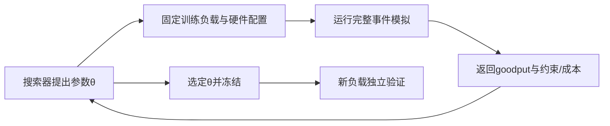

# D侧高压力调度：研究问题、文献线索与实验交接报告

记录日期：2026-10-15（Asia/Hong_Kong）。读者：用户、师兄，以及负责继续检索论文和设计实验的另一个 session。

实现更新（2026-10-19）：报告下文是10月15日的研究快照；其中目标KV容量不足的固定PD等待现已实现，见[第23章](chapters/23-handoff-capacity-wait.md)和[最新交接](HANDOFF.md)。D→P迁移、动态路由及零阶优化仍未实现，后续实现缺口请按最新架构核对。

**当前研究问题：在 Decode 侧拥塞、Prefill 侧仍有余量时，能否把部分正在生成的请求迁到 P 侧继续 Decode，从而提高整个系统的 SLO 达标吞吐？应该迁哪些、迁到哪个 P worker、迁多少？**

师兄建议先尝试的是**零阶优化（zeroth-order optimization）**，不是零和优化。本文给出可讨论的建模和实验草案，不代表已经选定算法、实现迁移，或证明存在新的研究贡献。

本文件尽量自包含；仅做文献和实验设计的 session 不需要先读全部代码。代码仓库：https://github.com/robin1hub/llm-serving-lab 。实现现状以 [ARCHITECTURE](ARCHITECTURE.md) 为准，最新交接见 [HANDOFF](HANDOFF.md)，前一轮文献入口见 [READING](READING.md)。

## 1. 为什么要研究这个问题

PD 分离中，P worker 处理输入，D worker 持续生成。请求在 D 侧停留较久时，活跃请求和 KV 可能积累。即使系统还有空闲 P 算力，D 也可能已经出现生成间隔增加、KV 容量紧张、请求排队。

不过，“D-heavy”至少需要分成三种情况测量：

| 情况 | 可观察现象 | 迁到P的潜在作用 |
| --- | --- | --- |
| D服务时延受限 | batch耗时或排队使生成间隔接近SLO，KV未必满 | 分摊计算，但需确认P上的混合执行是否更慢 |
| D的KV容量受限 | D仍可计算，但无法接纳或扩展请求KV | 释放D容量，同时消耗P的KV和链路 |
| 全局过载 | P和D都繁忙，或者传输已拥塞 | 迁移未必增加有效容量，需与准入/限流比较 |

这三类不能只用“GPU利用率高”代替。P 有空闲显存也不等于有足够服务余量；同样数量的 Decode 请求，因为上下文不同，服务成本也不同。

用户的三个决策相互影响：长上下文请求可能最占KV，但也最贵迁；迁得太少不能缓解D，迁得太多会拖慢P并伤害新请求的TTFT。需要比较**D获益、P受损、迁移开销和未来排队变化**。

## 2. 项目已经做到哪里

这是用于学习 LLM serving 的 Python 离散事件模拟器，不执行真实模型。相邻师兄项目 router-simulator 仅供参照，不属于本轮修改范围。

| 能力 | 当前状态与边界 |
| --- | --- |
| 单卡组batch | 已有请求数/token预算、chunked prefill、P/D优先和交替、一个P chunk与多个D成员混合 |
| 调度与时间 | 一个全局事件堆；每worker独立队列、Scheduler、Predictor、KV池和运行状态；在batch完成边界推进 |
| KV | 分页块、预留/填充/Ready、请求块表、释放；独立Mix支持阻塞或抢占重算 |
| 多卡Mix | 支持多个独立Mix worker，显式固定请求归属；没有动态负载均衡 |
| 固定PD | 已实现恰好1P1D；P产首token后，完整输入KV经FIFO链路传到D，D继续生成 |
| 传输成本 | 可配每token KV字节数、链路带宽、固定延迟；源KV保留到目标Ready；串行链路可与计算重叠 |
| 容量不足 | PD目标拷入时放不下会报错；尚无目标等待/重试协议。后续D增长仍可能阻塞 |
| 统计 | TTFT、ITL、请求延迟、P50/P95、吞吐及执行/传输记录；尚无完整SLO goodput和准入统计 |
| 还没有 | 运行中D→P迁移、PD中的P-heavy混合角色、多个P/D的动态路由、在线控制器、零阶搜索 |

**现有P→D初次交接，不等于已经能把运行中的D请求迁回P。** 实验计划不能把后者当作现成接口。

核心代码阅读地图：

| 文件 | 负责什么 | 后续研究可能需要扩展的位置 |
| --- | --- | --- |
| `simulator/engine.py` | 全局事件推进、逐worker运行状态 | 控制事件、迁移边界、目标唤醒 |
| `simulator/worker.py` | worker身份/角色/资源配置 | P-heavy允许承担Decode的明确语义 |
| `simulator/handoff.py` | 固定PD交接和FIFO链路 | 运行中迁移、目标容量等待和复制状态 |
| `simulator/kv_cache.py` | 块表、生命周期、写事务 | 迁移保护及两端一致性 |
| `simulator/scheduler.py` | 本卡候选计划与组batch | 本地选批和全局迁移决策的边界 |
| `simulator/predictor.py` | 给定batch组成/上下文，估计执行耗时 | 成本评估；不是剩余输出长度预测器 |
| `simulator/metrics.py` | 请求与全局结果统计 | SLO、固定到达队列口径、迁移间隔和失败统计 |
| `simulator/config.py` | 独立配置与校验 | 策略参数、角色、网络与实验配置 |

当前路线完成到第22章固定1P1D。已有测试基线106项：104通过、2项因分词依赖缺失跳过；本报告不引入运行行为变化。

### 2.1 校准基础能支持什么结论

已有4090与A6000、Qwen2.5-3B相关的执行轮耗时测量。4090的纯P/D新形状验证平均绝对误差约5.95%、最大13.65%；A6000独立纯P/D拟合后，4组留出平均8.08%，其中P256高估21.40%。A6000另有9组“1P chunk + 1/3/7D”共180个受控目标轮，冻结纯P/D参数后的平均绝对误差5.64%、最大10.35%，未用混合轮拟合。

这些数字的边界是**特定模型、硬件、同步eager的Worker执行轮**，不是请求级TTFT/ITL精度，更不是所有模型、上下文和batch组合的精度。4090使用Instruct版本，A6000使用本地基础版，不能把两者差异简单归因于显卡。KV跨卡传输和多卡端到端请求尚未实测校准。细节与证据入口见第18–20章。

研究初期可以用模拟做机制分析；如果优化收益小于成本模型偏差，需要做敏感性验证和后续真实系统复核，不能直接宣称有效。

## 3. 优先读哪些论文

以下均提供原始论文或官方页面。阅读深度明确区分；摘要核对不能代替算法复现。没有在本轮完成穷尽检索，也没有据此认定研究空白。

### 3.1 与系统问题直接相关

| 优先级 | 论文、年份和来源 | 已核对内容与研究用途 | 继续精读的问题 |
| --- | --- | --- | --- |
| 最高 | [TaiChi: Prefill-Decode Aggregation or Disaggregation? Unifying Both for Goodput-Optimized LLM Serving，2025 v1](https://arxiv.org/html/2508.01989v1) | 已看§3.3：Flowing Decode在P-heavy/D-heavy间移动生成任务，是最直接的邻近工作 | 触发、请求选择、回迁、防抖、迁移开销怎样处理？我们与它究竟有什么差异？ |
| 高 | [Llumnix: Dynamic Scheduling for Large Language Model Serving，OSDI 2024](https://www.usenix.org/conference/osdi24/presentation/sun-biao) | 官方会议页/摘要：运行中请求重调度和KV迁移 | 负载度量、迁移协议与停顿成本；不要把后来的产品能力当成2024论文内容 |
| 高 | [TetriInfer / Inference without Interference: Disaggregate LLM Inference for Mixed Downstream Workloads，2024 v1](https://arxiv.org/html/2401.11181v1) | 已看§3.3.4/§3.4和相关实验：利用预测长度、内存余量做D调度 | 预测误差、D目标选择和内存预留；哪些机制不依赖准确剩余长度？ |
| 高 | [Mooncake: Kimi’s KVCache-centric Architecture for LLM Serving，2024 v1](https://arxiv.org/html/2407.00079v1) | 已看§6：未来D负载、过载准入与振荡问题 | 迁移何时已无益，准入何时更合适？如何避免控制振荡？ |
| 基础 | [DistServe: Disaggregating Prefill and Decoding for Goodput-optimized Large Language Model Serving，OSDI 2024](https://www.usenix.org/conference/osdi24/presentation/zhong-yinmin) | 官方会议页/摘要：PD分离与满足TTFT/TPOT约束的goodput | 固定PD资源配置基线、指标定义和设备公平比较 |
| 扩展 | [STAR: Decode-Phase Rescheduling for LLM Inference，2510.13668 v2，2026更新](https://arxiv.org/abs/2510.13668v2) | 仅摘要/版本：预测剩余生成长度并做Decode重调度 | 预测器成本、训练数据和错误鲁棒性；是否适合我们的可观察状态 |
| 理论 | [Large-Scale LLM Inference with Heterogeneous Workloads: Prefill-Decode Contention and Asymptotically Optimal Control，2026 v2](https://arxiv.org/abs/2602.02987v2) | 仅摘要/版本：状态相关服务率，P准入与D路由联合控制 | 能否借用状态/目标建模；多服务器渐近保证不能直接用于两卡 |

版本注意：Mooncake有[FAST 2025正式版](https://www.usenix.org/conference/fast25/presentation/qin)，上表章节号来自2024 v1；STAR旧标题与v2不同，检索时用编号核对。未核实的会议归属不要补写。

### 3.2 零阶优化与调度参数搜索

零阶的核心是：给一个候选方案，可以运行模拟器得到分数，但不要求模拟器提供目标函数的导数。广义无导数搜索包含多种方法；师兄也可能特指用扰动估计梯度的一类算法，需要进一步确认。[Larson、Menickelly与Wild，Derivative-free optimization methods，Acta Numerica 2019](https://arxiv.org/abs/1904.11585)是概念入口。

| 方法/文献 | 已核对来源 | 对本项目的候选用途与限制（本列为我们的判断） |
| --- | --- | --- |
| [Random Search for Hyper-Parameter Optimization，Bergstra与Bengio，JMLR 2012](https://www.jmlr.org/papers/v13/bergstra12a.html) | 期刊页面/摘要 | 必须有的简单搜索基线；原论文的机器学习实验不能当作本调度问题的效果保证 |
| [SPSA：Multivariate Stochastic Approximation Using a Simultaneous Perturbation Gradient Approximation，Spall，IEEE TAC 1992](https://doi.org/10.1109/9.119632) | IEEE元数据/摘要与[作者原文](https://www.jhuapl.edu/spsa/pdf-spsa/spall_tac92.pdf) | 扰动参数估计梯度；适合讨论师兄是否指这类零阶方法，但离散动作、硬容量和阶梯式SLO分数可能造成困难 |
| [SMAC3: A Versatile Bayesian Optimization Package for Hyperparameter Optimization，Lindauer等，JMLR 2022](https://www.jmlr.org/papers/v23/21-0888.html) | 期刊页面/摘要 | 少量策略参数和多负载实例的算法配置候选；先确认所选实现如何支持整数/类别/条件参数 |
| [Bayesian Optimization with Inequality Constraints，Gardner等，ICML 2014](https://proceedings.mlr.press/v32/gardner14.html) | 官方论文页/摘要 | 区分性能约束与目标；KV硬限制仍由执行器精确检查，不能交给概率模型保证安全 |
| [Scalable Global Optimization via Local Bayesian Optimization（TuRBO），Eriksson等，NeurIPS 2019](https://proceedings.neurips.cc/paper/2019/hash/6c990b7aca7bc7058f5e98ea909e924b-Abstract.html) | 官方论文页/摘要 | 连续参数维数增大后再评估；不要直接把动态请求指派强行当连续向量 |
| [BOHB: Robust and Efficient Hyperparameter Optimization at Scale，Falkner等，ICML 2018](https://proceedings.mlr.press/v80/falkner18a.html) | 官方论文页/摘要 | 评估昂贵时研究多保真搜索；截短trace是否保持策略排名必须先检验 |

另有值得继续核对的直接交叉线索：[EWSJF: An Adaptive Scheduler with Hybrid Partitioning for Mixed-Workload LLM Inference，Sidik、Levi与Kampeas，2026](https://arxiv.org/abs/2601.21758)。其摘要明确提出用Bayesian Meta-Optimization调整打分和分组参数。目前只核对摘要，尚不能判断其更新开销、实验可靠性，或是否覆盖PD之间的运行中迁移；它至少提醒我们，“给调度器做贝叶斯调参”本身不能直接视为创新。

建议阅读顺序：**TaiChi明确问题重合 → Llumnix了解迁移 → Mooncake/TetriInfer补负载与容量 → 零阶综述明确方法范围 → 随机搜索/SMAC/SPSA选择实验方法**。不需要一开始精读所有证明。

## 4. 把三个决策写成一个问题

在一个允许迁移的时刻，设可迁移请求集合为R，候选P-heavy worker集合为P。定义：

```text
x[r,p] = 1：把请求r迁往worker p；否则为0
每个r满足 sum_p x[r,p] <= 1
迁移数量 k = sum_r,p x[r,p]
```

因此“迁哪些、迁到哪里、迁多少”是联合决策。数量可以由指派自然导出；单独设一个k并不能保证选到了合适的请求和目标。动作集合必须包含**本次不迁移**。

可观察状态建议包括：各卡当前batch/队列、活跃D人数与上下文、KV空闲块、已有token时间、P待处理输入量、链路队列与带宽、迁移中请求，以及请求的SLO类别。

禁止在线策略读取trace中的真实最终输出长度。模拟器需要知道它来判定完成，但这不代表调度器能提前知道。允许的替代是当前已生成长度、历史统计或单独训练的剩余长度预测器；使用真实剩余长度的实验只能标为不可部署的oracle上界。

### 4.1 第一版建议：搜索策略参数，而不是直接搜索所有指派

固定一套可解释的控制流程π，搜索少量参数θ：

```text
当前状态s → 策略πθ(s) → 可行动作 → 模拟执行 → 全局指标
```

第一组可以只调两个参数：D压力触发阈值、P上最多容纳的外来D请求数。先固定请求排序和目标排序规则，便于解释结果；随后再加入P余量阈值、迁移收益阈值、冷却时间或请求打分权重。

例如，一种待验证的规则是：D超过阈值时，按估计收益/迁移成本排序候选；给P预留Prefill余量；只接纳能通过KV检查的请求；每轮有迁移上限，并设置冷却时间。具体压力度量和排序公式需要实验比较，不应在报告阶段写死。

这能先回答“简单策略是否存在更好的参数”。它不等于已经解决任意状态下的最优请求选择；固定排序可能限制上限，后续需要消融或更丰富动作空间。

### 4.2 离线调参和在线搜索是两条路线



建议先做上图的**离线参数搜索**。在线运行时，控制器只计算规则，不反复跑完整模拟。它更适合现在的教学项目，也方便比较搜索预算和泛化。

另一条是每个控制周期复制当前状态、试若干未来动作、滚动预测后执行。那需要状态快照、未来到达/长度预测、有限时间窗和计算开销控制，当前尚未实现，不建议混入第一版。

“零阶”不要求目标一定随机：固定trace和固定策略下，我们的模拟可以是确定性的。换trace、换随机策略种子、引入预测误差后，评估才会出现相应变化。

## 5. 目标函数和约束怎样定义

第一版建议主指标使用**固定到达队列中，同时满足TTFT和生成间隔SLO的完成请求数**。为避免把不同概念混在一起，初步口径可设：

```text
TTFT(r) = 首输出时间 - 到达时间
max_ITL(r) = 该请求相邻输出时间差的最大值
pass(r) = 完成 且 TTFT(r)<=目标 且 max_ITL(r)<=目标
cohort_goodput = 固定到达窗口内请求的pass总数 / 固定窗口秒数
```

这是一种**本项目待确认的指标口径**，不是声称所有论文都这样定义。若研究改用平均TPOT或P95 ITL，要明确另列，不能与max_ITL混用。只有一个输出token的请求没有相邻间隔，单独说明其ITL约束不适用。

预热请求与正式评估请求分开。对固定评估到达窗口[T0,T1)的同一批请求，统一设置截止时刻T1+固定drain时长；截止后未完成者计失败，拒绝者也在原始到达队列中计失败。每个策略使用相同截止和分母，同时报告完成率、截止时积压、排空时间，不能只统计已完成请求或任意延长排空来美化结果。这种cohort指标也不应冒充稳态容量测量。

同时报告：

- P侧新请求TTFT的P50/P95/达标率，D侧ITL/TPOT和尾部间隔；原驻留请求与外来D分别统计。
- 总完成率、所有到达请求的SLO达标率、吞吐、拒绝/阻塞/未完成数量。
- 每卡忙时、KV峰值、迁移数量/字节/排队/停顿、回迁次数与控制开销。
- 分请求类型的达标率和等待，防止牺牲某一类请求换平均收益。

物理硬约束由执行器保证：目标KV可预留、源目标模型兼容、一个请求只有一个计算owner、迁移中禁止重复执行、batch边界合法、链路容量守恒。将SLO作为目标或性能约束都可以讨论，但它不等于物理可行性；所有请求超时也不能靠“拒绝后不计入分母”处理。

## 6. 做实验前，最小还要补什么

以下是建议依赖顺序，不是本轮自动实施计划。

1. **目标容量等待协议**：目标放不下时进入明确等待/取消/重试流程；避免当前ValueError直接让某策略没有结果。不可恢复阻塞要保留失败和积压指标。
2. **运行中迁移语义**：先实现一次stop-and-copy，在源batch完成后冻结请求，保留源KV；目标预留并复制；目标Ready后切换owner、释放源、继续生成。失败时回滚或恢复源执行。
3. **P-heavy执行能力**：明确P允许混合Decode，保留P侧队列和预算约束；不等于把worker永久切成纯D。
4. **可配置控制器**：与本地Scheduler分开；先实现不迁移和简单阈值规则，记录每次候选、拒绝理由和动作。
5. **统一评估与搜索接口**：在指标口径固定后，封装“参数+负载+资源配置→结果”，最后再接零阶搜索器。

迁移需要延续同一请求的到达、首token和完整输出历史。不能重新Prefill冒充迁移，不能多产生或少产生token。迁移停顿必须出现在真实相邻token间隔中。

普通Decode边界下，若输入长度为L，已经输出g个token，则已处理的KV通常对应L+g-1个token；最新输出还没作为下一轮输入。应以**实际已提交KV状态**计算载荷，不机械使用完整输入长度，也不能复制尾页空位却按有效token成本计价。首版沿用当前有效KV字节模型；如果改为整页复制，要同时改成本和文档。

迁移耗时至少包括链路排队、固定延迟和载荷/带宽；还应记录源暂停到目标恢复的总间隔。首版不做源端边算边拷、多级缓存、共享前缀或COW；不声称当前固定PD流程已提供通用迁移保护。

## 7. 分阶段实验草案

### 阶段A：先确认迁移什么时候有用

先用1P1D和小型确定性负载：P空闲或轻载，D有若干长生成请求。手动指定一次D→P迁移，对比不迁移；逐项核对token、KV、owner、时间守恒。再增加P到达流和慢链路，观察收益何时变负。

这个阶段不需要优化器。先画出“迁0/1/2…个请求”的结果，确认系统不是无论怎么迁都更差。如果场景总容量都饱和，出现无收益是合理结果，不能靠忽略迁移成本制造改善。

### 阶段B：在1P1D比较选哪些和迁多少

1P1D只有一个P，**不能研究目标P选择**。适合先比较：

| 基线 | 目的 |
| --- | --- |
| 固定PD、不迁移 | 衡量迁移是否真的增加达标请求 |
| 简单阈值+固定迁移上限 | 可解释、可手调的控制基线 |
| 随机挑请求，保持相同可行性检查 | 判断收益是否来自选择规则 |
| 按当前上下文/已生成量/估计收益挑选 | 分离容量节省、成本和长度估计的影响 |
| 同一策略空间的随机搜索与零阶候选方法 | 判断优化方法是否比简单试参更省评估 |
| 极小场景的枚举 | 检查搜索空间内最优参数或可行动作；不能直接声称是完整动态问题最优解 |

先用二维小网格画性能曲面，再比较随机搜索与SMAC/其他候选。若师兄特指SPSA，可增加连续打分权重版本；需要说明SLO阶梯目标的平坦区、整数取整和约束投影问题。不要只选最漂亮的一次运行。

### 阶段C：再扩展目标选择

扩展到2P1D，才有“迁往哪个P”：比较轮询、最少活跃请求、最少待处理P工作量、最小预计完成/干扰成本等。随后再做2P2D，研究源D选择和多方向迁移竞争。

每组策略对比必须使用相同GPU总数、模型、显存和链路预算。两卡结果和三卡结果可以解释机制演变，但不能直接把更多卡带来的收益算成算法收益。

### 阶段D：压力矩阵与泛化

| 维度 | 至少需要的对照 |
| --- | --- |
| P负载 | 轻载、持续繁忙、突发到达 |
| D压力 | 生成间隔受限、KV受限、全局饱和 |
| 请求长度 | 短/长上下文，短/长输出及混合；长度分布和到达过程分开控制 |
| 链路 | 高/低带宽，不同固定延迟，迁移排队 |
| 策略稳定性 | 无冷却/有冷却、不同迁移上限，观察反复迁出迁回 |
| 信息条件 | 无剩余长度预测、有误差预测、真实长度oracle单独标记 |
| 成本模型 | 执行与传输成本扰动后的策略排名 |

负载优先使用可解释合成trace定位因果，再用本地ShareGPT单轮长度分布构造独立trace。到达时间需要明确生成并保存，不能默认为所有请求同时到达，也不能把静态对话数据天然当在线到达流。

训练/验证/测试按trace和随机种子分开；搜索只看训练集，验证用于选方法，最终测试集冻结不反复调参。保留新的长度、突发和P繁忙程度，检验跨分布鲁棒性。

初始搜索预算可以试20/50/100次完整模拟调用，并用多个搜索种子重复；这些是待调整的起始规模，不是论文要求。若一次候选参数需要跑多个trace，每个底层模拟调用都要计入成本。比较相同调用预算，同时报告实际墙钟时间；SPSA两次扰动、BO初始化和重试也都计入。

在相同外部trace/种子上配对比较，报告多trace结果与区间。确定性模拟对同一配置反复运行不会自动产生有效独立样本。若试BOHB，先验证短trace与完整trace的策略排名相关性，避免短片段漏掉过载或迁移振荡。

## 8. 关键消融和可能失败的原因

- **去掉迁移成本**只作为理想上界，再恢复真实载荷与链路；如果恢复后收益消失，结论是成本抵消收益。
- 固定迁移数量，改变请求选择；固定请求顺序，改变数量；多P时再固定前两者改变目标选择。由此分清三个决策的贡献。
- 固定控制器，比较手调/网格/随机/候选零阶优化。不能拿复杂控制器+优化，对比一个故意弱化的基线后，把收益全归给优化器。
- 允许P混合执行但不迁移、仅改变初始D路由等作为补充机制对照，区分复用P算力与运行中重调度的价值。
- 对服务耗时、传输延迟等做例如±10%/±20%的敏感性扰动。这是人为鲁棒性场景，**不是测得的置信区间**。检查优化器是否只利用了模拟公式的误差。
- 评估状态滞后与冷却：频繁迁移可能使系统抖动；控制周期也是实验参数，但第一轮应固定，避免同时搜索过多维度。

若没有收益，要检查：P并不真正空闲、迁移太晚、KV太大、目标混合干扰太强、目标容量没有持续增长空间、输出即将结束、指标口径错了，或者基线已接近可达到上限。不能预设迁移一定有益。

## 9. 尚需和师兄确认的研究边界

1. “零阶优化”是泛指黑盒搜索，还是特指有限差分/SPSA类梯度估计？是离线调策略参数，还是在线选动作？
2. 首要目标是goodput、P95生成间隔、平均TPOT、拒绝率，还是满足SLO后的吞吐？不同请求有没有不同SLO？
3. P侧是否允许长期承担D？仅迁移正在生成的请求，还是也允许新请求直接留P生成？回迁是否必要？
4. 第一轮是否固定同型GPU/同模型/单卡模型副本，不研究TP/PP与异构设备？
5. 长度信息允许到什么程度？若没有预测器，应先用哪些历史特征？
6. 最终贡献希望落在策略、优化方法、成本/可行性建模，还是实证比较？“迁到P+零阶调参”不足以直接证明新颖性。

## 10. 给另一个session的可直接复制任务

> 请围绕“D-heavy条件下，让P-heavy worker分担正在进行的Decode”开展文献检索并设计实验，先不要改代码或启动GPU实验。
>
> 我的三个问题是：选哪些D请求迁移、迁往哪个P worker、总共迁多少。师兄建议零阶优化，是zeroth-order而非zero-sum；尚需区分离线策略参数搜索与在线动作优化。我希望先做可解释的少参数策略，再比较随机搜索、合适的贝叶斯/无导数方法；不要先默认强化学习或万能在线最优算法。
>
> 当前教学模拟器是Python离散事件：有chunked prefill、混合batch、请求/token预算、分页KV、独立多Mix worker和固定1P1D FIFO KV交接。没有运行中D→P迁移、P-heavy混合角色、目标KV不足等待、多P/D动态路由、SLO goodput控制器和零阶优化接口。已有4090/A6000特定3B模型的batch执行轮校准，但没有跨卡链路或请求级精度保证。不能把真实最终输出长度当在线已知信息。
>
> 请先读TaiChi的Flowing Decode（2508.01989 v1 §3.3），核对与本问题的直接重合；结合Llumnix迁移、TetriInfer调度、Mooncake过载、DistServe目标、STAR重调度，以及EWSJF的Bayesian Meta-Optimization，继续追踪相关与后续工作。零阶方法从Larson等2019综述、SPSA、随机搜索、SMAC和约束贝叶斯优化开始筛选。可以补充其他更合适的方法，不必拘泥于本报告名单。
>
> 请输出：①按直接相关/方法可借用/背景分类的论文表，列原始链接、作者、年份/版本/已核实会议、关键章节、代码、阅读深度；②明确每篇解决的决策、信息假设、迁移开销、SLO口径及与我们差异，避免凭摘要宣称创新；③两到三个可证伪的研究假设；④从1P1D到2P1D再到2P2D的最小实验方案，包含基线、消融、负载、预算、公平性、训练测试隔离、失败条件和图表；⑤按依赖排序列最少实现项，并明确哪些必须补完才能跑实验。请标注论文结论、你的推断和待验证设计，不只给论文标题列表。
>
> 所有比较要计入KV迁移造成的ITL停顿和P侧TTFT损害；拒绝/未完成不能从到达分母中消失。先找机制有效区间，再谈零阶方法是否优于简单试参。不要创建或给其他session发消息。

检索词建议：`prefill decode disaggregation decode overload`、`P-heavy D-heavy flowing decode scheduling`、`LLM live migration KV cache goodput`、`decode offloading prefill workers`、`black-box optimization LLM scheduling`、`derivative-free algorithm configuration simulator`、`constrained Bayesian optimization scheduling`、`SPSA discrete scheduling simulation optimization`。

## 11. 后续记录方式

下一轮把精读笔记、版本差异和实验决策记录到文档，并保留“为什么不用某方法”的理由。论文性能数字应附配置与指标口径；没有复现就写未复现。实现仍按小步学习推进，机制变更需同步架构契约、章节流程/数据结构、确定性测试和交接。本轮只有研究报告，没有新增运行功能或服务器操作。
