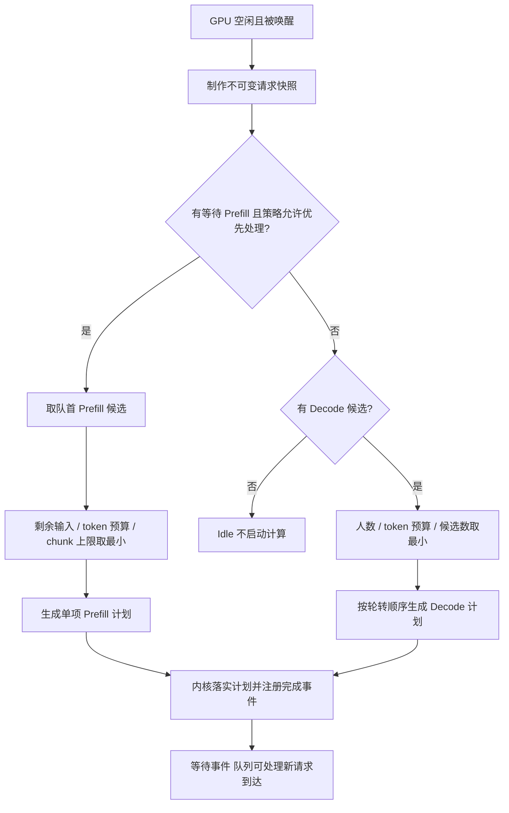
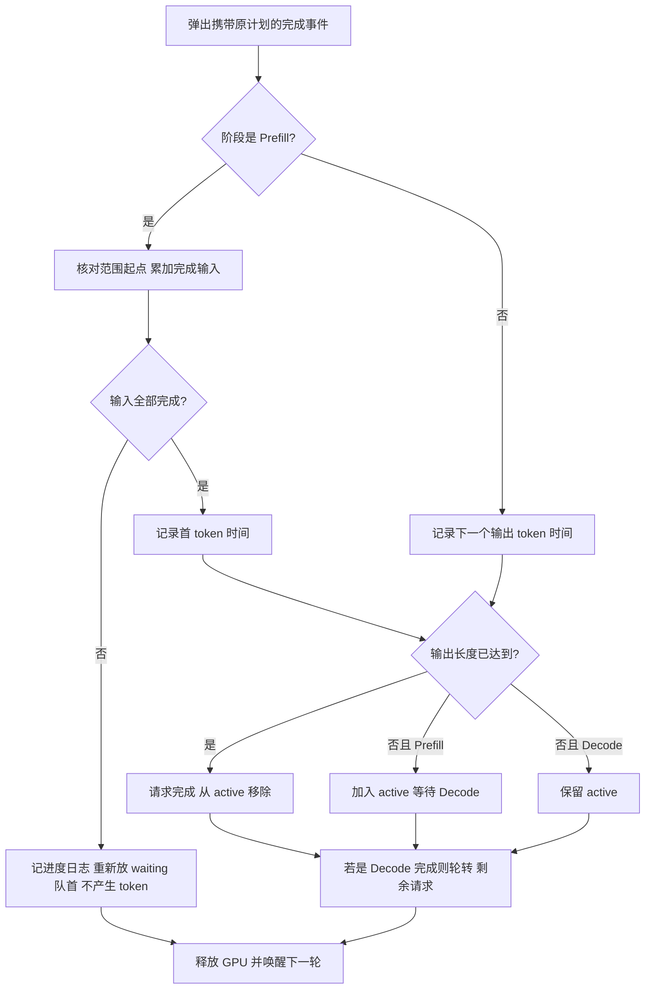
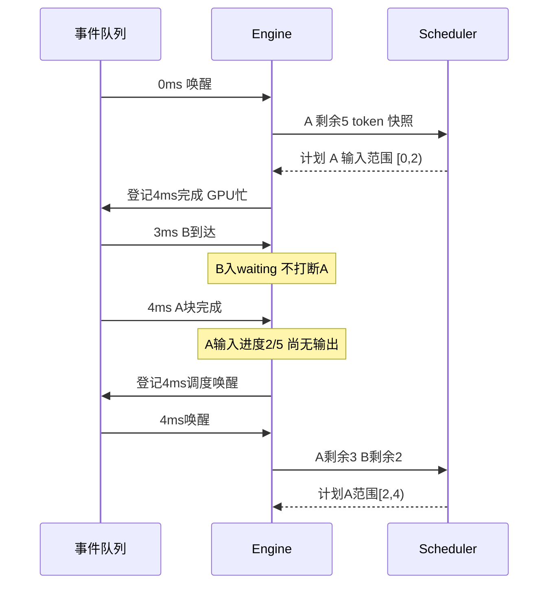

# 第 8 章：token 预算与 Prefill 分块

本章先看机制与状态表，再读对应函数。当前仍是单卡、P/D 分轮执行，不涉及 KV 容量或混合 batch。

本章的旧 `scheduler` 配置仍兼容；当前实验文件已迁移为独立方案引用，见[第9章](09-worker-profiles.md)。第9章同时新增可选交替策略，本章严格优先级的例子仍保持原结果。

## 从三个限制开始

```json
"scheduler": {
  "policy": "prefill_first",
  "max_batch_requests": 2,
  "max_tokens_per_batch": 3,
  "prefill_chunk_tokens": 2
}
```

| 字段 | 限制什么 | 不代表什么 |
| --- | --- | --- |
| max_batch_requests | 一轮最多包含几个请求 | 活跃请求数或显存容量 |
| max_tokens_per_batch | 一轮最多处理多少新 token | 已有上下文长度或最终输出长度 |
| prefill_chunk_tokens | 单个 Prefill 一轮最多推进多少输入 | KV block 大小 |

三个字段均为正整数；null 或省略是不启用该限制，旧配置保持兼容。0、负数、小数、字符串和 bool 拒绝。

当前 Prefill 每轮仍只选一个请求：q=min(剩余输入, 非空 token 预算, 非空 chunk 上限)。Decode 每请求处理 1 个新 token，选中数量为 min(候选数, 非空人数上限, 非空 token 预算)。预算限制的是工作量，不是可靠的时间估计；Decode 仍会读取上下文，但本耗时模型未表达其成本变化。

## 调度流程图



严格 Decode 优先有 active 时不会执行 Prefill；Prefill 优先有等待输入时就选 Prefill。没有为了分块隐式改优先级。

## 数据结构：计划与进度分开

| 结构 / 字段 | 拥有者 | 含义 | 何时改变 |
| --- | --- | --- | --- |
| Request.input_tokens | 输入参数 | 整个请求输入总长度 | 不变 |
| prefill_done[id] | engine 局部状态 | 已经完成计算的输入数量 | Prefill 完成事件 |
| waiting | engine | 已到达、等待开始或继续 Prefill 的 ID | 到达、启动、块完成 |
| active | engine | 输入已全部完成、输出未结束的 ID | 最后输入块/Decode 完成 |
| ReadyTask.token_count | 候选快照 | Prefill 候选是剩余输入；Decode 是 1 | 每次唤醒重新构造 |
| ReadyTask.range_start | 快照/计划 | Prefill 输入起点 | 取当前已完成进度 |
| BatchPlan.items | Scheduler 返回 | 这一轮实际执行的范围和工作量 | 冻结，不修改 |
| token_times[id] | engine | 实际输出 token 时间 | 最后输入块及每轮 Decode 完成 |
| starts[id] | engine | 第一个 Prefill 块的开始时间 | 仅第一次启动 |

ReadyTask 同时用于候选与计划，但 token_count 的角色不同：候选可处理剩余全部，计划只处理被预算批准的一部分。计划范围是 [range_start, range_start+token_count)，左闭右开。

例如候选 C=(Prefill, start=4, count=16)，预算 3、chunk 2，计划变为 C=(Prefill, start=4, count=2)，执行输入下标 4 和 5。原输入和候选不被修改。Decode 的 range_start 当前固定 0，不表示其完整上下文长度。

## 完成时的状态变化



把未完成块放回队首是当前 FCFS 规则，不能把它当作重新到达的新请求。开始时间、原始到达和输出目标都不重置。

## 启动与完成的时序



## 手算例子与真实输出

```bash
python3 run_simulation.py --config configs/token_budget.json --output output/token_budget.json
```

A 在 0ms 到达，输入5、输出3；B 在3ms到达，输入2、输出2。每输入 token 2ms，Decode 整轮2ms。

| 时间 | 计划 | A 输入进度 | A 输出数 | B 输出数 |
| --- | --- | --- | --- | --- |
| 0–4ms | A Prefill [0,2) | 2/5 | 0 | 0 |
| 4–8ms | A Prefill [2,4) | 4/5 | 0 | 0 |
| 8–10ms | A Prefill [4,5) | 5/5 | 1 | 0 |
| 10–14ms | B Prefill [0,2) | 5/5 | 1 | 1 |
| 14–16ms | Decode A、B，各1 | 5/5 | 2 | 2，完成 |
| 16–18ms | Decode A，1 | 5/5 | 3，完成 | 2 |

表中进度是区间结束时的状态。A 输出时刻10/16/18ms，B 为14/16ms；A 的 starts 始终是0而不是最后块开始的8。B 等待7ms，TTFT=14−3=11ms。

## 对应代码怎么读

1. scheduler.py / SchedulerConfig：检查三个上限。
2. Scheduler.decide 的【预算重点 1】：先取剩余长度再缩小，生成新计划。
3. engine.py / simulate_events 的快照构造：总输入减去 prefill_done 得到剩余。
4. 完成分支的【分块重点 1】：输入累加；没完成就 continue，不进入产生 token 的逻辑。
5. 启动分支的【分块重点 2】：只有第一块写 starts，继续块另记日志。
6. Scheduler.decide 的【预算重点 2】：Decode 同时受人数和 token 预算限制，轮转沿用第7章。

本轮 Prefill 耗时是 plan.token_count × 每输入 token 耗时，不重复按完整输入计时。plans/trace 保存工作量，steps 保存时间区间。

## 关键局限：分块不等于自动交替

当前 Prefill 优先会连续处理等待输入，严格 Decode 优先则排空 active 后才处理输入。我们增加了边界，但没有决定何时在边界把机会交给另一阶段。上述例子与不分块相比首 token/Decode 时刻相同，只是 Prefill 被分成更多完成事件。

耗时模型没有每块额外启动开销，故总输入计算时间不因分块改变。这不能推导真实硬件上分块没有开销。下一步再讨论混合 batch 或明确的阶段交替；不要自动把两者加入本实现。

## 验证与继续工作

31 个标准库测试中29通过，2分词集成因系统 Python 没有依赖跳过。验证最后一块才产生首 token、单输出边界、输入范围连续覆盖不重算、Decode token预算、配置CLI、两种策略的随机进度与旧行为兼容。

后续 AI 先读 AGENTS.md、docs/HANDOFF.md 和 docs/ARCHITECTURE.md；历史见 LEARNING_LOG。不要把“已分块”误认为“已混合、已交替、已建模 KV”。
