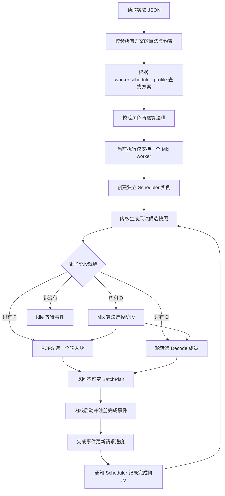
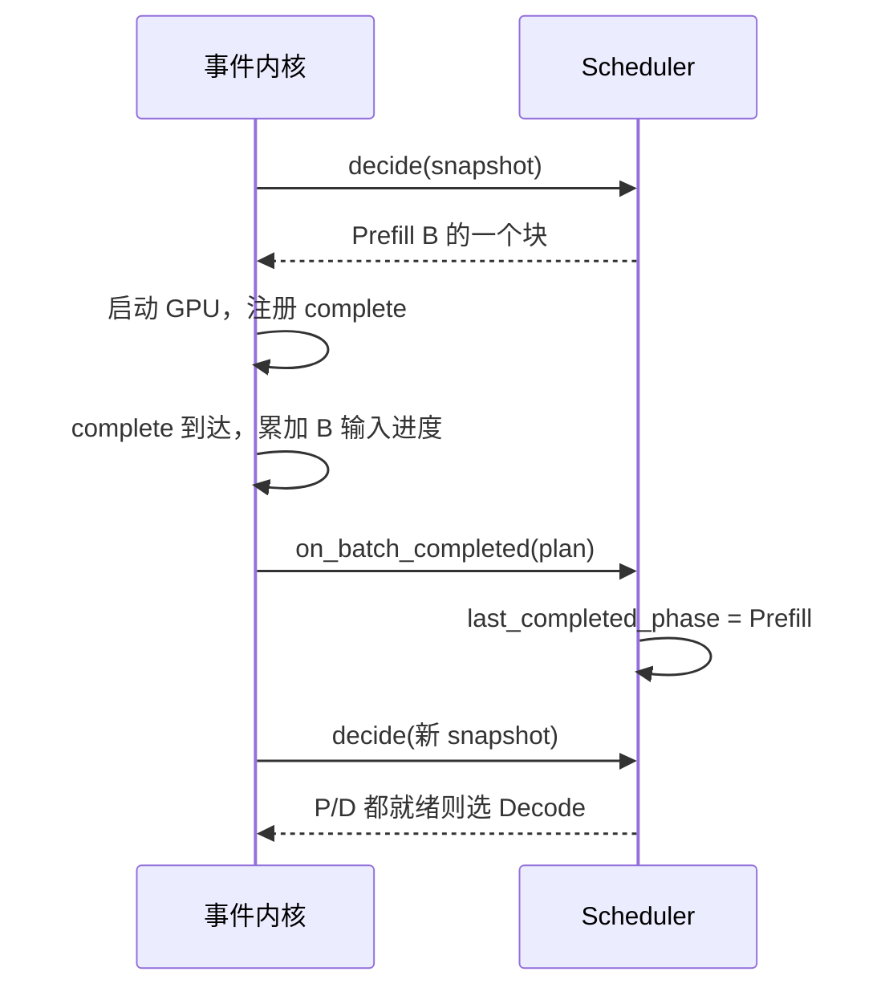

# 第 9 章：worker 引用独立调度方案

这一章解决你提出的问题：后续 worker 可能承担 P、D 或 Mix 角色，选批算法应该可以独立配置。现在仍只运行一个逻辑 Mix worker；先把算法、约束与 worker 的绑定关系分清，再扩展执行架构。没有新增 KV 容量，也没有真正实现 P→D 交接。

## 1. 先看配置，再看代码

配置分成三层：`scheduler_profiles` 定义可复用方案，`constraints` 描述每轮限制，`workers` 按名字引用方案。同一方案以后可以供多个 worker 使用，但有状态 Scheduler 实例需要各自创建，不共享轮次状态。

```json
{
  "workload": {"path": "../workloads/alternating_requests.json"},
  "scheduler_profiles": {
    "mix_default": {
      "prefill_algorithm": "fcfs_chunked",
      "decode_algorithm": "round_robin",
      "mix_algorithm": "alternating",
      "constraints": {
        "max_batch_requests": 2,
        "max_tokens_per_batch": 3,
        "prefill_chunk_tokens": 2
      }
    }
  },
  "workers": [
    {"id": "worker_0", "role": "Mix", "scheduler_profile": "mix_default"}
  ],
  "timing": {"prefill_ms_per_input_token": 2, "decode_ms_per_step": 2}
}
```

三个算法槽回答不同的问题：

| 槽 | 当前支持 | 回答的问题 |
| --- | --- | --- |
| prefill_algorithm | fcfs_chunked | Prefill 候选按先到先服务，从队首取一个块 |
| decode_algorithm | round_robin | Decode 从轮转队列前面取成员，完成后移到尾部 |
| mix_algorithm | prefill_first / decode_first / alternating | P、D 都就绪时，本轮选择哪个阶段 |

Mix 表示 worker 同时具备两阶段能力。当前一轮仍只执行一个阶段；`mix_algorithm` 是两类候选竞争时的选择规则。它还没有把 P 和 D 合入同一个 batch。

`prefill_first`、`decode_first` 是严格阶段优先级。`alternating` 在两阶段都就绪时选择与上轮完成阶段不同的一种，初始选择 Prefill。这里的“交替”按 batch 轮次，不保证两阶段 GPU 时间相等。

约束独立于算法：Prefill 块为剩余输入、token 预算、chunk 上限三者最小值；Decode 每请求耗费一个 token，所以成员数为候选数量、请求数上限、token 上限三者最小值。省略或 null 表示不限制。这些仍不是 KV 容量限制。

## 2. 从配置到执行的流程



为什么记录“完成阶段”，而不是在 `decide()` 中切换？选批只是提出计划。在未来需要资源准入时，计划可能被拒绝；重复查询也不应该消耗一次交替机会。现在先守住这个边界：完成事件调用 `on_batch_completed()`，下一轮才能看到更新。



只有 P 就绪时可以连续处理输入块，只有 D 时也可以连续 Decode；不会为等待另一阶段而主动空转。Prefill chunk 本身只限制块大小，`alternating` 才决定块间能否插入 Decode。

## 3. 数据结构与状态归属

| 数据结构 | 内容 | 谁能改变 |
| --- | --- | --- |
| SchedulerProfile，冻结 dataclass | 三个算法槽、约束 | 创建后不变；可以作为方案复用 |
| Experiment，冻结 dataclass | 解析后的方案、worker 标识与角色、请求与耗时 | 配置加载创建，不持有请求进度 |
| Scheduler 实例 | 方案、角色、last_completed_phase | 完成反馈仅改变该实例的上轮阶段 |
| SchedulingSnapshot，冻结 dataclass | waiting_prefill / ready_decode 两个元组 | 内核每轮创建；选批不改动 |
| BatchPlan，冻结 dataclass | 本轮成员、阶段、范围、原因 | 选批创建；完成事件使用原计划 |
| engine 内部队列和进度 | waiting、active、prefill_done、token_times 等 | 仍由事件内核独占 |

旧 `SchedulerConfig.policy` 保留以兼容早期 Python 调用和旧 JSON。新方案从 `mix_algorithm` 选择阶段，`constraints` 中不能配置 `policy`；结果导出也只保留三项约束，避免出现两个策略来源。新旧 JSON 写法不能同时使用。

角色能力校验规则：P 要有 Prefill 算法，D 要有 Decode 算法，Mix 要有全部三个槽。可以在配置里定义未引用的 P/D 方案（见 `worker_alternating.json`），但将当前唯一运行 worker 改为 P 或 D 会明确报错：完整请求生命周期需要后续的路由、交接与完成汇总。定义方案不是实现了多卡。

目前 P 与 D 各只有一种实现；不支持的算法名称直接报错。新增算法时，需要同时补实现、允许名称和验证，而不是写一个名字就自动生效。

## 4. 手算与对照结果

输入 A 在 0ms 到达，输入 1、输出 4；B 在 1ms 到达，输入 6、输出 2。Prefill 每输入 token 2ms，Decode 整轮 2ms。请求数上限 2、token 预算 3、chunk 2。

| 时间区间 ms | alternating 执行 | 完成后发生什么 |
| --- | --- | --- |
| 0–2 | Prefill A | A 发出第一个 token；B 已排队 |
| 2–4 | Decode A | 上轮是 P，因此给 D 一轮 |
| 4–8 | Prefill B [0,2) | B 还没有输出，输入进度变为 2 |
| 8–10 | Decode A | A 发出第三个 token |
| 10–14 | Prefill B [2,4) | B 输入进度变为 4 |
| 14–16 | Decode A | A 完成并退出 active |
| 16–20 | Prefill B [4,6) | 仅 P 就绪，B 输入完成并发出首 token |
| 20–22 | Decode B | B 完成 |

对照只改 `mix_algorithm`，输入、预算与耗时完全相同：

| 指标 | prefill_first | alternating |
| --- | --- | --- |
| A 输出时间 ms | 2 / 16 / 18 / 20 | 2 / 4 / 10 / 16 |
| A 最大 ITL ms | 14 | 6 |
| B 首 token 时间 ms | 14 | 20 |
| B TTFT ms（减到达 1ms） | 13 | 19 |
| 全部完成时间 ms | 20 | 22 |

交替减少了 A 在长输入期间的最长等待，代价是 B 的首 token 更迟；这个负载还改变了 Decode 的组批机会，从而增加总执行时间。策略优劣需要看负载与服务目标，不能只凭一个例子下结论。这里没有 SLO 或显存准入。

## 5. 建议阅读与运行

先看配置、上面时间表，再按以下顺序读少量代码：

1. `scheduler.py: SchedulerProfile.validate_role`：角色需要哪些能力。
2. `Scheduler.decide` 的“角色重点”：根据候选场景选择阶段。
3. `Scheduler.on_batch_completed`：交替策略只保存一个状态。
4. `engine.py` 完成事件中的反馈调用：什么时候允许改变上轮阶段。
5. `config.py` 的“方案重点”：按名字绑定，其他解析细节可以暂时略读。

```bash
python3 run_simulation.py --config configs/worker_prefill_first.json --output output/worker_prefill_first.json
python3 run_simulation.py --config configs/worker_alternating.json --output output/worker_alternating.json
python3 -m unittest discover -s tests -q
```

结果新增 `worker` 与 `resolved_scheduler_profile`，并保留本轮计划原因。`tests/test_profiles.py` 检查手算时间、分块范围、重复查询不切换、单阶段不空转、角色能力、错误引用、无效算法和旧配置兼容。

当前学习停在“方案可配置＋阶段交替”。下一步先理解上述取舍，再讨论简单 KV 容量或混合 batch；不同角色的多个 worker 需要独立的一步来实现。
