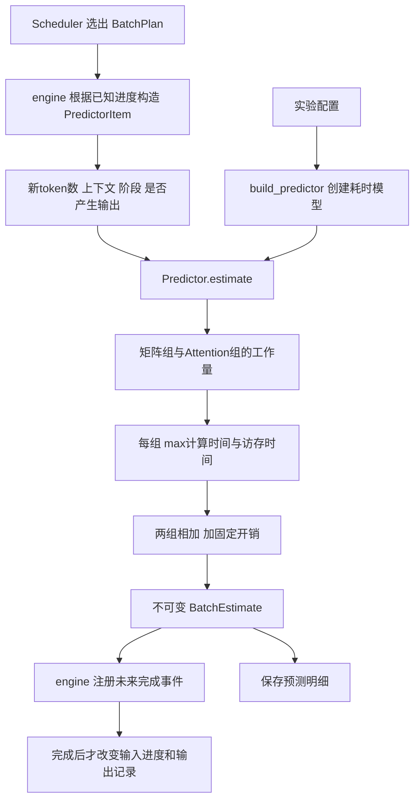
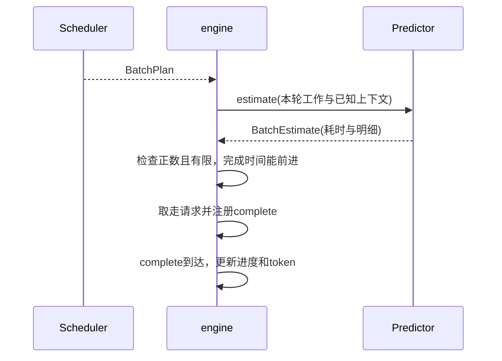

# 第10章：把耗时预测独立出来

阅读补充：2026-10-14用户希望详细理解预测过程，见本章末尾“真实模型数字手算”。第17章已完成硬件/两套解析预测对照，尚未正式拟合；本章早期实现进度保留为历史。

当前可选KV块准入与生命周期已加入，详见[第12章](12-kv-blocks.md)；本章例子省略KV配置，保留原结果。

本章记录该学习阶段；当前已加入可选混合算法，见[第11章](11-mixed-batches.md)。第9章分轮对照与第10章单阶段例子仍保持原结果。

本步借鉴师兄的 Predictor 分工，让 Scheduler 负责选成员、Predictor 负责估算本轮时间、engine 负责注册事件和更新进度。先接入现有单阶段 batch；没有新增混合选批、KV 容量或实测校准。用户不必先读完整代码，先看流程、参数表和手算例子。

## 1. 两种耗时来源

- `teaching`：原 Prefill 每输入 token 2ms、Decode 整轮2ms，可由 timing 配置。旧配置省略 predictor 时默认用这一种，原结果保持相同。
- `roofline`：按简化 dense Transformer 的工作量、硬件能力与修正系数估算。当前只是未校准近似，不能称为真实4090性能。



Predictor 不持有 waiting/active、不推进模拟时间，也不查询真实最终输出长度。Scheduler 本步尚未调用 Predictor 判断 SLO；它选定成员后，engine 才预测。

## 2. 输入与上下文口径

| 数据 | 字段 | 所有权与含义 |
| --- | --- | --- |
| ModelProfile | 层数、hidden、MLP维度、头数、词表、元素字节数 | 不可变，描述计算结构 |
| DeviceProfile | 名称、peak_flops、memory_bandwidth_bytes_per_s | 不可变，描述算力/带宽，无CUDA核心数字段 |
| Calibration | dense_factor、attention_factor、batch_overhead_ms | 不可变，先手动配置，尚无拟合器 |
| PredictorSettings | kind、model、device、calibration | 不可变，选择实现；结果保存实际配置 |
| PredictorItem | request_id、phase、new_tokens、context_tokens、produces_token | engine 构造的本轮已知工作；无未来目标输出长度 |
| OperatorEstimate | FLOPs、字节数、两类时间、耗时、瓶颈 | Predictor 返回的解释明细 |
| BatchEstimate | source、items、duration_ms、operators、overhead_ms | 不可变；与 plans/steps 同序一一对应 |

Prefill 的 context_tokens 是该请求已完成输入数；new_tokens 为本轮块大小。只有最后输入块的 produces_token 为 true，才计算 LM Head 工作量。中间输入块没有输出。

Decode 的 new_tokens 固定1。若输入长度为 N，已产生输出数为 G，已有KV上下文为 `N + G - 1`：最新产生的输出尚未作为下一轮输入写入KV。第一轮 Decode 时 G=1，因此 context=N；之后每轮增加1。不能直接用 N+G，否则会多计一个上下文 token。



## 3. 公式如何得到

记 L 为层数，H 为 hidden_size，I 为 intermediate_size，V 为词表大小，d=H/Attention头数，K=KV头数×d。本轮全部新token数为 T，产生输出的成员数为 R。

第一组将 QKV、输出投影和 SwiGLU 的三次 MLP 矩阵乘合并为简化矩阵组：

```text
矩阵参数数量 M = L × [H×(H+2K) + H² + 3HI]
矩阵组 FLOPs = 2TM + 2RHV
矩阵组字节数 = [M + (R>0时HV，否则0)]×权重元素字节数
             + 2THL×激活元素字节数
```

乘加按2次浮点运算计算。权重近似每batch读一次，体现组批共享，不能按每请求重复计整份权重；激活流量是很粗的近似，不是精确算子实现。忽略embedding读取、norm、激活函数等额外工作；不支持MoE/MLA或复杂量化内核。

第二组为 Attention。每成员已有上下文 c，本轮输入 q：

```text
Attention位置对数 S = Σ q×[c+(q+1)/2]
Attention FLOPs = 4×Attention头数×d×L×S
Attention字节数 = 2KL×KV元素字节数×Σ(c+q)
```

位置对数来自因果注意力：一个新token可以看已有上下文以及本块中直到自身的token。KV流量近似已有KV读一次、新KV写一次；没有模拟缓存命中、FlashAttention分块重读和实际内核访存过程。

每组分别计算：

```text
compute_ms = factor × FLOPs / peak_flops × 1000
memory_ms  = factor × bytes / memory_bandwidth_bytes_per_s × 1000
group_ms   = max(compute_ms, memory_ms)
batch_ms   = dense_ms + attention_ms + batch_overhead_ms
```

组内取max，是计算与访存重叠的近似；组间相加。不同于直接把整批全部运算量和访存量分别求总后取一次max。修正系数乘在时间上，大于1使预测更慢；固定开销每batch加一次，分块轮数变多会重复支付开销。

与师兄的区别：师兄逐类算子还有精度/量化系数、启动开销及多卡建模；我们先保留两组让公式可读。这里没有显存容量字段，因为耗时预测与容量准入是两个职责；有了KV访存估计，不代表已经实现KV容量管理。

## 4. 配置与手算例子

完整文件是 `configs/predictor_roofline.json`。roofline 不允许同时写 timing，避免两种参数来源冲突。predictor 的三个对象必填；calibration 可以是空对象，默认两系数为1、开销0。

```json
"predictor": {
  "kind": "roofline",
  "model": {
    "num_layers": 1, "hidden_size": 4, "intermediate_size": 8,
    "num_attention_heads": 2, "num_kv_heads": 1, "vocab_size": 8
  },
  "device": {
    "name": "toy-device-not-4090",
    "peak_flops": 1000000,
    "memory_bandwidth_bytes_per_s": 1000000
  },
  "calibration": {
    "dense_factor": 1, "attention_factor": 1, "batch_overhead_ms": 0.1
  }
}
```

这是虚拟小模型、小显卡参数，目的就是可以手算。peak_flops 单位是 FLOP/s，不是TFLOP/s；带宽单位是byte/s，不是GB/s；输出与固定开销是ms。字节数默认2，表示第一版用2字节元素，不等于已建模对应精度的所有内核效果。真实硬件参数必须与运算精度匹配，并经实测验证。

第一轮处理 A 的2个输入token，context=0，中间块不产生输出：

```text
M = 32 + 16 + 96 = 144
dense FLOPs = 2×2×144 = 576；bytes = 288 + 32 = 320
attention FLOPs = 48；bytes = 16
dense时间 = max(0.576, 0.320) = 0.576ms
attention时间 = max(0.048, 0.016) = 0.048ms
总耗时 = 0.576 + 0.048 + 0.1 = 0.724ms
```

负载A输入3输出3、B输入1输出2，都在0到达，Prefill优先、chunk2：

| 轮次 | 工作 | 上下文 | 是否产生输出 | 耗时ms | 完成时间ms |
| --- | --- | --- | --- | --- | --- |
| 1 | Prefill A，2 token | 0 | 否 | 0.724 | 0.724 |
| 2 | Prefill A，1 token | 2 | 是 | 0.516 | 1.240 |
| 3 | Prefill B，1 token | 0 | 是 | 0.484 | 1.724 |
| 4 | Decode AB，各1 token | 3 / 1 | 都是 | 0.900 | 2.624 |
| 5 | Decode A，1 token | 4 | 是 | 0.548 | 3.172 |

A输出1.240/2.624/3.172ms；B输出1.724/2.624ms。浮点输出可能有末位误差，测试用近似比较。先看每轮工作量与耗时，暂时不要把此吞吐解释为真实GPU吞吐。

## 5. 后续怎样校准

这一步只是铺好可替换接口与明细输出，尚未部署vLLM、测量4090或拟合系数。后续固定模型、精度、服务框架及版本，测量不同输入块、Decode人数、上下文下的batch执行耗时，用一部分样本拟合系数和开销，另一部分样本检验误差。混合batch接入后还要补混合测量。

不要将端到端TTFT直接当执行耗时：它包含排队；我们的Predictor只管执行。仅有整batch观测时，两组系数可能无法唯一识别，所以要覆盖不同工作量或取得算子级计时。实测、拟合、验证是后续独立步骤；保存配置并不会使未校准模型自动变准。

## 6. 阅读位置与运行

1. `predictor.py` 重点1：为什么教学Decode不能乘人数。
2. `RooflinePredictor.estimate` 重点2/3：上下文、工作量与权重共享。
3. `_operator` 重点4：工作量怎样换成时间。
4. `engine.py` 预测重点1：构造上下文，预测后才注册事件。
5. `config.py` 预测重点：严格校验与来源互斥，其余解析可暂时略读。

```bash
python3 run_simulation.py --config configs/predictor_roofline.json --output output/predictor_roofline.json
python3 -m unittest discover -s tests -q
```

结果 `predictor` 保存配置，`timing_source` 为 `uncalibrated_roofline`，`timing` 为null；旧教学模式仍为 `teaching_assumption`。新增 `estimates[i]` 与 `plans[i]`、`steps[i]` 对应，记录预测输入、FLOPs、字节、瓶颈及耗时；结果schema_version仍为1，属于扩展字段。

测试覆盖两种瓶颈的手算、系数与开销、上下文增长、组批权重共享、事件上下文/首token/时间线、无效参数、CLI导出和默认教学兼容。下一步先理解公式与假设，用户确认后再选择混合选批或KV容量；不要自动进入完整校准工程。

## 真实模型数字手算：从batch到毫秒（2026-10-14）

当前校准对照使用roofline，而不是早期“每token 2ms”的教学常数。Predictor也没有运行模型，它根据模型结构算工作量，再除以配置中的处理速度，返回这一轮的耗时；engine随后注册完成事件。这里不包括排队或师兄的小Prefill等待，也不代表HTTP TTFT。

第一步确定本轮工作。输入Prefill128的成员是new_tokens=128、context_tokens=0、produces_token=true；首轮Decode则new_tokens=1、context_tokens=128、produces_token=true。输出目标长度不用来预测本轮；之后每轮Decode的context增长。模型结构决定每token会经过多大的矩阵，输出标记决定本轮是否需要LMHead。

第二步分成dense矩阵组与attention组。dense包含Q/K/V投影、attention输出投影、MLP以及需要时的LMHead；attention包含新query与已有/新KV之间的注意力计算。这两组分别估算运算次数和显存流量，细小算子和实际kernel行为仍是近似。

第三步把工作量换算成时间：

```text
计算时间ms = FLOPs / 配置算力(FLOP/s) × 1000
访存时间ms = 流量bytes / 配置带宽(bytes/s) × 1000
单组时间 = max(计算时间, 访存时间)
本轮时间 = dense组时间 + attention组时间 + 固定开销
```

max代表组内计算和访存能重叠的理想近似，较慢的部分决定耗时；不是声称真实kernel一定完全重叠。dense和attention有前后依赖，本版两组相加。100TFLOP/s是每秒10^14次浮点运算，1TB/s是每秒10^12字节；本次这两个数是未校准假设。

“读权重”是从显存送到GPU计算单元，不是每轮从硬盘加载模型。权重虽然常驻显存，运算仍需要读它。我们近似一个batch读一次权重，成员共享这份读取成本；实际片上缓存、融合和重复读取没有逐一模拟。

以Qwen2.5-3B的36层/H2048/I11008/16注意力头/2KV头/V151936/BF16为例，head_dim=128、KV宽度=2×128=256。矩阵组参数M=36×[2048×(2048+2×256)+2048²+3×2048×11008]=2774532096。乘加按2次运算，LMHead矩阵为H×V=311164928个参数。这里的M是本公式计入的矩阵数量，不是精确模型总参数量。

首轮单请求Decode（新token1、已有context128）：

| 项目 | dense组 | attention组 |
| --- | ---: | ---: |
| 运算量 | 6171394048 FLOPs | 38043648 FLOPs |
| 估计显存流量 | 6171688960 bytes | 4755456 bytes |
| 计算时间 | 0.061714ms | 0.000380ms |
| 访存时间 | 6.171689ms | 0.004755ms |
| max后的组时间 | 6.171689ms | 0.004755ms |

两个系数1、固定开销0，总和6.176444ms。这解释了为何表中Decode预测约6.18ms：在当前公式中，主要时间来自约6.17GB的权重/激活流量除以假设1TB/s。第17章按context128–158的多轮中位数汇总，数值6.176997ms略有不同，不是两次公式不一致。

一个batch有8个Decode请求时，新token总数增到8，运算和每成员KV工作增加，但这份矩阵权重不在公式里重复读8次。若访存仍主导，batch耗时只略增，却一次处理8个token。这体现组batch提高吞吐的原因；不是断言所有模型、上下文或batch大小都如此。

Prefill128一次处理128个位置，dense FLOPs随新token数增加；因果attention位置对数是1+2+…+128。一般每成员处理q个新token、已有c个context，位置对数=q×c+q×(q+1)/2。首轮Decode则q=1、c=128，对应129个位置。矩阵计算量主要随新token数增长；整段Prefill的attention计算量还有平方增长部分。

同一参数下，直接运行当前代码得到：

| 单请求工作 | dense计算ms | dense访存ms | attention组ms | 总预测ms |
| --- | ---: | ---: | ---: | ---: |
| Decode1/context128 | 0.061714 | 6.171689 | 0.004755 | 6.176444 |
| Prefill128/context0 | 7.109025 | 6.209143 | 0.024348 | 7.133373 |
| Prefill2048/context0 | 113.651058 | 6.775374 | 6.187773 | 119.838831 |

所以公式内部也有不同瓶颈：这次Decode受访存主导，两个Prefill例子受计算主导。与第17章实测相比，P128实测19.0245ms、P2048实测87.0746ms、D中位约16.15ms。短P/D被低估而长P被高估；不能把全部差额都归为固定开销。有效速度、重叠/融合、CPU与kernel调用开销、算子分组近似等均需继续检验，目前没有分离测量各自贡献。

校准保留同一工作量与公式，先拟合：
```text
预测ms = dense_factor×原dense组ms
       + attention_factor×原attention组ms
       + batch_overhead_ms
```
两个factor在当前代码中同时缩放对应组的计算/访存时间，不是直接测得的物理GPU参数。固定开销每个batch收一次，不能先假定就是实测差额10ms。只用fit数据求参数，validation独立核对；不足时再调整分组或分阶段模型。本次讲解只新增文档，未实施拟合或修改公式。

代码阅读顺序：predictor.py的PredictorItem → RooflinePredictor.estimate中【重点2：工作量】→【重点3：组批共享】→ _operator的【重点4：时间公式】→ batch总和。ModelProfile/DeviceProfile/Calibration是输入结构；OperatorEstimate把上述每一步数字保存出来，方便核对。
