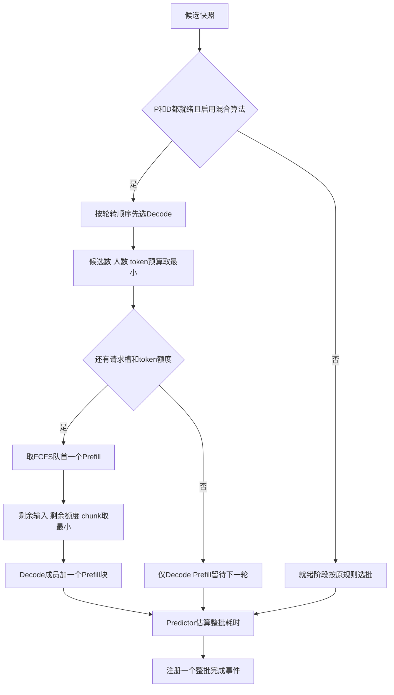
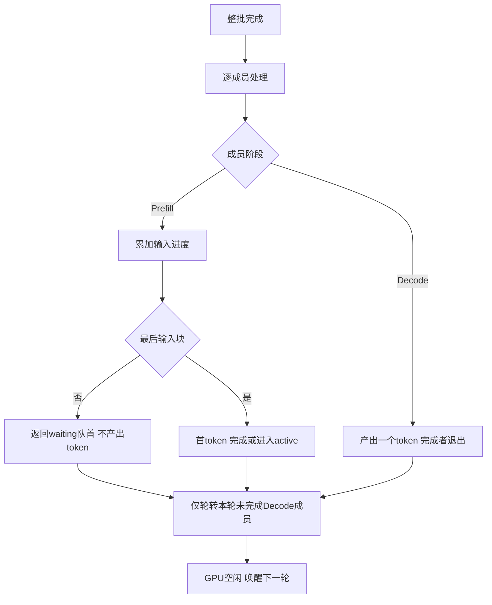

# 第11章：同一轮的混合 batch

当前可选KV块准入与生命周期已加入，详见[第12章](12-kv-blocks.md)；本章例子省略KV配置，保留原结果。

新增 `mix_algorithm: mixed_decode_first`：先选Decode，再用剩余预算加入一个Prefill块。仍是一个逻辑Mix worker，未实现KV容量、传输、抢占和SLO准入，耗时未校准。

## 1. 与交替有什么不同

```text
alternating：       一轮Decode → 一轮Prefill → 一轮Decode
mixed_decode_first：一轮包含 [Decode A、Decode B、Prefill C的一个块]
```

Mix worker指两阶段能力，Mixed是本轮同时包含两阶段的标签。旧decode_first仍严格阶段优先，不与新算法混淆；旧三种算法和例子保留。

## 2. 选批流程



例：人数上限4、token预算8、chunk6，三个Decode各占1个token和1个请求槽，剩下1个请求槽、5个token，因此Prefill最多5个输入token，不能按chunk6直接加入。

Decode耗尽请求槽或token额度时，不为Prefill强行预留空间。持续Decode负载仍可能让Prefill饥饿，本步没有解决公平性。仅一阶段就绪时不空等另一阶段；无预算限制时也最多选一个Prefill块。

## 3. 数据结构与完成逻辑

| 结构 | 内容与职责 |
| --- | --- |
| ReadyTask | 不变，每成员phase仍只能Prefill/Decode，保存工作量和输入偏移 |
| BatchPlan | items可含两阶段，phase属性统一时为原阶段，否则Mixed |
| BatchPhase | Prefill/Decode/Mixed，仅用于批级显示与完成反馈 |
| PredictorItem | 各成员上下文与是否产出token分别构造 |
| BatchEstimate | 整批估算，仍与steps/plans同序 |
| BatchStep与完成事件 | 保存批级标签与固定成员，整批同一完成时间 |

关键是提交和完成都按 `item.phase` 判断，不能用整批Mixed标签决定是否进入active。



新Prefill完成进入active时，没有在本轮做过Decode，不算已服务者，因此排在未完成已服务Decode成员前面。这是本模型明确的队列规则。执行中不退出/补充成员；轮中到达只能排队，下一轮才有机会入选。

## 4. 两种耗时假设

教学模式：输入块token数×Prefill系数，加一次Decode轮时间（仅有Decode成员时）。例如2个输入token加若干Decode，系数2ms/2ms，整批耗时6ms。所有成员在6ms结束一起更新，Decode不会在2ms提前退出。相加只是教学近似，不代表真实混合内核效率。

roofline直接对整个混合成员元组计算矩阵组与Attention组；权重按整batch读一次、固定开销加一次。不是将两份单独预测相加，也不是把P/D时间取最大。第10章公式保持不变，仍标记未校准。

## 5. 手算与实验

`configs/worker_mixed.json` 与第9章交替使用相同负载：A在0到达输入1输出4，B在1到达输入6输出2；人数2、预算3、chunk2。

| 时间ms | 本轮成员 | 完成后 |
| --- | --- | --- |
| 0–2 | Prefill A，输入1 | A首token |
| 2–8 | Decode A + Prefill B [0,2) | A第二token，B无输出 |
| 8–14 | Decode A + Prefill B [2,4) | A第三token，B无输出 |
| 14–20 | Decode A + Prefill B [4,6) | A完成，B首token |
| 20–22 | Decode B | B完成 |

A输出2/8/14/20ms，B20/22ms；交替例子A为2/4/10/16ms，B也是20/22ms。教学相加假设下混合轮数更少，但不更快，A首个ITL还更长。不能把轮数少直接当性能好。

`configs/predictor_mixed.json` 使用第10章相同小模型/虚拟硬件与负载，改混合策略并设预算3：

| 本轮 | 耗时ms | 完成时刻ms |
| --- | --- | --- |
| Prefill A，2输入token | 0.724 | 0.724 |
| Prefill A，最后1输入token | 0.516 | 1.240 |
| Decode A + Prefill B，1输入token | 0.884 | 2.124 |
| Decode B、A | 0.916 | 3.040 |

混合轮矩阵组704 FLOPs/384 bytes，Attention组80 FLOPs/40 bytes；两组时间0.704+0.080，再加0.1ms开销=0.884ms。A输出1.240/2.124/3.040，B2.124/3.040ms。第10章对照总完成3.172ms、B首token1.724ms：混合总时间减少，但B首token更晚。这是模型假设下的取舍，不是4090实测。

## 6. 重点代码与验证

1. scheduler.py 的 `_mixed_decode_first` 混合重点1/2：先扣Decode额度再切Prefill块。
2. BatchPlan.phase：仅推导标签，真实阶段在items。
3. engine.py 混合提交/完成重点：逐成员更新，只轮转Decode。
4. TeachingPredictor.estimate：教学混合时间规则；roofline没有额外分支。

```bash
python3 run_simulation.py --config configs/worker_mixed.json --output output/worker_mixed.json
python3 run_simulation.py --config configs/predictor_mixed.json --output output/predictor_mixed.json
python3 -m unittest discover -s tests -q
```

steps会出现Mixed，plans/estimates按每成员区分阶段；schema_version仍为1。test_mixed.py核对预算/人数不足、只读选择、分块/中间块无输出、同轮完成和轮转、roofline手算、轮中到达及Decode占满后释放槽。旧策略继续原测试。

下一步先理解同批等待与耗时假设，再讨论KV容量；不自动扩大为多worker或完整校准工程。
