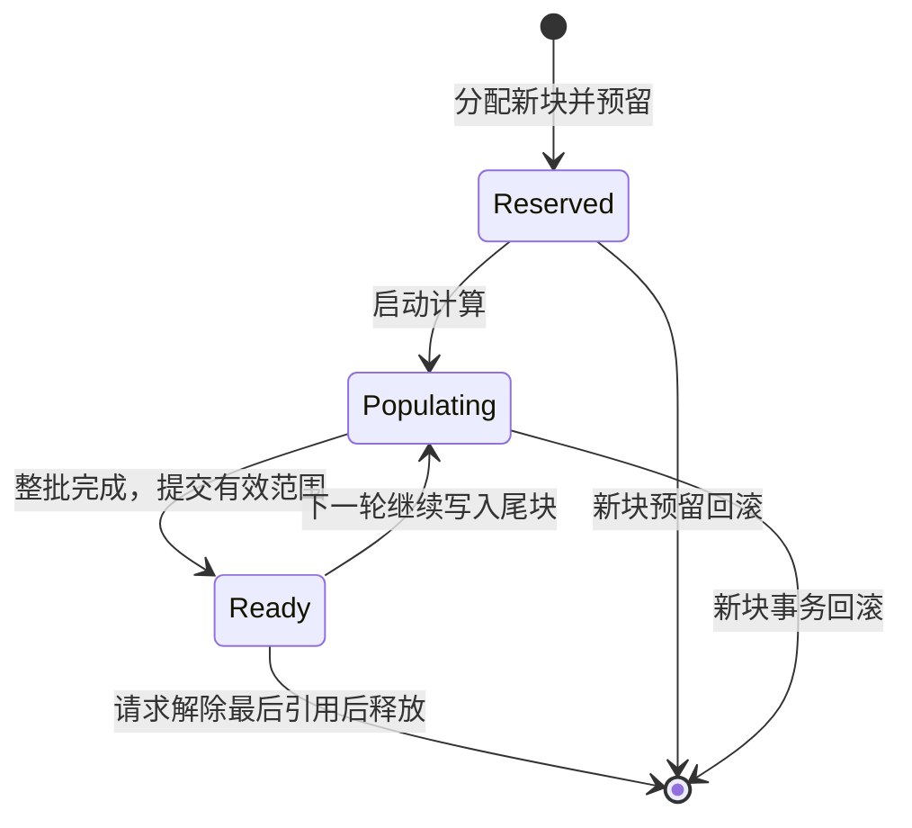
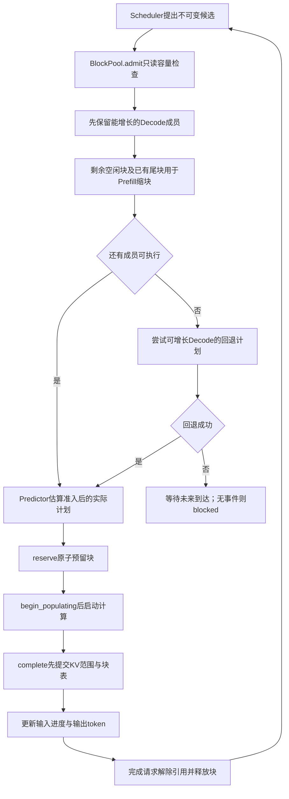

# 第12章：有身份和生命周期的 KV 块

本步按用户要求保留块身份、GPU归属、请求映射与状态，参考师兄“候选选批→容量准入→预留→执行→完成/释放”的分工。不是只计一个总容量数字；目前运行仍是一个GPU和一个Mix worker。共享、COW、传输、多卡副本尚未启用，不会因为有引用字段就自动出现这些功能。

## 1. 先看配置和小例子

```json
"kv_cache": {
  "gpu_id": "gpu_0",
  "total_blocks": 2,
  "block_tokens": 2
}
```

这里总共可占用2个物理块，每块保存2个token在各模型层上的KV。gpu_id是池的设备身份，当前只支持一个池；编号用GPU身份与block_id一起解释。省略整个kv_cache保持旧行为；null、错字段、非正整数均报错。

total_blocks是直接给定的可用KV池容量，不是GPU全部显存。尚未根据权重、固定预留、模型KV字节、元数据与对齐换算成实际显存。计算能力仍由Predictor配置；KV容量和耗时是不同模块。

假设A有3个已缓存token，每块2个：

```text
请求A的块表：[块1，块2]
块1：GPU0，有效范围[0,2)，Ready
块2：GPU0，有效范围[2,3)，Ready，尾部还空1格
```

A再处理1个token，填块2尾部，不申请新块；再处理第5个token，要申请块3。这是按具体请求的页边界分配。块2没填满的一格是内部碎片，不能直接给请求B使用。块存的是身份、范围、状态，模拟器没有真的计算K/V张量或分配CUDA内存。

## 2. 数据结构与所有权

| 结构 | 内容 | 归属 |
| --- | --- | --- |
| KVConfig，冻结 | gpu_id、总块数、每块token数 | 配置 |
| KVBlock，冻结记录 | block_id、gpu_id、logical_index、有效范围、state、request_refs、execution_owner | BlockPool保存并用新记录替换 |
| RequestBlockTable，冻结 | 请求ID、GPU、按逻辑顺序的block_ids、cached_tokens | BlockPool在完成时提交 |
| KVWrite，冻结 | 请求原/新缓存终点、本次使用的块ID | 预留事务 |
| KVReservation，冻结 | 事务编号、写入集合、新块ID、修改前块记录 | 执行期间由完成事件携带 |
| BlockPool | 活块、已提交请求块表、在途事务、ID生成器、峰值 | 每次模拟独立创建，当前一池一在途事务 |
| KVSnapshot / KVRecord | 不可变快照、时刻与动作 | engine导出，不可反向修改池 |

新块ID单调生成；释放容量可供下一请求使用，但ID不复用，避免旧句柄指向新块。logical_index表示请求中的第几页，不是显存地址。Ready块可以有部分有效范围，Ready并不代表整页填满。

request_refs使用元组保存引用身份，本阶段每块只有一个请求。execution_owner记录正在写入该页的事务；请求释放时检查是否有执行保护。有字段不等于已实现共享引用接口、COW、读共享保护或传输保护；以后加入那些机制还需扩展状态规则。

在预留/填充期间，已提交请求块表与cached_tokens仍是旧值。新增块与本轮暂定映射在reservation.writes中；快照同时导出reservations。完成后才把新映射提交到tables，避免把未写好的KV视为可用上下文。

## 3. 块的生命周期



更新已有尾块时，reserve先设置execution_owner，保留原Ready状态和有效范围；begin_populating才把本轮写入块变成Populating。新块先Reserved，开始时同样Populating。complete提交有效终点、变Ready并解除执行保护。rollback删除本轮新块、恢复旧尾块，原请求表不改变；事务完成/回滚后不能再次使用。

全量容量和范围检查在分配前完成。容量预留失败不留下半个batch。峰值记录曾经预留到的块数，包括后来回滚的预留；ID也不会因回滚倒退。

## 4. 选批、准入和执行流程



准入只删减已有候选，不增加人数或token工作量，因此原Scheduler上限仍成立。Decode每成员增长1个KV token，跨页才申请块。Prefill能处理的最大量为：

```text
可写token数 = (请求已有块数 + 本轮剩余空闲块数) × block_tokens − 已提交cached_tokens
本次Prefill量 = min(候选块量，可写token数)
```

例如A已有1个token占1块（每块2token），池只剩1块。候选Decode A + Prefill B输入3：A可填尾块，不占新块；B最多处理2个输入token，候选被缩小到2。同批结束A若完成，就释放其块；B的下一个输入块在后续轮次申请新块。

候选Prefill完全放不下时，可回退执行能增长的Decode。回退先过滤本轮无空间增长的Decode，再按原人数/token上限选，避免只因队首Decode跨页就错过另一个可填尾块的请求。它是容量保护规则，不是SLO策略或抢占。Prefill继续FCFS，不跳过其队首去选另一个输入请求。

容量满且所有Decode都要新块时，可能无法继续。我们不看未来最终输出长度来偷分空间，不在执行中释放成员，也没有交换/抢占/未来增长预留。无后续事件时明确返回blocked，而非无限安排空唤醒。这表示当前策略无可运行计划，不是证明所有可能调度方案都无解。

## 5. 和token预算、Predictor的关系

token预算控制本轮新计算量；KV块容量控制累计数据占用。Prefill chunk控制输入计算块大小，block_tokens控制存储页大小，不能混用。

Prefill完成会写入本轮输入的KV；中间块仍无输出。Decode把上一个输出作为新输入，写入1个token的KV。最后预测出来的token尚未再作为输入处理，所以请求结束时累计KV一般是input_tokens+output_tokens−1；结束后释放全部请求块。

Predictor接收容量删减后的工作描述，未执行的输入不会计耗时。KV分配、状态转换本步没有独立耗时；不改变现有计算公式。所有成员仍在整批完成后统一更新。

## 6. 手算与输出

configs/kv_blocks.json：A在0到达，输入2输出3；B在1到达，输入3输出2；2块，每块2token，混合算法、chunk2，教学耗时。

| 时间ms | 执行 | KV变化 |
| --- | --- | --- |
| 0–4 | Prefill A，输入2 | 占1块，输入填满；A首token |
| 4–6 | Decode A | 新申请第2块，缓存3；无空间给B |
| 6–8 | Decode A | 填尾块，缓存4；A完成，释放2块 |
| 8–12 | Prefill B，输入2 | 占1块；中间输入块无输出 |
| 12–14 | Prefill B，输入1 | 再占1块，缓存3；B首token |
| 14–16 | Decode B | 填尾块，缓存4；B完成，释放2块 |

A输出4/6/8ms；B14/16ms。结束free_blocks=2、peak_used_blocks=2，表和活块为空。ready快照会显示尾块碎片，释放前的占用不会因最终空池而丢失。

configs/kv_blocked.json只改为1块：A在4ms完成输入，已产首token，但下一轮Decode必须申请新块；B也无法申请第一块。模拟结束status=blocked，pending_request_ids为A/B，pending_progress保留输入进度、已产生token时间与首次开始时间。

JSON新增kv_cache、kv_records、kv_final、status、pending_request_ids、pending_progress及summary_scope。blocked时requests与summary的请求/token/延迟/吞吐指标仅含完成请求，执行轮数仍包含全部实际batch，不能把它当整负载性能；部分请求已输出的token在pending_progress中。CLI仍先保存诊断结果，再以退出码2报告阻塞。成功退出码0；旧配置无KV时输出null/空记录，原结果与时间线不变。schema_version仍为1，扩展字段。

快照碎片统计只针对Ready块：每块容量减其有效token数，不把Reserved/Populating的待写空间包装成已产生的尾块浪费。KV记录保存完整快照用于学习，长负载结果文件可能较大。

## 7. 重点代码与验证

1. kv_cache.py重点1 admit：只读检查、删减/缩块。
2. 重点2 reserve：先校验再修改；新块ID与在途写入。
3. begin_populating、重点3 complete与rollback：状态和有效范围何时变化。
4. 重点4 release_request：执行保护与解除引用。
5. engine.py KV重点1/2：准入回退、预测、预留和完成事件的连接。

```bash
python3 run_simulation.py --config configs/kv_blocks.json --output output/kv_blocks.json
python3 run_simulation.py --config configs/kv_blocked.json --output output/kv_blocked.json
python3 -m unittest discover -s tests -q
```

test_kv_cache.py核对身份/范围/尾部浪费、冻结历史、保护释放、跨页增长、容量原子失败/回滚、混合缩块、Decode回退、阻塞诊断/退出码与旧行为兼容。下一步先理解这些结构，再分别添加共享、COW或多卡传输；已有GPU字段不能视为多卡已实现。
