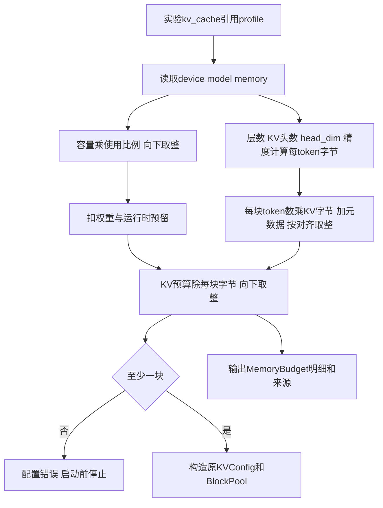

# 第13章：4090显存预算与独立配置

本步参考师兄设备配置与MemoryConfig分离，新增一个独立容量profile文件，按显存字节、模型KV结构、权重与运行时预留换算块数。只读访问服务器采集参数，没有部署模型、运行GPU任务或修改服务器。计算耗时仍未校准。

## 1. 师兄如何配置

设备DeviceConfig保存显存容量、算力和带宽；MemoryConfig另配hbm_utilization、fixed_runtime_reserve_bytes、每页元数据与对齐。模型结构用于计算权重和每token KV大小；GpuMemoryRuntime先扣预算再准入。

我们沿用这个职责分离，在独立JSON里把device/model/memory分成三个对象。第一版显式填权重张量字节数，不复刻师兄全部模型分片、多卡预算和存储框架。

## 2. 配置方式

实验文件configs/rtx4090_memory.json引用：

```json
"kv_cache": {
  "gpu_id": "gpu_0",
  "block_tokens": 16,
  "memory_profile": "profiles/rtx4090_qwen3_8b_bf16.json"
}
```

memory_profile路径相对实验文件目录，其内容如下（完整文件还保存来源与假设）：

```json
{
  "device": {
    "name": "NVIDIA GeForce RTX 4090",
    "memory_capacity_bytes": 25757220864
  },
  "model": {
    "name": "Qwen3-8B BF16",
    "num_layers": 36,
    "num_kv_heads": 8,
    "head_dim": 128,
    "kv_bytes_per_element": 2,
    "weight_bytes": 16381470720
  },
  "memory": {
    "utilization": 0.9,
    "runtime_reserve_bytes": 2147483648,
    "block_metadata_bytes": 0,
    "block_alignment_bytes": 1
  }
}
```

旧total_blocks人工配置仍兼容；total_blocks与memory_profile必须且只能有一个，避免两处决定容量。profile必需device/model/memory，provenance可选对象，未知字段报错。运行时只读本地JSON，不需要联网或连接服务器。

## 3. 实测信息与假设分开

2026-10-13，只读查询服务器nvidia-smi：可见6张RTX4090，每张memory.total为24564 MiB。本配置模拟其中一张，不把六张显存相加。按报告值换算：24564×1048576=25757220864字节，不直接填宣传规格24GiB。

此前Qwen2.5-7B路径当前不存在，因此选服务器已有Qwen3-8B作容量例子。config.json显示36层、8个KV头、head_dim128、bfloat16、无滑动窗口；model.safetensors.index.json的metadata.total_size为16381470720字节。这里只读小型JSON元数据，没有读模型权重内容。

下列值仍是可调假设：使用比例90%、运行时预留2GiB、BF16 KV每元素2字节、块元数据0、对齐1字节。权重采用检查点张量大小作为GPU占用估计，不等于真实加载后测量值；CUDA graph、计算workspace、框架状态等开销由预留近似。以后应实测，再调整profile，不能宣称1972块与vLLM一致。

未使用当前memory.free作为硬件容量：它受其他进程影响。这个预算假设模拟服务拥有对应使用份额；部署到共享GPU时还需核对实际可用资源。本例不是完整4090性能配置，Predictor仍为teaching，并未填未经核实的算力值。

## 4. 换算流程与公式



```text
usable_bytes = floor(capacity_bytes × utilization)
kv_budget = usable_bytes − weight_bytes − runtime_reserve_bytes
每token KV = 2 × num_layers × num_kv_heads × head_dim × kv_bytes_per_element
页payload = block_tokens × 每token KV
页大小 = 向上对齐(payload + metadata)
total_blocks = floor(kv_budget / 页大小)
```

K/V两份所以乘2。此公式限定单卡普通dense/GQA、完整上下文KV；不适用于MLA、混合窗口、压缩/量化元数据或多卡分片。对齐只描述每块收费大小，不模拟实际内存地址/外部碎片。

| 计算项 | 当前结果 |
| --- | --- |
| 允许使用显存 | 23181498777字节 |
| 权重估计 | 16381470720字节，约15.26GiB |
| 运行时预留 | 2147483648字节，2GiB，未实测 |
| KV预算 | 4652544409字节，约4.33GiB |
| 每token KV | 147456字节，144KiB |
| 每块16token | 2359296字节，2.25MiB |
| 可用整块数 | 1972 |
| 不足一块的剩余字节 | 12697 |

总块容量1972×16=31552个KV token位置；由于各请求尾块浪费，实际有效KV token通常少于这一数字。第12章的碎片、预留和容量阻塞机制继续生效。

## 5. 代码、结构与验证

| 文件/结构 | 职责 |
| --- | --- |
| memory_budget.py / MemoryDevice | 设备名称与字节容量 |
| MemoryModel | KV结构、精度字节、显式权重占用 |
| MemorySettings | 使用比例、预留、元数据、对齐 |
| MemoryBudget | 冻结的解析配置、各步计算结果、最终块数和余量 |
| config.py | 严格解析/相对路径；profile与人工块数互斥，返回已解析KVConfig |
| kv_cache.py | 不感知硬件profile，只用已解析块数管理生命周期 |
| run_simulation.py | 导出memory_budget和memory_provenance |

先读memory_budget.py重点1/2/3，分别是扣占用、算KV字节、按整页取整。Predictor与memory_profile同时使用时，会检查层数/KV头数/头维度/KV元素字节一致，避免一个模型管容量、另一套结构管耗时。这个检查不代表其耗时已经准确。

```bash
python3 run_simulation.py --config configs/rtx4090_memory.json --output output/rtx4090_memory.json
python3 -m unittest discover -s tests -q
```

本例使用小型人工token负载，目的为查看容量明细，不是4090 benchmark。已有ShareGPT长度用Qwen2.5 tokenizer准备，若之后校准Qwen3，应使用对应tokenizer重新准备负载。

test_memory_budget.py核对手算、元数据/对齐、无预算/不足一块、非法参数、profile相对路径/互斥、服务器profile结果及Predictor结构冲突。schema_version仍1，新增memory_budget/memory_provenance字段；不改变现有人工块数例子与默认耗时。

后续固定实际模型/精度/服务版本后，测运行时占用和KV块数来验证容量，再做耗时校准；当前只完成独立可配置预算与一个有来源的4090示例。

后续补充：第14章新增可选preempt＋recompute恢复；本章例子默认block，原阻塞结果和容量公式保持不变。见[抢占与重算恢复](14-recompute-recovery.md)。
