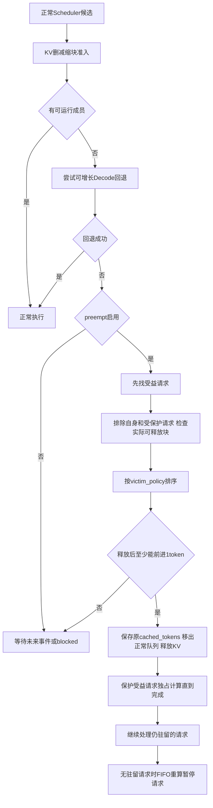
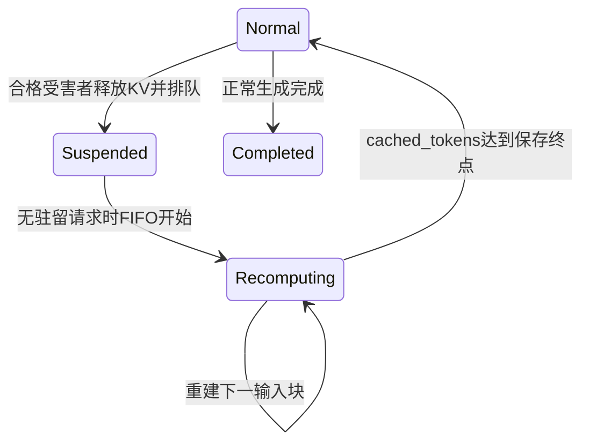

# 第14章：选择、抢占与重算恢复

本步参考师兄“容量准入、受害者选择、恢复事务”分工，实现可配置的释放后重算。没有交换、CPU池或传输，不能写swap名字假装已经支持。仍是单GPU；用户尚未确认理解本步，先读手算表，再看少量重点代码。

## 1. 配置分开表达三个问题

```json
"recovery": {
  "capacity_policy": "preempt",
  "victim_policy": "fewest_generated",
  "recovery_action": "recompute"
}
```

| 字段 | 支持值 | 作用 |
| --- | --- | --- |
| capacity_policy | block / preempt | 无可准入计划时继续原阻塞方式，或尝试抢占 |
| victim_policy | fewest_generated / newest | 合格请求中选输出较少者，或选较晚到达者 |
| recovery_action | recompute | 释放KV，之后通过计算重建，其他值报错 |

省略recovery默认block，旧KV例子保持原结果。preempt必须配置KV；字段严格校验。fewest_generated先按已产生输出数升序，平局选arrival_order较大者；newest仅选较大arrival_order。arrival_order是按到达时间稳定排序的序号。选择不读取目标输出长度或未来剩余工作。

这里capacity_policy控制是否启用抢占，现有KV删成员/缩Prefill准入规则仍固定；不是师兄完整sglang/ksana/swap_then_evict配置的复制。当前recovery位于实验顶层，对唯一worker生效，多worker时需再做角色绑定。

## 2. 触发顺序与进展保护



抢占只发生在GPU空闲、正常准入与Decode回退都失败时。受益请求优先从当前Decode队列，再看Prefill等待队列；已有focus时只为它腾空间。

受害者必须有已提交KV、不是受益请求、没有执行保护，并且解除它的独占引用后能让受益请求至少处理1个token。正在恢复和已暂停的请求不在普通候选中。共享机制尚未启用；检查只计算单请求引用可释放的块，不把解除共享引用直接当释放整页。

暂停后立即恢复会重新吃掉刚释放的空间，可能来回抢占。因此本步采用保守规则：focus只向Scheduler暴露受益请求，直到它完成；其间新到达仍排队。其他驻留请求排空后，再FIFO恢复暂停请求。恢复后的请求也独占到完成。它不是最优公平性/SLO策略，会增加其他请求等待，后续可以研究更细的恢复准入。

如果一个请求自身的下一步就超过整池容量，释放别人也帮不了，仍明确blocked；不通过把自己反复丢弃/重建来制造无限循环，也不看最终输出目标来偷算未来预留。

## 3. 重算到底重算什么

抢占保存的是本请求当时已写入KV的序列终点cached_tokens。它可能包含完整输入和已处理的生成历史，也可能只是部分Prefill输入。真实系统保留输入及已生成token内容，重放以重建KV；本模拟器只模拟长度、资源和耗时，不生成实际文本。

重算使用独立成员阶段Recompute，按chunk/token预算分块执行。每轮仍受KV容量限制，走reserve→populating→ready。Predictor把它当输入序列工作量，produces_token必须false，不执行新输出采样/LM Head，也不增加原prefill_done和token_times。



重建完后：若曾产生首token，就回Decode；若尚未完成原输入，就回Prefill，并从原prefill_done继续。starts、已有输出时间和生成数量始终保留，因此TTFT不会被重新计算成恢复时刻，ITL会自然包含暂停/重算等待。

Recompute不混入普通P/D batch，也不消耗alternating的阶段切换记忆；它是独立恢复计算。教学耗时按重算token×Prefill系数；roofline正常估算工作量但不计算LM Head。释放/选择本步假设瞬时，没有另设抢占开销；重算本身真实计入模拟时间。

## 4. 数据结构与权责

| 结构/模块 | 内容与职责 |
| --- | --- |
| RecoveryConfig | 三个独立配置项，不可变 |
| RecoveryCandidate | ID、已生成数量、到达顺序；没有最终输出目标 |
| select_victim | 合格候选的只读排序，不释放块 |
| RecoveryTarget | 暂停请求ID、待恢复的KV终点，不可变 |
| RecoveryController | FIFO队列、restoring、focus与记录，运行独立实例 |
| BlockPool | 分配/释放和KV事务，仍不决定暂停谁 |
| engine | 筛选进展条件、暂停/恢复队列连接、完成事件与输出保护 |
| RecoveryRecord | time/action/request/恢复目标/受益请求，冻结并导出 |

请求原语义进度与KV驻留进度分开：释放KV后cached_tokens可为0，但原prefill_done和已输出数量不倒退。初次进入与恢复后新的块ID不同，块池原身份/事务生命周期继续使用。

## 5. 手算例子

configs/recompute.json：A、B均0到达、输入2输出3；2块、每块2token，Prefill优先、chunk2、preempt＋fewest_generated。block模式下8ms时都需要新块而阻塞。

| 时间ms | 执行/动作 | 输出与KV |
| --- | --- | --- |
| 0–4 | Prefill A | A首token，KV2，占1块 |
| 4–8 | Prefill B | B首token，KV2，再占1块 |
| 8 | 暂停B，保护A | 两者输出数相同，较晚序号B被选中，释放1块 |
| 8–10 | Decode A | A第二token，KV3占2块 |
| 10–12 | Decode A | A第三token并完成，释放2块 |
| 12–16 | Recompute B，2token | 恢复B的KV2，不产生输出 |
| 16–18 | Decode B | B第二token |
| 18–20 | Decode B | B第三token，释放全部KV |

A输出4/10/12，B8/18/20ms；B首token仍8ms，第一个ITL为10ms。正常输入总数4，输出总数6；额外重算2token另记recovery_summary，不能把它混入逻辑输入/输出长度。

更复杂测试覆盖：抢占已经生成多个输出的A时，恢复input+processed_outputs的4个KV token，A旧输出时间不变；抢占部分Prefill的B时，重算已有2个输入，再继续最后输入块，首token只产生一次。token预算1时重算也切成1token块。

## 6. 代码入口与验证

1. recovery.py重点1 select_victim：排序规则最容易读。
2. engine.py恢复重点1 try_preempt：先检查能否腾空间，再选择。
3. RecoveryController重点2：focus保护避免恢复来回打架。
4. engine.py恢复重点2/3：完成时不产生输出；何时开启FIFO重算。
5. predictor.py：Recompute禁止produces_token，教学按Prefill计时。

```bash
python3 run_simulation.py --config configs/recompute.json --output output/recompute.json
python3 -m unittest discover -s tests -q
```

结果新增recovery配置、recovery_records、recovery_pending和recovery_summary；pending保存暂停/在重建的目标，阻塞时仍保存原pending_progress和KV快照。steps/plans/estimates可出现Recompute。schema_version仍1，属于字段扩展；默认block保持旧行为。

test_recovery.py验证两种排序、与block对照的手算、输出历史/部分Prefill恢复、预算/FIFO优先和进展保护、单请求不可容纳仍blocked、roofline无LM Head及配置错误。未实现交换、前缀共享/COW、多卡/SLO优化或完整师兄保护策略，下一步先理解这条恢复路径。
