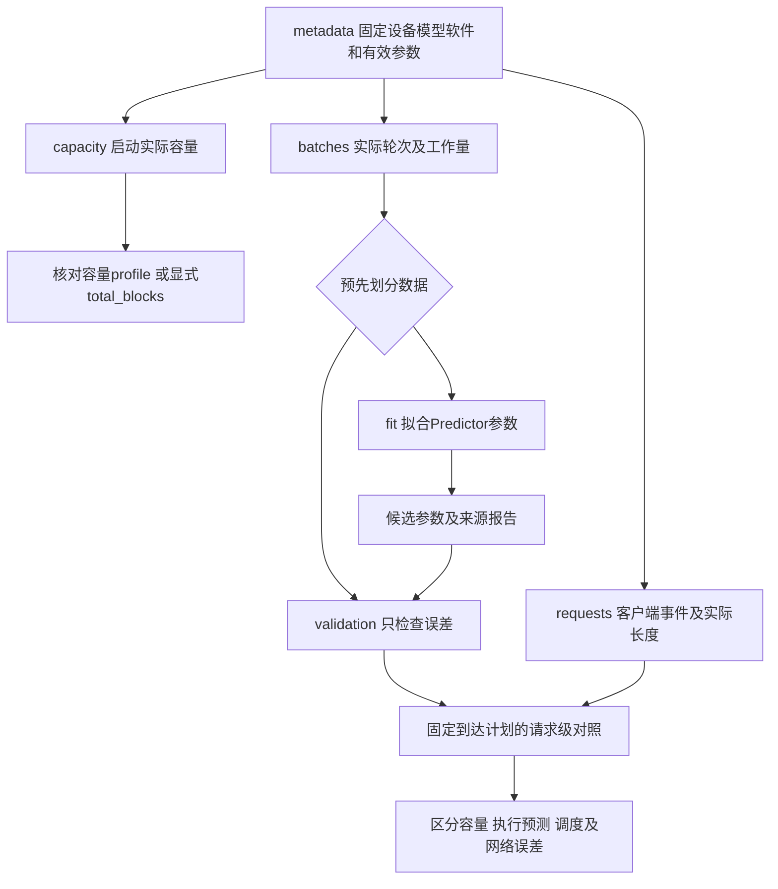

# 第15章：单卡校准实验方案与记录格式

当前进度：实验准备。没有启动vLLM，没有采集真实数据，也没有修改Predictor系数。先测容量和纯Prefill/Decode，再验证请求流程；混合、分块重算和抢占压力是后续实验。本章与calibration/是下一次服务器实验的入口。

## 1. 先弄清楚我们要校准什么

通俗地说：容量回答“放得下多少”，Predictor回答“这一轮算多久”，请求指标回答“用户等多久”。三个问题分别记录，不能拿一个接口响应时间代替所有参数。

| 观测 | 用来对齐 | 不能直接代替 |
| --- | --- | --- |
| 引擎启动报告的KV块数/token容量 | kv_cache.total_blocks或memory预算 | nvidia-smi剩余显存不等于KV池容量 |
| 实际执行轮的成员、新token、上下文与耗时 | Predictor.estimate(items) | 请求TTFT不是单轮执行时间 |
| 客户端发送、首输出、完成、输出事件 | TTFT、端到端延迟、吞吐及条件允许的ITL | HTTP流式块不一定对应单个token |

本计划建议RTX4090＋Qwen3-8B BF16，TP=1，与现有容量profile一致。当前服务器模型路径和软件版本尚未重新核对；不假定vLLM已安装或某张卡空闲。模型权重、KV精度、tokenizer、chat template、框架版本、实际后端、CUDA Graph方式都要保存。已有ShareGPT长度由Qwen2.5分词，不能直接拿来作为Qwen3的真实输入长度。

## 2. 小步实验与条件

calibration/plan.json保存建议值，不是run_simulation.py或vLLM的配置文件。版本相关参数需查已安装版本的帮助并保存实际启动命令；不能依赖框架默认值。第一轮建议关闭前缀缓存、投机解码、CPU卸载，避免额外机制；分块Prefill也关闭，若该版本无法做到，就记录实际行为并分离样本。不能将期望关闭写成已经关闭。

建议max_model_len=4096、max_num_seqs=8、max_num_batched_tokens=4096、16token/块、90%显存比例；这是实验条件，不是4090最优配置。容量不够时记录失败，并通过新的run_id明确修改条件，不偷偷降精度或换模型。为每个形状预热5次、记录20次，每个采样保留原值；预热/编译/Graph捕获与稳态数据分开，必要时延长预热直至稳定。记录其他GPU进程和功耗/频率设置，初轮不主动调整设备设置。

| 顺序 | 拟合形状 | 独立验证形状 |
| --- | --- | --- |
| 容量 | 相同设置启动3次，记录实际池容量与日志 | 对照现有1972块估计与启动重复性 |
| Prefill | B=1；输入128/512/2048，context=0 | B=1；输入256/1024 |
| Decode | B=1/4/8；已缓存context=128/512/2048；每请求新token=1 | B=2；context=256/1024 |
| 请求流程 | 不用来拟合执行系数 | 20请求，固定到达率0.5/1/2 req/s分别运行，目标输出32 |

Prefill首轮可申请只生成1token，减少后续Decode干扰；Decode准备阶段先构造KV，然后测后续实际轮次。生成长度控制建议temperature=0、ignore_eos=true，具体按框架接口核对支持；始终记录实际输出数而非只记申请上限。没有精确轮次观测时，Decode的context会随生成增加，必须逐轮记录实际值，不能把初始prompt长度复制到所有样本。

先跑最小形状和容量，确认可运行再扩矩阵。B表示同一轮实际执行请求数，不是HTTP客户端并发数。Prefill初轮只拟合我们支持的单请求块；多Prefill成员、非零上下文块和Mixed留到后面。

## 3. 测量边界比工具名字更重要

vLLM有[latency benchmark](https://docs.vllm.ai/en/stable/cli/bench/latency/)，可以设置输入/输出长度、batch大小、预热和采样次数，也提供profile选项。它的生成过程可能跨多个执行轮；保存原生输出，不把整次生成延迟填入单轮duration_ms。框架的[profiling示例](https://docs.vllm.ai/en/stable/examples/features/profiling/)可作为trace采集参考；具体插桩点待核对服务器版本后决定。

我们的Predictor输出用于安排一个batch的完成事件。因此拟合的主要口径选择engine_iteration_wall：模型前向＋本轮采样的执行窗口，不含请求排队、分词、HTTP传输。计时起止点、同步方式必须写入metadata及样本；GPU异步执行时，仅记录Python调用返回时间会漏掉实际计算。可用同步后的单调时钟观测整轮，或GPU事件/trace观察设备执行；两种口径分别标记，不能混起来拟合。

CUDA事件观察GPU时间时记为gpu_forward，CPU调度/采样等遗漏成本另行量化，不能直接冒充engine_iteration_wall。强制同步和profiler会改变执行行为：少量trace确认边界，正式稳态测量尽量轻量，并对照无profile运行。把窗口外的调度开销明确作为模拟器误差来源；现阶段不能把网络耗时塞进batch_overhead_ms。

如果目前只能测HTTP，请先完成容量＋请求端基线，并将Predictor拟合标为blocked_by_missing_iteration_timing；先补采集能力，不猜测单轮耗时。服务端[production metrics](https://docs.vllm.ai/en/latest/usage/metrics/)可辅助观察请求阶段和TTFT/ITL等，但聚合直方图不能还原逐请求、逐token的完整轨迹；单位seconds转换为ms需乘1000。指标名称以实际版本为准，保存原始metrics。

## 4. 数据结构与流程



| 文件 | 粒度和核心字段 | 代码对应 |
| --- | --- | --- |
| metadata.json | run_id；设备、模型哈希、软件、实际开关、采集边界 | 配置和实验身份，不参与调度 |
| capacity.json | 每次启动；reported_gpu_blocks/kv_token_capacity、block_tokens、日志位置 | KVConfig与memory_budget.resolve_budget |
| batches.jsonl | 每个实测轮；items、duration_ms、timing_scope、shape_id、split、预热标记 | PredictorItem→Predictor.estimate→BatchEstimate |
| requests.jsonl | 每请求；实际输入/输出数、计划到达/发送/首输出/完成、流式事件 | Request、Result、metrics.summarize |
| comparison.csv | 每形状；实测中位数/P95、预测值、相对误差和状态 | 后续拟合/评估报告，尚无导入器 |

模板全部record_status=template，测量值为null或空数组；不是0ms结果。复制到output/calibration/<run_id>/填写，实测行改measured，提供source_artifact/source_location。未知字段保留null并解释，不伪造完整元数据。时间统一ms、容量bytes/token/block；run_id跨文件关联，shape_id标识完整实际items形状，sample_id标识单次观测。不同实际上下文不能聚为同一形状。原始文件另存，单位转换不覆盖原始数据。

batch.items沿用PredictorItem字段：phase、new_tokens、context_tokens、produces_token；批人数和new_tokens总数由items导出，与actual_batch_requests/actual_new_tokens核对。Decode new_tokens=1、produces_token=true；context为本轮之前已缓存数量。如果输入长度L且已生成g个输出，我们的当前约定context=L+g−1。第一次Decode是L；请求时间记录实际长度，未来目标不能回传给Scheduler。

请求端所有时间使用同一客户端单调时钟相对run开始的毫秒值：TTFT=first_output−send，latency=finish−send；planned_arrival与send分开，保存负载发生器的发送偏移。模拟器arrival对应真实实际send的重放可隔离发送误差，同时单独报告计划到达误差。不能直接相减服务器与客户端两个未经同步的时钟。

output_events每项为{"time_ms":实际时刻,"output_token_count":本事件已确认新token数或null}。只有能可靠建立逐token映射时才标event_token_mapping=per_token，并对齐逐token ITL；多token合并或仅文本chunk标chunk/unknown，报告事件间隔或请求级TPOT，不声称等于我们的逐token ITL。不要逐chunk重新分词后相加推断token数。吞吐用确认的最终输出总数/首发送至末完成窗口；失败请求另报成功率与失败原因，不静默删除。

## 5. 如何把数据用回模拟器

容量先看实际引擎启动报告：确认单位、单GPU、同一block_tokens。若只报告精确可用KV token容量，确认其语义后按floor(tokens/block_tokens)换块，别用“支持的最大并发数”代替。先把测得块数写入新实验的kv_cache.total_blocks，与memory_profile互斥，保留现有未校准profile。权重VRAM/运行时非KV内存未分开测量时，不同时猜两个数去凑容量；日志缺字节预算则保留null。

耗时使用当前roofline两组基础时间D_i和A_i（calibration系数置1，开销置0）：

```text
预测_i = dense_factor × D_i + attention_factor × A_i + batch_overhead_ms
相对误差_i = (预测_i − 实测_i) / 实测_i
```

系数必须>0，开销>=0；固定模型维度和硬件参数，优先只拟合这三个值。不要同时自由调整peak_flops、带宽与所有系数，避免参数互相抵消。未确认4090精度对应的算力数值前不填虚构值。实测时长必须正且有限；fit样本按形状取稳态中位数，避免Decode长序列的大量轮次淹没Prefill形状。保存P95观察抖动；同一run的预热不进入拟合。

两组工作量可能相关，三个参数不一定能唯一识别。若拟合不稳定，增加不同瓶颈形状/算子观测，或先固定部分系数，不包装成物理参数实测。初轮缺少非零context Prefill/Mixed/Recompute样本，因此这些区域仍标未验证。

验证集只评估不调参数：建议先用“逐形状中位数绝对相对误差≤20%”作教学初始目标，另报平均/最大误差和覆盖范围；20%不是行业保证。不通过先检查边界/上下文/批人数，必要时修正预测模型或另开一轮数据划分，不能把失败验证样本并入fit后仍称独立验证。当前没有自动拟合器或已校准来源标记，后续实现时再接入参数及来源报告；保存模板不会改变uncalibrated_roofline状态。

最后才用请求级对照：Qwen3分词准备20个有效样本，保存真实输入与实际输出长度、同一到达时间。先低负载纯阶段，再提高压力/引入chunk和Mixed；vLLM策略与我们的FCFS/轮转/focus并不相同，即使耗时预测准确也可能TTFT/ITL不一致。没有调度轨迹对齐时只作整体趋势比较，不把所有差异都通过系数“拟合掉”。

## 6. 下一次实际动手的顺序

1. 只读核对服务器空闲GPU、模型及tokenizer、vLLM/torch/CUDA版本、命令帮助，记录metadata。当前未执行这一步。
2. 根据实际版本实现独立采集脚本/计时边界，先测容量和B=1短输入；不修改师兄模拟器。
3. 检查记录单位、证据、实际长度与items，再扩展到plan中的fit/validation形状。
4. 写拟合和验证工具，评估通过后新增实验profile及来源，再测小负载请求流程。

本步只整理材料，无服务器启动命令、采集器、拟合器或运行时新机制。模板和JSONL语法已本地核对，保持现有67通过/2跳过的验证基线；文档变更不重复运行整套模拟测试。
