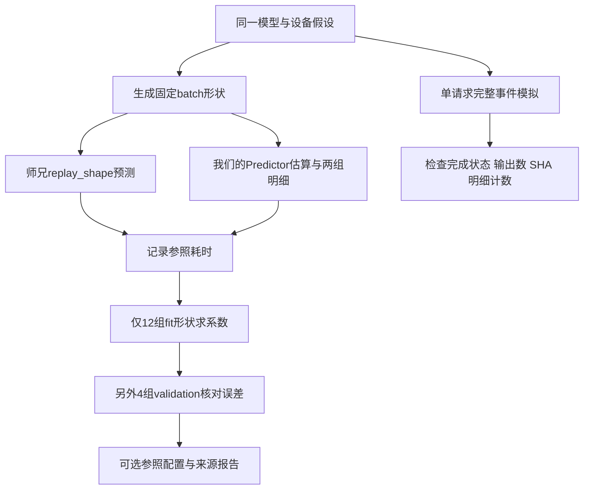

# 第16章：用师兄的模拟器作参照

这一步已经跑通，但不是4090实测校准。我们借用师兄已有的native模拟器，在相同模型、设备假设和执行工作量下比较两个Predictor，再拟合可选系数。原始输出在本地output/calibration/senior-reference-04；可提交的条件与16组结果在calibration/reference/scenario.json和result.json。

## 1. 为什么先比较batch，而不是直接比较TTFT

Predictor回答“一轮工作算多久”，TTFT还包含排队和调度等待。首次单请求运行中，师兄默认的小Prefill等待额外增加约50ms。若直接拿65ms的TTFT调整我们的15ms执行时间，就把调度等待错误地塞进了算力系数。

最终单请求实验设prefill_delay_min_tokens=1，调度间隔1微秒；4个输入token、2个输出token，没有容量压力。师兄首输出15.166638ms、第二输出30.311723ms；我们的原始预测分别15.139144ms、30.276665ms。这里对照的是完整流程，仍有调度差异，不用于拟合。

拟合使用师兄提供的replay_shape：给它已经选好的成员与处理范围，只计算执行耗时，不经过到达、选批或排队。它当前支持纯Prefill/Decode；本次没有绕过限制测试Mixed。



## 2. 条件与数据结构

模型为服务器config.json读出的Qwen3-8B：36层、hidden4096、intermediate12288、32个注意力头、8个KV头、head_dim128、词表151936，BF16。两边都设100TFLOP/s、1TB/s。**这两个速度是共同的假设值，不能称作4090有效性能。** 容量采用之前读到的24564MiB，本实验没有容量压力，也没有校准KV块数。

师兄的calibration_params为空，使用解析默认系数1、开销0；qwen3-fused-v2是模型版本名称，不证明参数经过实测。师兄分QKV、Attention、输出投影、MLP、LMHead及辅助工作，我们将主要工作合为dense和attention两组，所以不要求完全一样。

| 结构 | 保存什么 | 在哪里看 |
| --- | --- | --- |
| scenario | 同一模型、设备假设、师兄系数及模型配置SHA | calibration/reference/scenario.json |
| PredictorItem | phase、new_tokens、context_tokens、produces_token | simulator/predictor.py |
| IterationShape | 设备、层范围、每个成员处理范围及logits数 | 师兄calibration/replay.py |
| 对照row | shape_id、fit/validation、items、参照/原始/拟合耗时、相对误差 | calibration/reference/result.json |
| provenance | native文件SHA、仓库HEAD、二进制报告commit、输出验收、系数 | 同一result.json |

Prefill取context=0、new_tokens=输入长度，最终块计算1个logit；Decode取context=指定历史长度、new_tokens=1，同样计算1个logit。每个batch中的请求长度相同。这些是冻结的执行工作量，不把最终输出目标提供给选批算法。

## 3. 拟合做了什么

原始Predictor把dense时间与attention时间相加。现在拟合三个参数：

```text
预测耗时 = dense_factor × 原始dense时间
         + attention_factor × 原始attention时间
         + batch_overhead_ms
相对误差 = 预测耗时 / 参照耗时 - 1
```

只用fit组最小化相对误差平方和，要求两个系数为正、开销非负。脚本枚举三个变量的有效集合，再用最小二乘求可行解；这只是一个小型离线工具，不是事件模拟器的依赖。得到dense_factor=1.012111、attention_factor=0.905319、overhead=0ms；这些数只是在当前范围内补偿两种解析模型差异，不是物理算力或实测kernel开销。

fit组：Prefill B1、长度128/512/2048；Decode B1/4/8、上下文128/512/2048，共12组。validation组：Prefill B1、长度256/1024；Decode B2、上下文256/1024，共4组，没有参与拟合。

| 独立验证形状 | 师兄参照ms | 我们原始ms | 参照拟合ms |
| --- | ---: | ---: | ---: |
| Prefill B1 L256 | 37.157 | 35.769 | 36.181 |
| Prefill B1 L1024 | 146.613 | 145.357 | 146.787 |
| Decode B2 C256 | 15.227 | 15.213 | 15.389 |
| Decode B2 C1024 | 15.454 | 15.440 | 15.594 |

表中值以result.json为准，四舍五入展示。验证组最大绝对相对误差由约3.74%降至2.63%；Decode原本已很接近，拟合后部分误差反而升高。fit中短Prefill L128仍约低估6%，说明两个修正系数不能消除所有结构差异。不要据此声称所有batch都能达到2.63%，也不要为改善验证结果反复调参并继续称独立验证。

## 4. 怎么运行与读代码

无需师兄环境即可运行已保存的可选参照配置：

```bash
python3 run_simulation.py --config configs/reference_senior.json --output output/reference_fitted.json
```

该例子首输出15.3224ms、完成30.6432ms。它仅检查配置可使用，4token短输入不在拟合覆盖范围内。默认basic/ShareGPT/4090容量配置不变；输出仍标uncalibrated_roofline，因为没有硬件实测来源。参照文件名称、设备名称与本章说明其用途。

在当前WSL已有师兄Python3.13环境和native二进制时，重新生成全部参照：

```bash
../router-simulator/.venv/bin/python -S -B calibration/scripts/run_senior_reference.py \
  --senior-root ../router-simulator \
  --scenario calibration/reference/scenario.json \
  --output output/calibration/senior-reference-new
```

输出目录必须全新。-S关闭editable自动构建钩子，-B不写pyc；脚本只读师兄环境/源码/已有二进制，日志、工作负载缓存和结果都写我们自己的output目录。没有安装、编译、修改师兄项目，也没有运行GPU推理。脚本依赖师兄已有的NumPy/YAML等环境，基础模拟仍仅标准库。

代码阅读顺序：run_senior_reference.py的【重点1】只读载入 → 构造配置和固定形状 → replay_shape与estimate →【重点2】拟合与独立验证 → 保存来源。输出验收在【重点3】：完整manifest、JSON/schema、文件SHA、压缩明细数量、请求完成与输出token数。辅助导入和文件写入可以先略读。

本次输出验收：schema8，complete=true，1个完成请求、2个输出token，4条事件、290条算子记录，文件SHA与明细计数通过。二进制SHA为b5b79be3b1901784839009900d714519979f3530a512110a34a3b8872be85a71；native报告source_commit为3b374848…，当前源码HEAD为4b7a96be…，二者不同。本次结果对应已有二进制，不能声称已经运行最新HEAD构建；不为这次参照修改或重编译师兄项目。

## 5. 下一步边界

本次没有测4090耗时、实测KV容量、ShareGPT请求级精度、Mixed、非零context Prefill或Recompute。服务器采集入口已准备但GPU运行未验证；此前启动尝试遇到UUID兼容问题及显存占用，未取得有效数据，详见交接文档。等王服务器有可用卡，再把这里的“师兄参照耗时”换成边界明确的真实执行耗时，重新拟合、独立验证；不会把这套参照系数自动当成4090校准结果。
