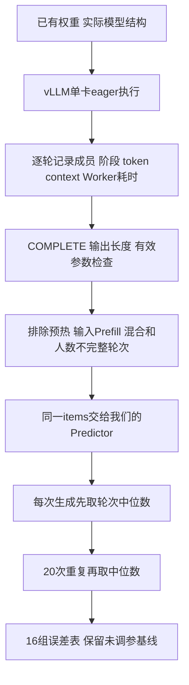

# 第17章：第一次完整实测与原始预测对照

2026-10-14，使用杜老师服务器的单张4090（GPU4）和已有Qwen2.5-3B-Instruct权重，完成16组形状、每组5次预热和20次重复。没有下载模型，没有修改既有环境或师兄模拟器。先比较未调参的Predictor，不拟合、不修改默认运行配置。

## 1. 换模型需要同步什么

这次目标是学习校准流程，不要求必须Qwen3-8B。只要真实测量和模拟预测使用同一模型结构，已有权重就能用。

服务器检查发现：A6000有完整Qwen3-8B和Qwen2.5-3B；杜机Qwen3-8B仍缺全部权重分片，但Qwen2.5-3B-Instruct的两分片完整。验证了索引、文件存在以及safetensors头中的数据范围与文件长度，未做完整权重内容SHA。杜机已有独立vLLM0.11.0环境，GPU4检查为4MiB/0%，因此选它省去环境及权重下载。

模拟侧configs/measure_qwen25_3b.json改成36层、hidden2048、intermediate11008、16个注意力头、2个KV头、head_dim128、词表151936、BF16。设备速度沿用原参照基线的**假设100TFLOP/s、1TB/s**，dense/attention系数都是1，batch开销0。这不是宣称4090有效速度已经测量。真实模型的QKV bias等细小操作仍未逐算子建模；权重共享等实际显存结果由vLLM报告，不由简化Predictor推算。

## 2. 数据怎么采，怎么对应



输入是精确长度的合成token IDs，不是ShareGPT。这里测的是已经选出的batch执行耗时，没有请求到达时间，也不是TTFT或调度策略对照。

Prefill：B1、输入128/256/512/1024/2048，生成1token。Decode：B1/4/8、初始上下文128/512/2048，以及B2、上下文256/1024，生成32token。Decode实验也需要先执行输入Prefill，随后每请求执行31轮Decode；实际历史随生成增长，不能始终写成初始长度。

| 数据结构 | 含义 |
| --- | --- |
| metadata.engine / effective_engine | 请求参数与实际有效参数分别保存 |
| batch.items | 本轮真正的成员、阶段、new_tokens、context_tokens、produces_token |
| sample_id | 一次生成实验；同一次的多个Decode轮次相关 |
| shape汇总 | 20次重复中位数、有效轮次、上下文范围、排除计数 |
| comparison provenance | 模型config SHA、软件版本、GPU UUID、原始文件SHA、fit_performed=false |

原始数据有400次生成、9224条Worker记录；每次输出数量都核对过。每个形状保留20次有效重复。比如B8/C2048保留540条完整纯Decode轮次，其余预热、输入Prefill/混合、部分人数轮次单列排除；不将小batch冒充B8。

比较使用每一轮的实际items。先在一次生成中分别取实际/预测轮次中位数，再对20次重复取中位数，避免轮次更多的一次生成被当作更多独立实验。相对误差=(预测中位数/实测中位数−1)，负数表示预测偏快，正数表示预测偏慢。总体指标是16组等权平均绝对误差，不是逐token加权或端到端误差。

## 3. 结果：原始预测还不准

| 形状 | 实测ms | 预测ms | 相对误差 |
| --- | ---: | ---: | ---: |
| Prefill B1 / 128 | 19.025 | 7.133 | −62.50% |
| Prefill B1 / 256 | 19.122 | 14.309 | −25.17% |
| Prefill B1 / 512 | 23.608 | 28.805 | +22.01% |
| Prefill B1 / 1024 | 44.336 | 58.376 | +31.67% |
| Prefill B1 / 2048 | 87.075 | 119.839 | +37.63% |
| Decode B1 / C128 | 16.152 | 6.177 | −61.76% |
| Decode B1 / C512 | 16.124 | 6.191 | −61.60% |
| Decode B1 / C2048 | 16.142 | 6.248 | −61.29% |
| Decode B4 / C128 | 17.270 | 6.194 | −64.14% |
| Decode B4 / C512 | 17.243 | 6.250 | −63.75% |
| Decode B4 / C2048 | 17.252 | 6.477 | −62.46% |
| Decode B8 / C128 | 17.277 | 6.216 | −64.02% |
| Decode B8 / C512 | 17.321 | 6.329 | −63.46% |
| Decode B8 / C2048 | 17.331 | 6.782 | −60.86% |
| Decode B2 / C256 | 17.245 | 6.192 | −64.09% |
| Decode B2 / C1024 | 17.271 | 6.249 | −63.82% |

表中的C是初始上下文，实际范围到C+30，预测已使用每轮真实值。16组平均绝对相对误差54.39%，最大64.14%。结果说明当前假设基线存在明显偏差，不能因为与师兄模拟器参照接近，就认为与硬件接近。

短Prefill和Decode预测偏快，长Prefill预测偏慢。固定开销、有效计算/访存速度及两组近似都是下一步待检查的因素；这一轮没有分离测量这些因素，不能将其中某一个说成已证实的原因。下一步才用fit组拟合，再用原定4个validation形状独立核对，不用这次展示误差时偷偷调参。

## 4. 实际运行条件与限制

首次90%预算运行在2048输入时OOM，没有COMPLETE，不参与统计。第二次降为50%成功，run_id=du-qwen25-3b-eager-matrix-20261014-02。实际权重VRAM6218668032bytes，KV预算6028470272bytes，10220块×16=163520token；容量足以覆盖矩阵，未发生抢占恢复。采集结束GPU4恢复4MiB/0%。其他卡和同服务器仍有任务，不承诺整个服务器独占或完全无干扰。

**有效参数不能只看传入值。** 我们请求enable_chunked_prefill=false，但vLLM V1实际改为true，本次Worker读到的有效配置和日志都确认了这一点。新增effective_engine记录它；这也纠正此前王机smoke文档仅凭请求值称“禁用分块”的表述。按实际工作量预测及排除混合过渡轮次，因此不会把分块阶段差异强行拟合进纯Decode时间。

计时仍为worker_execute_wall：CUDA前后同步包围Worker.execute_model，包含预处理、forward、采样和输出，不含Engine Scheduler/RPC/HTTP/分词；不是纯GPU kernel时间。eager与同步计时不能直接代表CUDA Graph生产服务，更不能把本次系数或误差移用到A6000/Qwen3/Mixed/重算。未进行ShareGPT请求级TTFT/ITL验证。

## 5. 代码阅读与复现

重点代码：collect_batches.py记录请求和有效配置；worker_probe.py读取实际容量并计时；compare_measured.py的【重点1】按实际context预测，【重点2】按生成重复等权汇总。模型/设备基线在configs/measure_qwen25_3b.json。事件模拟器与默认配置不变。

原始数据在ignored output/calibration/du-qwen25-3b-eager-matrix-20261014-02；对应远端runs目录保留一份。已提交的摘要calibration/measurements/du-qwen25-3b-matrix-20261014.json包含16组统计、条件及证据SHA，逐轮对照在本地output/calibration/du-qwen25-comparison-01/matched_rounds.jsonl。

```bash
python3 calibration/scripts/compare_measured.py \
  --run output/calibration/du-qwen25-3b-eager-matrix-20261014-02 \
  --config configs/measure_qwen25_3b.json \
  --output output/calibration/du-qwen25-comparison-new
```

比较输出目录必须全新。脚本拒绝缺COMPLETE、模型结构不符、输出长度错误、缺形状或不足20次有效重复的记录。6个采集专项测试通过，覆盖实际context、等权重复、过滤及非法耗时；基线配置CLI成功运行。用户学习理解进度尚未确认，本步只完成测量与原始误差对照。

## 6. 同一实测的师兄预测：三方对照（2026-10-14）

用户要求师兄预测这份实测数据。新增compare_senior_measured.py，只读使用师兄已有native二进制，调用官方replay_shape执行估算接口，没有重新采硬件、没有运行到达/调度事件，也没有拟合参数。先核对原始文件SHA，再复用compare_rows，所以实测值、有效重复、轮次数、排除条件和上下文范围逐组完全一致。

两边统一Qwen2.5-3B结构、BF16/TP1、假设100TFLOP/s与1TB/s。师兄calibration_params为空，即当前默认解析参数；不移用其他设备/模型的经验系数。原输入长度prompt_end与增长的context分开传：如输入128、当前context145，则Decode范围145–146、prompt_end仍128、logits1。6681个有效轮次对应541个不同工作量形状；相同形状复用预测，缓存不包含请求ID，但包含每个成员上下文/阶段/范围/logits/原输入长度。

| 工作量 | 实测ms | 我们预测ms | 师兄预测ms | 师兄相对误差 |
| --- | ---: | ---: | ---: | ---: |
| Prefill B1 / 128 | 19.025 | 7.133 | 7.815 | −58.92% |
| Prefill B1 / 256 | 19.122 | 14.309 | 14.977 | −21.68% |
| Prefill B1 / 512 | 23.608 | 28.805 | 29.427 | +24.65% |
| Prefill B1 / 1024 | 44.336 | 58.376 | 59.005 | +33.08% |
| Prefill B1 / 2048 | 87.075 | 119.839 | 120.481 | +38.37% |
| Decode B1 / C128 | 16.152 | 6.177 | 6.182 | −61.73% |
| Decode B1 / C512 | 16.124 | 6.191 | 6.196 | −61.57% |
| Decode B1 / C2048 | 16.142 | 6.248 | 6.253 | −61.26% |
| Decode B4 / C128 | 17.270 | 6.194 | 6.212 | −64.03% |
| Decode B4 / C512 | 17.243 | 6.250 | 6.269 | −63.64% |
| Decode B4 / C2048 | 17.252 | 6.477 | 6.496 | −62.34% |
| Decode B8 / C128 | 17.277 | 6.216 | 6.253 | −63.81% |
| Decode B8 / C512 | 17.321 | 6.329 | 6.367 | −63.24% |
| Decode B8 / C2048 | 17.331 | 6.782 | 6.821 | −60.64% |
| Decode B2 / C256 | 17.245 | 6.192 | 6.201 | −64.04% |
| Decode B2 / C1024 | 17.271 | 6.249 | 6.258 | −63.76% |

师兄16组等权平均绝对相对误差54.17%、最大64.04%；我们为54.39%、64.14%。在这组相同假设条件下两边都明显偏离实测，之前的“模拟器间对齐”不能替代硬件校准。这里的结论仅针对这套默认解析配置，不能说师兄所有已校准配置都有同样误差，也没有验证其整体调度模拟精度。

调用路径：实测items → replay_requests范围适配 → IterationShape/replay_shape → Native CalibrationReplayResult.duration_s → ms → 同一compare_rows。纯batch接口不接受Mixed；此前的50ms调度等待不会进入这次执行耗时对照。测量边界仍是Worker同步eager，Predictor的执行成本近似与它之间是否缺少CPU/调用开销等因素仍待独立分析。

本次不产生完整DES的schema8 manifest/events；只输出离线估算比较JSON/逐轮JSONL，不能冒充请求级模拟结果。来源记录二进制SHA、源码HEAD、配置、原始数据及原基线摘要SHA。已有二进制SHA仍b5b79be3…，与第16章同一文件（当时native报告commit3b374848…），当前HEAD4b7a96be…，不声称已运行最新源码构建。没有修改/重编译师兄仓库、环境或默认配置。

摘要提交calibration/measurements/senior-du-qwen25-3b-20261014.json；原始离线输出在output/calibration/senior-du-qwen25-comparison-01。新增适配/缓存测试，8个采集专项测试通过；实际调用完成且逐组口径核对一致。

```bash
../router-simulator/.venv/bin/python -S -B calibration/scripts/compare_senior_measured.py \
  --senior-root ../router-simulator \
  --run output/calibration/du-qwen25-3b-eager-matrix-20261014-02 \
  --baseline calibration/measurements/du-qwen25-3b-matrix-20261014.json \
  --output output/calibration/senior-du-qwen25-comparison-new
```
