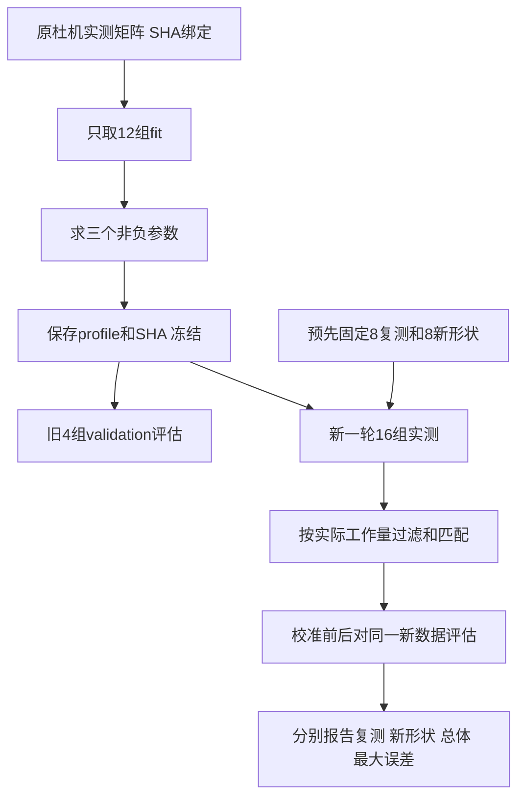

# 第18章：实测拟合、冻结参数与一半新形状验证

2026-10-14，用户授权校准后重新测试，并选择“新长度和batch人数”，本轮仍为纯Prefill/Decode。完成旧12组fit拟合、旧4组validation评估和全新16组实测；新16组一半复测、一半新形状，测试结果没有回流训练。混合batch尚未专门验证，后续先沿用参数测试，误差大时再补充拟合或模型，而非默认必须另外一套系数。

## 1. 公式通用，参数有适用范围

同一套公式可以读取不同模型结构，计算其FLOPs/字节数；本次拟合的参数却只能视为Qwen2.5-3B、BF16、单4090、TP1、vLLM0.11.0 eager、Worker前后CUDA同步计时的修正量。

换模型大小或结构，会改变GPU利用率、矩阵形状、KV占比和执行开销；换显卡、精度、TP、框架版本、CUDA Graph也可能改变时间。模型规模相同不意味着系数一定通用。可以拿已有参数作初始猜测，但必须在目标条件下验证；不把本次平均误差外推为所有模型的保证。

## 2. 怎样避免测完再调，导致虚假的“验证”



fit_timing.py检查原始文件SHA和基线Predictor身份，从compare_rows得到有效轮次。每次生成先取dense/attention基函数的轮次中位数，再按20次重复取中位数，与实测中位数构成训练方程。只接受split=fit，原validation不进入求解。

```text
预测ms = dense_factor × 原dense组ms
       + attention_factor × 原attention组ms
       + batch_overhead_ms
目标：最小化12个形状的相对误差平方和，各形状等权
约束：两个factor为正，固定开销非负
```

三个参数很少，标准库枚举有效变量集合，并用带主元消元求最小二乘候选，不增加运行时依赖。得到：

| 参数 | 冻结值 |
| --- | ---: |
| dense_factor | 0.35379254965754375 |
| attention_factor | 4.3110183582864 |
| batch_overhead_ms | 14.168541970007391 |

这些系数同时补偿工作量近似、速度假设及计时边界等差异，不是独立测得的GPU物理性能。Attention系数大不证明真实Attention单独慢4.3倍；14.17ms也不能当作已经分离测量的CPU/kernel启动时间。三组参数的相关性仍是泛化风险，不能随意移用到新模型或长上下文。

profile在新采集前生成并冻结，SHA为229f40d9ecad321b3631de1c65f0614f0dcb509937addf5e7027a3586c9e0dce。validate_fresh.py首先核对这个SHA、模型config SHA、软件版本、有效运行参数、矩阵身份和COMPLETE，拒绝配置变化后仍冒充同一次验证。

## 3. 原4组validation只评估，不调参

| 未参与拟合的形状 | 校准后相对误差 |
| --- | ---: |
| Prefill B1 / 256 | +2.57% |
| Prefill B1 / 1024 | −7.65% |
| Decode B2 / C256 | −4.68% |
| Decode B2 / C1024 | −3.40% |

训练报告在calibration/measurements/du-qwen25-fit-20261014.json，参数不因这些结果调整。本轮代码没有在新数据上重拟合。

## 4. 新一轮数据到底换了什么

矩阵在calibration/fresh_validation.json，采集前固定。8个复测：P128/256/512/2048，D B1/C128、B4/C512、B8/C2048、B2/C1024。8个新形状：P192/384/768/1536，D B3/C384、B3/C1536、B6/C768、B6/C1536。

新长度、B3/B6此前没有出现在训练或旧validation形状中；仍在已测规模附近，不是对任意长度的外推测试。seed换为20261014、输入token IDs基值由1000变为2000。继续使用精确长度合成输入，非ShareGPT自然语言请求，没有请求到达时间或端到端TTFT验证。

杜机GPU4，已有Qwen2.5-3B权重/独立环境，显存预算50%；eager、实际chunked prefill=true、prefix=false，与原成功采集一致。每形状5次预热/20次重复，run_id=du-qwen25-3b-eager-fresh-20261014-03，400次生成、6874条Worker记录；输出长度逐次核对，退出0/COMPLETE，结束卡恢复4MiB/0%。KV仍10220块×16token。没有终止其他任务，没有新环境/权重下载。

预热、输入Prefill/混合过渡、人数不完整轮次仍排除；Decode上下文增长，预测使用实际items。按每次生成中位数再按20次重复中位数计算，各形状等权。新轮次中实测值变化正常，因此校准前后必须比较同一份新数据，而非用原轮54.39%直接减新轮误差。

## 5. 新测试结果

| 同一份新数据上的组别 | 校准前平均绝对相对误差 | 校准后平均绝对相对误差 | 校准后最大误差 |
| --- | ---: | ---: | ---: |
| 全部16形状 | 46.27% | 5.95% | 13.65% |
| 8个旧形状复测 | 48.30% | 6.53% | 11.63% |
| 8个新形状 | 44.24% | 5.36% | 13.65% |

16个形状均在预先沿用的20%教学验证阈值内；这是本轮观测结果，不是任意请求的准确率保证。

| 新形状 | 实测ms | 校准预测ms |
| --- | ---: | ---: |
| Prefill192 | 17.79 | 18.18 |
| Prefill384 | 19.93 | 22.65 |
| Prefill768 | 35.28 | 33.00 |
| Prefill1536 | 66.78 | 59.33 |
| Decode B3/C384 | 16.96 | 16.54 |
| Decode B3/C1536 | 16.92 | 17.09 |
| Decode B6/C768 | 16.96 | 17.10 |
| Decode B6/C1536 | 16.97 | 17.83 |

最大误差来自新Prefill384，约高估13.65%。其余完整16组/上下文范围/排除计数在calibration/measurements/du-qwen25-fresh-validation-20261014.json。旧3B模型以外、Mixed/Recompute、异构成员长度、真实请求级时序和压力仍未验证。

## 6. 代码结构与复现

| 文件/阅读重点 | 职责 |
| --- | --- |
| fit_timing.py【重点1】 | 明确隔离fit数据；构造两组基函数及常数项 |
| fit_timing.py【重点2】 | 冻结profile后才评估旧validation |
| matrix_plan.py / fresh_validation.json | 核对16形状、一半新类型；不修改训练矩阵 |
| collect_batches.py --matrix | 指定测试矩阵/seed/token IDs，保留实际工作量与有效参数 |
| validate_fresh.py【重点1】 | 参数SHA绑定及模型/软件/运行参数检查 |
| validate_fresh.py【重点2】 | 分别报告复测、新形状、总体及最大误差 |
| configs/calibrated_qwen25_3b.json | 可选已拟合参数，原默认配置不变 |

```bash
python3 run_simulation.py --config configs/calibrated_qwen25_3b.json --output output/calibrated.json
python3 calibration/scripts/validate_fresh.py \
  --run output/calibration/du-qwen25-3b-eager-fresh-20261014-03 \
  --baseline configs/measure_qwen25_3b.json \
  --profile configs/calibrated_qwen25_3b.json \
  --fit-report calibration/measurements/du-qwen25-fit-20261014.json \
  --plan calibration/fresh_validation.json \
  --output output/calibration/fresh-validation-new
```

完整原始数据忽略于output/calibration/<run_id>，远端runs保留一份；提交统计/参数/范围/证据SHA，不提交原始数据。CLI的4token例子仅确认profile加载和参数生效，不在本轮验证范围内。当前BatchEstimate.source仍固定为uncalibrated_roofline，尚未增加绑定校准证据的运行时来源接口；本次真实拟合和验证身份以独立报告为准，不能根据旧source字面判断参数未生效。

12个采集专项测试通过，新增已知参数恢复、非负边界、validation不入训练、半数新形状划分和最大误差检查；profile CLI成功。基础Predictor/Engine公式不变。用户学习理解尚未确认，下一步讨论误差与Mixed测试，不能宣称整个单卡服务或所有模型已精确校准。
