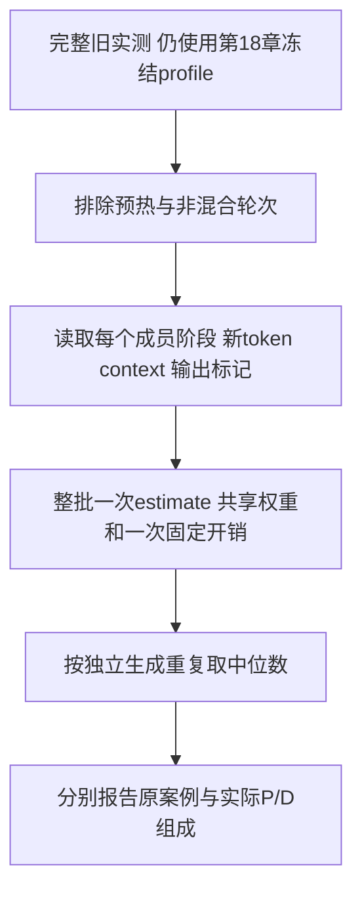

# 第19章：已有混合batch记录的验证

2026-10-15，用户授权查看混合batch效果。先复用第18章新采集时留下、此前被排除的混合过渡轮次，保持纯P/D拟合参数不变。已有记录足以检验部分组成，尚不足以完成我们选批策略全部“1P+多个D”的专门验证。

## 1. 本轮实际完成了什么

使用du-qwen25-3b-eager-fresh-20261014-03的非预热混合记录：219条Worker轮次、139次独立生成重复，来自7个原始投递案例。没有重新运行这些数据，没有将它们纳入拟合，也没有改变默认Predictor。

原来的case标签如Decode-B8-L2048表示“最初投递8个请求、输入2048”的实验，不代表每个实际轮次都是8个Decode。请求逐渐进入时，实际批次可能有多个Prefill和若干Decode。分析必须读items，而不是照标签推断成员。



## 2. 如何预测混合batch

不把P单独预测时间与D单独预测时间相加，而是把所有成员一起送入RooflinePredictor.estimate。总新token数、attention位置对数按成员累计，权重按整批一次读取估算，固定开销也只收一次。Prefill可以是部分块，produces_token决定是否有LMHead；Decode保持实际上下文。

analyze_mixed.py核对冻结profile SHA、模型身份、软件和有效引擎条件，只接受真实同时含Prefill/Decode的记录；然后调用校准前、校准后Predictor比较同一工作量。原案例内先按一次生成的混合轮次取中位数，再对各次生成取中位数；总体对7个原案例等权。

另按“原案例+P人数+D人数+P总token”报告组成档位，保留重复数/上下文范围。档位内具体成员context等仍可能不同，预测用每条完整items，不把档位假称完全相同batch。

## 3. 结果

| 在同一份混合数据上 | 数值 |
| --- | ---: |
| 原案例数 | 7 |
| 非预热混合轮次 | 219 |
| 有混合轮次的独立生成次数 | 139 |
| 校准前平均绝对案例误差 | 29.28% |
| 沿用纯P/D系数后平均绝对案例误差 | 21.77% |
| 沿用系数后最大绝对案例误差 | 31.55% |

典型组成档位如下（P/D表示同一轮中的成员阶段）：

| 实际组成 | 有效重复 | 实测ms | 校准预测ms | 相对误差 |
| --- | ---: | ---: | ---: | ---: |
| 1P×1024 token + 1D | 19 | 49.51 | 40.98 | −17.22% |
| 3P×512 token + 1D | 19 | 66.52 | 49.37 | −25.78% |
| 5P×768 token + 1D | 19 | 158.32 | 108.37 | −31.55% |

现有纯P/D参数在这些混合工作上仍有明显低估，不能把第18章纯阶段5.95%的误差声明直接推广。两个总体数字来自不同形状集合，不应相减当同数据前后效果；混合数据本身的前后对照是29.28%→21.77%。

我们当前mixed_decode_first最多放一个Prefill块；已有多数记录却是多个Prefill同时执行。1P+1D/1024有19次重复，可观察到约17.22%低估；其他1P+多个D的具体档位多只有1–2次，不能据此保证精度。不能把多Prefill结果当成我们调度策略必然出现的组成。

这些数据验证的是Worker单轮耗时预测。没有配对的同到达/同调度请求级实验，因此尚不能量化混合相对串行的TTFT/ITL/吞吐收益，更不能把执行时间变化直接称为用户延迟改善。

## 4. 补采尝试与用户停止拷贝

曾准备先让1/3/7个Decode就绪，再注入1个128/512/1536 token Prefill的受控实验。第一次启动前候选卡被其他任务占用，保护检查退出；第二次在模型文件检查处发现杜机原/data/HF_MODELS/Qwen2.5-3B-Instruct已不存在。两次都没有加载权重，没有有效新数据或COMPLETE。

查询A6000发现完整Qwen2.5-3B基础版，结构同旧Instruct但权重不同；A6000的现成环境也不能直接等同杜机独立环境。曾开始将该现有模型拷到杜机独立目录，以便保留4090/原环境。用户随后明确“别拷贝了”，已终止本任务scp，未启动模型，不自动恢复传输或补采。目标目录/data/llm-serving-lab-calibration/models/Qwen2.5-3B-base-from-a6000可能保留部分文件，不能当成完整模型；未删除文件。

受控采集器没有通过GPU执行验证，保留在ignored output/calibration/drafts/mixed/collect_mixed.py，不作为正式可用入口发布。正式launch_remote已恢复，仅公开已有记录分析工具。两份上一任务留下的8B配置仍是未提交草稿，不纳入此次结果。

## 5. 代码和证据

正式工具calibration/scripts/analyze_mixed.py：【重点1】整批一次估算，【重点2】区分投递案例和实际成员组成。结果摘要calibration/measurements/du-qwen25-existing-mixed-20261015.json保存profile/原始文件SHA、7案例和23组成档位；逐轮完整items在ignored output/calibration/du-qwen25-existing-mixed-01/matched_rounds.jsonl。

```bash
python3 calibration/scripts/analyze_mixed.py \
  --run output/calibration/du-qwen25-3b-eager-fresh-20261014-03 \
  --baseline configs/measure_qwen25_3b.json \
  --profile configs/calibrated_qwen25_3b.json \
  --fit-report calibration/measurements/du-qwen25-fit-20261014.json \
  --output output/calibration/mixed-analysis-new
```

13个采集专项测试通过，新增整批调用、部分Prefill输出标记、预热/纯阶段过滤、重复等权及非法耗时拒绝。没有重新拟合或改核心执行公式。后续若继续，应先获得可用权重与用户允许的运行条件，完成1P+多个D独立验证，再决定是否细化耗时模型。
