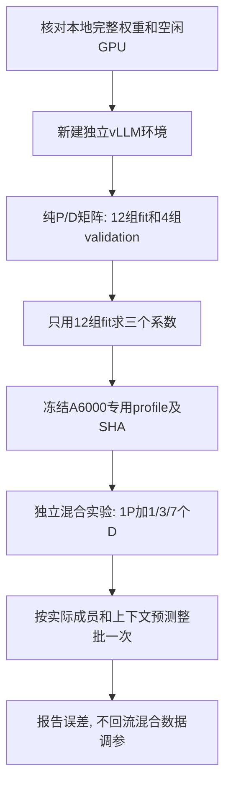
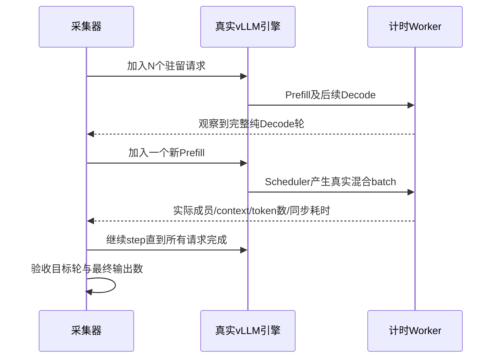

# 第20章：直接在A6000验证受控混合batch

## 为什么需要重测纯P/D

杜机原来的Qwen2.5-3B-Instruct已不存在。用户停止跨机权重拷贝后，改为直接在A6000运行本地已有的Qwen2.5-3B基础版。模型结构相同，但显卡、checkpoint都不同，4090的修正系数不能直接当作这次的准确基线。

本次仍用同步eager Worker执行时间。它包含Worker预处理、模型计算、采样和输出，不包含引擎调度、RPC、HTTP、排队及分词；不能把本章误差理解为TTFT/ITL误差。



## 如何保证真的测到混合轮次

`collect_mixed.py`使用真实vLLM Scheduler，不替换其选批算法。

1. 加入N个请求，每个输入512token、输出16token。
2. 调用引擎step，直到Worker记录显示全体都已经进入同一轮Decode。
3. 加入一个新的Prefill请求，输入128、512或1536token，只输出1token。
4. 持续step直到全部结束。检查恰好出现一次目标混合轮：指定N个Decode成员和这个完整Prefill。
5. 检查每个请求的最终输出数。任何一步不符就失败，不写COMPLETE。

正式矩阵为3个人数乘3个P长度，共9组；每组5次预热、20次有效重复。Decode上下文不是固定512，预测读取实际轮次的上下文。



## 数据结构和代码阅读

| 数据 | 内容及作用 |
| --- | --- |
| `metadata.json` | 模型config及SHA、软件版本、GPU UUID、请求/有效引擎参数、矩阵与完成状态 |
| `batches.jsonl` | 每次Worker执行的实际PredictorItem列表、上下文、新token数与同步耗时 |
| `generation_checks.jsonl` | 每次实验的样本ID、匹配的混合轮编号及各请求最终输出数 |
| `capacity.json` | 引擎初始化后实际块数、KV预算与权重显存 |
| `fit_report.json` | 纯P/D训练身份、三个系数、冻结profile SHA及4组留出误差 |
| `mixed_report.json` | 纯P/D系数不变时，9组受控混合轮的预测与实测对照 |

先读`calibration/scripts/collect_mixed.py`的【重点1】和【重点2】：前者决定何时投递新P，后者验收真实组成。`batch_records.match_controlled_mixed`同时核对请求身份、完整P和单token D，避免仅按人数误判。

`analyze_mixed.validate_controlled_run`再次独立检查整个矩阵，拒绝缺失/重复样本、错误输出和不一致的轮次编号。`controlled_target_rows`只保留验收记录中的目标iteration：驻留请求入场阶段也可能出现其他混合轮，不能混进1P+nD结果。`analyze_rows`对整批只调用一次Predictor，随后先按一次生成汇总，再按独立实验等权。

`fit_timing.py`增加device-label/scope参数，只改变来源标签，不改变公式。A6000基线仍使用100TFLOP/s和1TB/s作为解析坐标，三个系数再适配实测；这两个数不是A6000标称或实测峰值。默认模拟配置不变。

## 环境与边界

独立目录`/data/llm-serving-lab-calibration`，Python3.10.12、vLLM0.11.0、torch2.8.0、transformers4.56.1。只读取`/data/HF_MODELS/Qwen2.5-3B`，没有下载或跨机拷贝权重，不修改已有虚拟环境。GPU2通过UUID定位，开始前要求显存不超过64MiB且利用率为0；预算50%，TP1/BF16、eager、prefix cache关闭、有效chunked prefill开启、人数8、token预算4096、最大上下文4096、块16token。

本章测试回答“纯P/D校准能否预测真实1P+多D执行耗时”。它没有比较调度策略的请求级收益，没有证明所有模型/硬件都准确，也没有测量P/D分离或KV传输。

## 纯P/D实测与参数冻结

`a6000-qwen25-3b-pure-20261015-02`完成16组、400次生成、9214条Worker记录，每组5预热/20有效重复。相同数据上未校准解析基线的平均绝对形状误差49.56%，最大65.76%。

仅12组fit得到dense_factor=0.7568788631690692、attention_factor=3.060882675764624、batch_overhead_ms=11.729456370363053。独立profile为`configs/calibrated_a6000_qwen25_3b.json`，SHA256为`a471d55138c72911531508bcb783cd090ffe657b3f3bb55e40917be0c8005a0b`；没有覆盖4090参数。

| 未参与拟合的形状 | 实测ms | 预测ms | 相对误差 |
| --- | ---: | ---: | ---: |
| P256/B1 | 18.77 | 22.78 | +21.40% |
| P1024/B1 | 61.55 | 59.48 | -3.36% |
| D/B2/初始context256 | 17.27 | 16.46 | -4.67% |
| D/B2/初始context1024 | 17.13 | 16.64 | -2.89% |

4组留出平均绝对误差8.08%，短P256仍不准确，不根据这组误差再调参。实际KV池31961块、每块16token、511376token容量，KV预算18851833856字节，权重显存6218668032字节。这是当前50%显存预算的引擎结果，不是整张48GB都能用于KV。

证据摘要在`calibration/measurements/a6000-qwen25-{baseline,fit}-20261015.json`，原始文件保存在本地ignored `output/calibration/<run_id>/`及服务器`runs/<run_id>/`。初始smoke为`a6000-qwen25-3b-mixed-smoke-20261015-01`，只用于接口验证，不参与拟合或正式混合统计。

## 复现入口

服务器先运行`launch_remote.py`的纯P/D入口；本地依次使用`compare_measured.py`和`fit_timing.py`，为fit指定`--device-label`与`--scope`，保存独立profile并冻结。随后服务器使用`launch_remote.py --mixed`采集固定9组矩阵，本地用：

```bash
python3 calibration/scripts/analyze_mixed.py \
  --run output/calibration/a6000-qwen25-3b-mixed-20261015-03 \
  --baseline configs/measure_a6000_qwen25_3b.json \
  --profile configs/calibrated_a6000_qwen25_3b.json \
  --fit-report calibration/measurements/a6000-qwen25-fit-20261015.json \
  --output output/calibration/a6000-qwen25-mixed-analysis-replay
```

所有输出目录需是新目录。不要覆盖原始证据后重用同一run-id，也不要在GPU已有任务时绕过显存保护。

## 受控混合结果

`a6000-qwen25-3b-mixed-20261015-03`完成9组、225次实验（含45次预热）、3743条Worker记录。正式比较只取180个验收通过的目标混合轮，每组20次。驻留请求入场阶段还存在114个非预热混合轮，组成不等于本次注入目标，保留原始记录但排除正式统计。早期本地analysis-01误包含这些准备轮，已由analysis-final替代，不作为结论。

| 本轮组成 | 实测中位ms | 冻结参数预测ms | 相对误差 |
| --- | ---: | ---: | ---: |
| P128 + 1D | 17.14 | 17.24 | +0.54% |
| P512 + 1D | 36.83 | 34.47 | -6.40% |
| P1536 + 1D | 95.08 | 86.95 | -8.55% |
| P128 + 3D | 17.06 | 17.44 | +2.22% |
| P512 + 3D | 36.62 | 34.58 | -5.57% |
| P1536 + 3D | 95.92 | 87.06 | -9.24% |
| P128 + 7D | 17.90 | 17.86 | -0.23% |
| P512 + 7D | 37.68 | 34.78 | -7.69% |
| P1536 + 7D | 97.33 | 87.26 | -10.35% |

九组等权平均绝对误差：未校准28.80% → 纯P/D校准后5.64%，最大10.35%。这些混合数据没有进入参数拟合。D真实上下文为514–515token，按各成员实际值预测。完整报告为`calibration/measurements/a6000-qwen25-controlled-mixed-20261015.json`；本地逐轮对照在`output/calibration/a6000-qwen25-mixed-analysis-final`。

直观上，当前范围内Prefill越长，混合轮越慢，现有模型也越倾向低估；增加少量D成员的边际执行成本较小。这个现象不等于D请求延迟没有恶化：这些D必须等整轮长P结束，请求级ITL/TTFT的策略对照仍未做。

本次只能说明A6000/这个3B基础版/同步eager/当前9种组合的迁移效果，不能拿5.64%直接对比4090旧多P混合的21.77%并宣称显卡更准确，两者硬件、checkpoint和测试组成不同。更长D上下文、多P、chunk中间块等仍未专门验证。

采集退出0且均有COMPLETE，GPU2恢复4MiB/0%，无本任务残留推理或模型拷贝。15项采集专项测试通过，新增覆盖精确成员、重复目标、缺样本、输出不全与准备轮过滤。设计、数据结构与AI交接已同步，默认模拟配置和核心公式不变。
