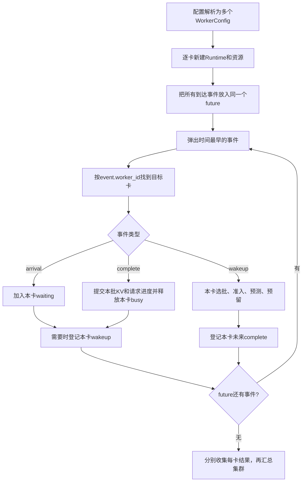

# 第21章：两张独立Mix卡，共享一个事件队列

这一步只学习多卡运行基础。每个worker都是完整的模型副本，自己完成请求的Prefill和Decode。两张Mix卡已经可以同时工作；P/D分离、跨卡KV传输还没有进入本章。完整后续计划见[ROADMAP](../ROADMAP.md)。

## 1. 先看结果，再理解结构

在WSL2进入项目目录运行：

```bash
python3 run_simulation.py --config configs/two_mix_workers.json --output output/two_mix_workers.json
```

耗时仍是教学假设：Prefill每输入token为2ms，Decode每轮2ms。两卡分别有独立的4个KV块，每块2token。

| 请求 | 到达 | 输入/输出token | 固定归属 | 输出时刻 |
| --- | ---: | --- | --- | --- |
| A | 0ms | 4 / 3 | worker_0 / gpu_0 | 8、10、12ms |
| B | 0ms | 2 / 2 | worker_1 / gpu_1 | 4、6ms |

时间线可以直接手算：

```text
模拟时间   0       4   6   8   10  12 ms
gpu_0     |---- A Prefill ----| A D | A D |
gpu_1     | B Prefill | B D |   空闲……
```

A的Prefill需要4×2=8ms，B需要2×2=4ms。因此B在4ms进入Decode时，A仍在进行Prefill。不同卡的区间可以重叠，同一卡的区间不能重叠。

A的TTFT是8ms、总延迟12ms；B的TTFT是4ms、总延迟6ms。集群窗口从0到12ms，完成2个请求，所以吞吐是2/0.012≈166.67req/s。不能把两卡局部窗口12ms与6ms相加当作集群耗时，也不能直接把两卡各自的吞吐相加。

## 2. 什么放全局，什么放每张卡

以前只有一份busy/waiting/active。现在把它们搬进`_WorkerRuntime`，每个worker实例各有一份。

| 数据/对象 | 所有者 | 为什么 |
| --- | --- | --- |
| `future`最小堆 | 全局事件驱动器 | 统一决定所有卡的下一个事件 |
| `sequence` | 全局事件驱动器 | 同刻同类事件也有稳定顺序 |
| 固定请求归属表 | 全局输入 | 到达时知道应该通知哪张卡 |
| `execution_order` | 全局事件驱动器 | 保存所有卡启动顺序，使steps/plans/estimates同序 |
| `waiting` | 每个worker | 只放已到达且未完成输入的本卡请求 |
| `active` | 每个worker | 本卡等待继续Decode的请求 |
| `busy`、`wakeup_pending` | 每个worker | 别的卡完成，不能让本卡提前空闲 |
| `Scheduler` | 每个worker新建 | 即使引用同一方案，交替阶段也不能互相影响 |
| `Predictor` | 每个worker新建 | 可为不同卡配置不同耗时参数 |
| `BlockPool` | 每个worker新建 | 卡0剩余显存不能直接用于卡1 |
| `RecoveryController` | 每个worker新建 | 抢占、保护、恢复队列只影响本卡 |
| 输入进度、输出时刻、首次开始等 | 请求所属worker | 当前阶段请求不迁移，因此归属始终不变 |

`WorkerConfig`是不可变的“配置单”，`_WorkerRuntime`是会变化的“运行现场”。共享一个不可变SchedulerProfile没有问题；共享运行中的Scheduler实例会让两卡的交替状态串在一起，这不允许。

## 3. 单线程代码为什么能模拟并行

我们模拟的是时间关系，不需要真的开启两个线程。启动A的Prefill时，只登记“8ms时卡0完成”，不会立刻把时间跳到8ms。启动B时再登记“4ms时卡1完成”。随后堆会先弹出4ms事件，卡1就能先继续工作。



`_ScheduledEvent`增加`worker_id`，仍按`(time_ms, priority, sequence)`排序。worker_id不参与比较，所以不是卡号小的卡总能优先抢到事件。

同一时刻按下面顺序处理全部卡：

1. arrival：先登记到达。
2. complete：再结算所有完成。
3. wakeup：最后各卡从最新状态选批。

例如4ms恰好有新请求到达、两张卡的batch同时完成，必须先处理到达和两次完成，再处理唤醒。一次唤醒可以登记未来完成事件，但不能改变全局当前时间。

`runtime.now_ms`只是当前收到事件的时间副本，来源永远是全局堆。每张卡没有独立推进的时钟。我们也没有先分别跑完两个单卡模拟再拼接结果；这为后续传输事件同时影响两张卡留出位置。

当前把各卡的计算和KV资源视为独立，未模拟共享CPU、主存或链路争用。重叠时间线是这个模型下的逻辑并发，不是实测两卡服务性能。

## 4. 配置怎么读

先看`configs/two_mix_workers.json`，重点是workers和routing两部分。

```json
{
  "workers": [
    {"id": "worker_0", "gpu_id": "gpu_0", "role": "Mix", "scheduler_profile": "mix_default",
     "kv_cache": {"gpu_id": "gpu_0", "total_blocks": 4, "block_tokens": 2}},
    {"id": "worker_1", "gpu_id": "gpu_1", "role": "Mix", "scheduler_profile": "mix_default",
     "kv_cache": {"gpu_id": "gpu_1", "total_blocks": 4, "block_tokens": 2}}
  ],
  "routing": {"policy": "fixed", "assignments": {"A": "worker_0", "B": "worker_1"}}
}
```

这只是字段摘录，完整配置还需要workload、耗时来源和scheduler_profiles。

- `id`是逻辑worker身份，`gpu_id`是逻辑卡身份。本阶段一worker对应一张独立卡，两者各自都必须唯一。
- 每个worker独立引用选批方案；即使方案名字相同，也会新建各自Scheduler。
- 顶层timing/predictor是公共默认来源。worker内可以用自己的timing或完整predictor覆盖；设置timing会替换父级predictor，设置roofline会替换父级timing，避免混用两种耗时来源。
- 多卡时KV和recovery写在各worker内；顶层KV/recovery明确拒绝，防止把同一GPU身份的池误用到两卡。没有写KV表示该卡未启用容量约束；没有写recovery默认block。
- KV的人工total_blocks和独立memory_profile仍二选一，路径相对当前实验配置目录；换算和Predictor模型结构校验继续复用原逻辑。
- 当前固定归属表必须恰好覆盖全部请求，不能遗漏、多写或引用不存在的worker。不给多卡routing会报错，不暗中采用某种负载均衡。
- P/D角色仍明确拒绝，直到后续实现KV交接。本章两卡都是Mix，不是1P1D，也不是一个模型拆到两卡的TP。

如果把worker_1的耗时改为：

```json
"timing": {"prefill_ms_per_input_token": 1, "decode_ms_per_step": 1}
```

B会在2、3ms输出；A仍在8、10、12ms输出。这说明它们使用不同的Predictor实例与参数，并不改变模型权重或使用真实显卡。

## 5. KV与阻塞为什么不能混在一起

两个池的块号都可能从0开始，所以跨卡解释身份时必须带GPU。卡0的`block_id=0`与卡1的`block_id=0`不是同一块。

如果卡0容量不够：

1. 卡0当前wakeup可能找不到可准入计划，记录blocked后返回。
2. 全局future中卡1的到达/完成事件仍会继续处理。
3. 只有全局future耗尽后，才收集各卡结果，判断是否还有未完成请求。

因此全局结果可以是blocked，同时卡1已经正常完成全部请求。报告必须保留卡0的输入进度、已产出token和KV快照，而不是丢掉它们或把卡1也判为未执行。

固定分配不会自动把卡0排队请求移到空闲卡1；迁移需要明确的后续协议。重算恢复也只操作本卡KV，不能跨卡挑受害者。

## 6. 输出怎么对应代码

旧单卡入口`simulate_events`和单卡JSON继续使用原EventRun/schema_version=1。本次不是维护两套执行算法：单卡包装器也使用相同的worker运行现场和共享堆驱动器，最后返回唯一worker的旧结果。

多卡Python入口为`simulate_workers(requests, workers, assignments)`，返回`ClusterRun`；多卡JSON使用schema_version=2。

| 输出 | 阅读方式 |
| --- | --- |
| `routing.assignments` | 请求固定交给哪张卡 |
| `steps[i].worker_id/gpu_id` | 这一轮实际在哪张卡运行 |
| `plans[i]`、`estimates[i]` | 与steps[i]同序，分别是本轮工作量和预测明细 |
| `requests[*].worker_id` | 完整请求结果的归属 |
| `workers[*]` | 每卡解析后的配置、状态、KV/恢复记录、局部统计 |
| `workers[*].busy_time_ms` | 本卡所有执行区间之和，不是集群总时长 |
| `summary` | 集群请求级统计，共用全局窗口 |
| `pending_request_ids/progress` | 未完成请求及归属和进度 |
| `trace` | 按实际事件处理顺序输出，带worker前缀 |

每卡summary仍使用该卡已完成请求的局部窗口；集群summary使用全部已完成请求的窗口。如果blocked，summary_scope标为completed_requests_only。KV快照不合并，避免把多卡容量当作一个可自由借用的大池。

## 7. 代码阅读顺序：先看这五处

| 顺序 | 位置 | 先理解什么 |
| --- | --- | --- |
| 1 | `worker.py:WorkerConfig`（多卡重点1） | 一张卡有哪些独立输入 |
| 2 | `engine.py:_WorkerRuntime.__init__`（多卡重点2） | 原单卡状态如何各建一份 |
| 3 | `engine.py:_drive_workers`（多卡重点3） | 唯一future、worker_id分发、启动顺序 |
| 4 | `engine.py:arrive/complete/dispatch` | 同一套单卡逻辑如何只修改本卡 |
| 5 | `config.py:load_experiment`（多卡重点4） | 参数覆盖、唯一身份和固定归属校验 |

`try_preempt`、`BlockPool`内部和JSON序列化可以暂时略读。先能回答“4ms为什么先轮到B，而不是等A的8ms”就抓住本章核心。

## 8. 验证与学习练习

`tests/test_multi_worker.py`用确定性小例子检查两卡重叠/单卡互斥、同刻事件顺序、独立KV、阻塞隔离、独立交替/恢复、不同速度、空闲卡、固定路由、配置拒绝、schema2/吞吐窗口及blocked保存后退出2。

改动前保存基础、KV和重算三个CLI结果；改动后完整JSON逐项相同，连trace和KV记录也一致。最终93项测试中91通过、2项分词依赖缺失跳过，包含新增9项多卡测试。

建议先做两个小实验：

1. 只把B改为worker_0。为什么卡1空闲，B仍不能过去？先观察固定路由；由于卡0只有4块KV，A的增长还会让B等待，输出为A的8/14/16ms和B的12/18ms。
2. 保持B在worker_1，只把卡1的速度加倍。确认A的输出时刻不变，再看集群窗口是否仍由A决定。

当前阶段完成后先阅读、讨论这些结果。下一阶段才实现固定1P1D与传输事件；本章不自动改变路线或继续部署真实服务。
