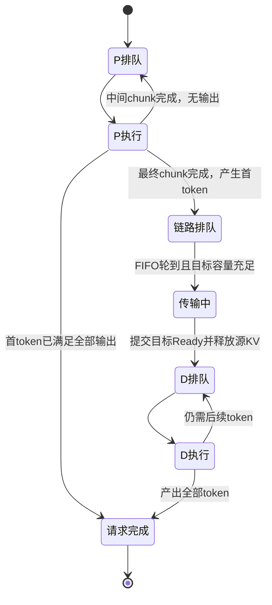
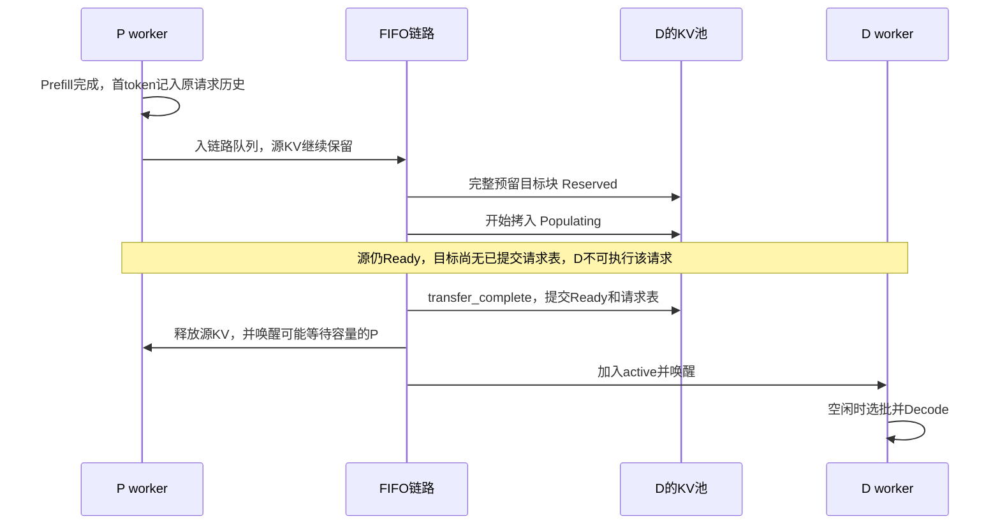

# 第22章：固定1P1D与KV传输

本章完成多卡路线第2阶段：一张P卡处理输入并产生首token，一张D卡生成后续token，中间通过一条可配置的FIFO链路传KV。两张卡都是完整模型副本，分别负责不同阶段；不是把模型权重拆成两半。

## 1. 先运行最小例子

在WSL2的项目目录运行：

```bash
python3 run_simulation.py --config configs/one_p_one_d.json --output output/one_p_one_d.json
```

请求A在0ms到达，输入4token、输出3token。教学耗时P每输入token为2ms，D每轮2ms。KV载荷假设1024bytes/token，带宽1024000bytes/s，固定延迟1ms；两卡各有16块×2token的独立KV容量。

| 时间 | 发生什么 | A的输出 |
| --- | --- | --- |
| 0–8ms | P处理4token输入 | 8ms产生第1个token |
| 8–13ms | 传输输入对应的KV | 等待，D尚不能计算 |
| 13–15ms | D处理P产生的第1个token | 15ms产生第2个token |
| 15–17ms | D继续处理上一个输出 | 17ms产生第3个token，完成 |

KV载荷=4×1024=4096bytes，传输耗时=1+4096/1024000×1000=5ms。因此输出时刻为8、15、17ms，TTFT=8ms，两个ITL是7ms和2ms，总延迟17ms。

**传的是已经处理过的4个输入token的KV。** P刚生成的首token还没有作为下一轮模型输入，因此它的KV尚未产生，不能把载荷写成5token。D开始第一轮时context=4；第二轮context=5。这与单卡Decode的上下文定义相同。

链路带宽减半时，传输变成1+8=9ms，输出时刻变为8、19、21ms。首token不变，首token之后的间隔变长。

## 2. 三种状态不能混为一谈

| 状态 | 最小例子8ms时 |
| --- | --- |
| P卡计算忙闲 | 已结束这轮计算，可以处理其他输入 |
| 源KV生命周期 | 仍保留在P卡，不能提前释放 |
| 请求是否可以在D执行 | 还不可以，需要等13ms的传输完成 |



单输出请求在P产生首token后直接完成，不传KV、不进入D。分块Prefill只在最终chunk完成后交接，不把每个中间块作为一次传输。

## 3. 交接时KV如何变化



传输完成不代表D立刻执行。如果D已有正在运行的batch，新请求只进入D的active队列，等该轮完成再参与选批。不能把传输完成时刻直接当作下一输出时刻。

当前未启用PD抢占，已经交接的请求也从P候选中移走，所以源KV不会在传输时被普通计算/恢复释放。这是当前固定流程的生命周期保护，不是完整的transfer-pin、共享引用或COW协议。

## 4. 数据结构和职责

| 对象 | 内容/职责 |
| --- | --- |
| `WorkerConfig` | P/D角色、各自方案、耗时与独立KV池 |
| `PDConfig` | 指定唯一P、唯一D，校验两卡角色和兼容性 |
| `LinkConfig` | bytes/s带宽、ms固定延迟、每token KV字节数 |
| `HandoffController.queue` | 已完成P但尚未占用链路的请求及ready时刻 |
| `HandoffController.active` | 当前唯一链路传输 |
| `KVReservation` | D池中这次拷入的未提交写入事务 |
| `TransferRecord` | 请求、起止worker、ready/start/end、载荷和完成状态；冻结记录 |
| `runtime.departed` | 已从P移交完整执行责任的请求，避免P和D都输出一份结果 |

全局仍只有第21章的同一个future堆，新增transfer_start和transfer_complete两种事件。transfer_start表示链路唤醒，实际成员由FIFO队首决定，不一定是触发唤醒的请求。

事件顺序为arrival=0，计算complete与transfer_complete=1，计算wakeup与transfer_start=2。同刻的所有完成先结算，再选批/启动传输；同类同刻按稳定序号排序。传输完成会同时影响源容量和目标队列，所以需要一个全局事件驱动器。

## 5. 为什么需要不同请求并行写KV

旧BlockPool限制一池只有一笔在途事务。现在D可能正在为A增长KV，同时通过链路接收B的KV，两笔写入涉及不同请求，可以并行。

本章把限制改为：**不同请求可有多笔事务，同一请求仍禁止重叠写入。** 每笔事务有自己的块、transaction_id和旧块快照，完成/回滚只修改自己持有的范围。容量计算包括所有未提交块，不能超额借用。

复制沿用Reserved→Populating→Ready生命周期，使用已有写入所有者字段保护目标块；不代表多发了一个计算batch。复制不会进入steps/plans/estimates，也不会调用Predictor收取第二次Prefill耗时。它有独立的transfers记录和链路耗时。

## 6. 请求历史如何保留

交接时D接收原Request信息、已完成输入进度和P的首次开始时间；token_times与records继续引用同一份请求历史。这样P的首token不会丢失，D也不会重新登记“请求到达”。

P把已移交请求记入departed，不再参与自己的完整请求结果汇总；最终由D保存一份端到端Result。单输出请求没有移交，仍由P保存完成结果。原始到达时间、TTFT、首token后的传输等待都保留，集群不重复计输入/输出。

PD输出仍使用schema_version=2，execution_mode=fixed_1p1d，增加pd和transfers。routing.assignments表示初始到达P的归属；requests中的worker_id表示最终完成所在卡，worker_path记录P→D路径。

每卡busy_time_ms只统计本卡计算；链路时间不加到GPU忙时。workers[*].summary仍是“由本卡保存的完整已完成请求”的端到端统计，不是阶段吞吐。为免误读，PD另存produced_output_tokens：最小例子P=1、D=2，集群总输出=3。

## 7. 配置与模型字节数

完整入口见`configs/one_p_one_d.json`，关键字段为：

```json
"pd": {
  "prefill_worker": "p0",
  "decode_worker": "d0",
  "link": {
    "bandwidth_bytes_per_s": 1024000,
    "latency_ms": 1,
    "kv_bytes_per_token": 1024
  }
}
```

两个worker分别role=P和role=D，各自引用P或D方案，不需要Mix槽。pd与routing互斥，因为本阶段固定全部请求先进入P，不执行动态路由；无pd的独立worker模式仍只接受Mix。

1024bytes/token只是便于手算的教学假设。普通dense/GQA模型的真实结构换算为：

`KV bytes/token = 2(K和V) × 层数 × KV头数 × head_dim × KV元素字节数`。

已有Qwen2.5-3B BF16示例为2×36×2×128×2=36864bytes/token。配置roofline或显存预算profile时，会核对链路字节数和KV结构/精度；两端roofline模型结构也要相同。不同设备的速度可以不同，但不能把不兼容模型的KV直接交接。

传的是有效载荷，不含尾页空位；两端可各自重新排页，未额外收取打包开销。固定延迟和有效带宽仍是输入假设，尚未做真实双卡传输校准。

## 8. 多请求的小例子

把负载改为同时到达的A（输入4/输出3）和B（输入2/输出2），其他配置保持：

| 请求 | P与首token | 链路ready | 实际传输 | 后续输出 |
| --- | --- | ---: | --- | --- |
| A | 0–8，首token8 | 8 | 8–13 | 15、17 |
| B | 8–12，首token12 | 12 | 13–16，排队1ms | 19 |

13–16ms复制B时，D正为A执行计算；B在16ms就绪，但不能打断A的15–17ms batch，因此17–19ms才轮到B。

如果P只剩足够容纳A输入的容量，A源KV要保留到13ms，B会等待。交接释放源后重新唤醒P，B才继续。这种源容量回压已遵循旧准入规则；它不等于目标容量不足的完整等待协议已经实现。

## 9. 当前边界与阅读顺序

- 需要恰好一P一D、不同GPU、各自启用KV，PD抢占明确拒绝。
- FIFO传输按整段串行，链路与两卡计算可重叠；未模拟共享HBM/PCIe/CPU争用。
- 开始传输时D放不下完整输入，会明确报错，不静默跳过或伪造完成；没有目标容量等待队列/恢复策略。这是路线第3阶段的内容。
- 已进入D后的Decode增长仍按原KV准入规则，无法增长时可能blocked；不承诺所有输入都能完成。
- 没有多P多D、动态路由、共享prefix/COW、增量流式传输或真实多卡精度保证。

代码先看`handoff.py`的LinkConfig（重点1）、HandoffController（重点2）与complete（重点3），再看engine.py的P完成分支和全局传输事件分发。KV并行事务只有reserve入口限制发生变化，不必重新通读整个BlockPool。

106项测试中104通过、2项分词依赖缺失跳过。新增13项PD测试核对单请求手算、真实上下文、KV保留/就绪/释放、带宽变化、FIFO与计算重叠、同刻完成顺序、源容量回压、单输出/空负载、分块交接、目标容量拒绝、事务回滚、模型字节校验及CLI端到端统计。此前单卡与多Mix测试继续通过。
