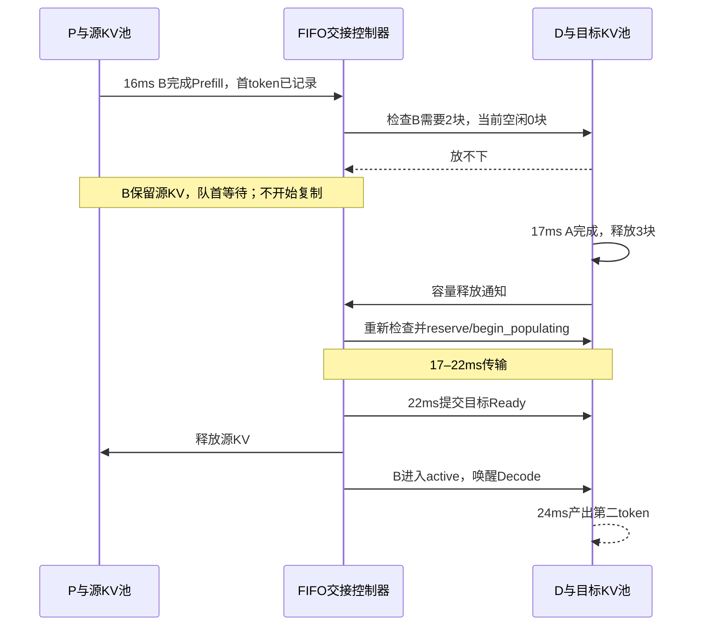

# 第23章：目标KV容量不足时，怎样等待并恢复交接

日期：2026-10-19。对应路线第3阶段的固定1P1D等待协议。这里的“恢复”指继续原交接，不是抢占重算，也不重新选择目标卡。

## 1. 先理解这次解决的问题

过去P完成Prefill后，如果D放不下完整输入KV，会抛出ValueError。现在改为：**请求留在FIFO交接队列，P端KV继续保留；D释放块后，再检查目标容量。**

本次不增加动态路由、D→P迁移、多级缓存或PD抢占。暂时不足不代表请求失败；整个事件堆耗尽且仍有未完成请求时，结果为blocked。

## 2. 手算：B为什么在16–17ms等待

配置：[pd_capacity_wait.json](../../configs/pd_capacity_wait.json)；负载：[pd_capacity_wait_requests.json](../../workloads/pd_capacity_wait_requests.json)。

- A、B都在0ms到达，输入各4token；A输出3token，B输出2token。
- P每个输入token耗时2ms，D每轮2ms。
- P有16块，D只有3块；每块容纳2token。
- 每token KV按1024字节计算；链路1024000bytes/s，固定延迟1ms。
- 每个请求初始KV为4096bytes，传输需要1+4096/1024000×1000=5ms。

以上均为教学参数，不代表实测显卡速度。

| 时间 | P与链路 | D端KV及计算 |
| --- | --- | --- |
| 0–8 | P处理A，8ms首token | 空闲 |
| 8–13 | 传A；P同时在8–16处理B | A的2块处于Populating |
| 13–15 | A源KV释放 | A开始Decode，预留后需要3块，15ms第二token |
| 15–17 | 16ms B首token已产出，但交接等待 | A继续Decode，D的3块都被占用 |
| 17 | B获得空间并开始传输 | A第三token产出，请求结束，释放3块 |
| 17–22 | B传输；P保留B源KV | B目标2块处于Populating |
| 22–24 | 22ms B源KV释放 | B继续Decode，24ms第二token并结束 |

最终A输出时间为8/15/17ms，B为16/24ms。B的8ms生成间隔由**1ms容量等待+5ms传输+2ms计算**组成。



## 3. 用状态看清楚：等待不等于传输

| 请求所处阶段 | 源KV | 目标KV | 能否在D计算 |
| --- | --- | --- | --- |
| 等链路 | 保留Ready | 尚未预留 | 否 |
| 等容量 | 保留Ready | 不为该请求预留新块 | 否 |
| 正在传输 | 仍保留Ready | Reserved后进入Populating | 否 |
| 传输完成 | 目标提交后释放 | Ready | 可以排队，不能打断当前batch |

交接队列是严格FIFO：队首放不下时，后面更小的请求也不越过它。链路忙时先等链路；只有链路空闲、轮到该请求且放不下时，才开始记录它的容量等待。两种等待的时间不能混用。

## 4. 为什么不每隔1ms检查一次

在当前固定PD模型中，D没有缓存淘汰或swap；能增加空闲块的事件是请求完成释放KV。重复定时检查不会产生新空间，反而可能制造无限事件。

事件内核处理一次D事件时，比较处理前后的free_blocks：

```text
free_after > free_before
          ↓
通知交接控制器capacity_released
          ↓
若有容量等待、链路空闲、没有已排队的检查事件
          ↓
安排当前时刻的transfer_start
          ↓
重新检查实际容量，成功才预留并复制
```

`start_pending`合并重复唤醒。到达优先级0、计算/传输完成优先级1、GPU/链路唤醒优先级2保持不变。同刻先处理完成事件，再处理调度或交接检查；同优先级依旧按稳定序号。D可能已为下一轮计算预留了块，因此唤醒不等于保证空间仍然足够，必须重新检查。

以后若加入swap、淘汰、逻辑预留或目标切换，需要扩展“哪些变化值得唤醒”的定义；本次不引入师兄完整的容量generation体系。

## 5. 数据结构：读这几处就够

### 5.1 HandoffController：运行中的可变状态

| 字段 | 意义 |
| --- | --- |
| `queue` | FIFO的(request_id, Prefill完成时间)，只有成功开始传输才取走队首 |
| `active` / `reservation` | 当前传输及目标池写事务；等容量时两者为空 |
| `wait_records` | 历史容量等待记录，记录对象冻结，状态变化用replace生成新对象 |
| `waiting_index` | 当前队首对应的等待记录索引；恢复后清空 |
| `start_pending` | 是否已安排链路检查事件，避免同刻重复唤醒 |

### 5.2 CapacityWaitRecord：导出的不可变记录

| 字段 | 意义 |
| --- | --- |
| `request_id` | 等待的请求 |
| `start_ms` | 首次检测到容量不足的时间 |
| `end_ms` | 成功开始复制的时间；未恢复时为null |
| `observed_until_ms` | 恢复时刻，或临时等待的观察截止；impossible记录即时判断时刻 |
| `required_blocks` | 本次交接需要新增的目标块数 |
| `free_blocks_at_start` | 首次等待时目标空闲块数，不是实时值 |
| `reason` | temporary_capacity或request_exceeds_target_capacity |
| `status` | waiting、resumed或impossible |
| `wait_ms` | 观察到的等待时长；JSON导出为observed_until_ms-start_ms |

固定1P1D已经在顶层pd配置标明两端，等待记录无需再复制一套源/目标配置。`TransferRecord`仍只记录真正启动的复制，不能把未传输请求伪造为in_flight。

## 6. 两类无法恢复的情况

**永久放不下：** 例如请求需要2块，目标总共只有1块。记录`impossible`和明确reason，不再因释放通知重试；仍保留源KV与pending进度。当前没有通用请求失败/取消协议，所以它不是自动删除请求，而是最终`blocked`。FIFO队首保留，后续交接不会绕过；这是保守且明确的本阶段规则。

**暂时等待，但系统最终没有可推进事件：** 例如D的活跃请求自身增长也需要新块，却没有空闲块，无法完成释放。此时记录`waiting`，`end_ms=null`；事件堆耗尽后返回`blocked`。观察截止仅表示“看到这里”，不表示等待已经解决。

目标输入KV放得下不保证后续Decode一定能增长。本次没有按未知最终输出长度预留全部KV，也没有引入抢占、swap或重路由，不能保证所有负载都完成。

源端也可能出现背压：等待请求仍占P的块，后续Prefill可能被容量阻止。只有复制完成释放源KV后，才唤醒P继续。这种影响应留在请求时间线中，不能忽略。

## 7. 代码阅读顺序

1. `simulator/handoff.py`的`CapacityWaitRecord`（等待重点1）：先分清结束与观察截止。
2. `wake_link` / `capacity_released`（等待重点2）：看什么触发重试、怎样合并唤醒。
3. `start_next`（等待重点3）：看容量不足时为什么不能popleft、reserve或释放源。
4. `simulator/engine.py`的全局事件循环（等待重点4）：看D释放块后如何通知控制器。
5. `HandoffController.complete`：沿用先目标Ready、再释放源、再进入D队列的边界。
6. `run_simulation.py`：导出capacity_waits，CLI区分交接总等待与容量等待。

不需要重新通读BlockPool。它的容量判断、并行事务、提交和释放接口本轮没有更改；我们把“放不下之后怎么办”补在交接控制器。

## 8. 运行与结果检查

在WSL2项目目录中运行：

```bash
python3 run_simulation.py --config configs/pd_capacity_wait.json --output output/pd_capacity_wait.json
python3 -m unittest discover -s tests -p test_pd.py -v
```

成功示例的JSON会包含：

```json
{
  "capacity_waits": [
    {
      "request_id": "B",
      "start_ms": 16,
      "end_ms": 17,
      "observed_until_ms": 17,
      "required_blocks": 2,
      "free_blocks_at_start": 0,
      "reason": "temporary_capacity",
      "status": "resumed",
      "wait_ms": 1
    }
  ]
}
```

PD结果保持schema_version=2，新增capacity_waits；独立Mix和单卡输出不加此字段。CLI原“链路等待”改称“交接总等待”，因为start_ms-ready_ms现在也可能包含目标容量等待，不再误标为纯链路排队。

blocked时照常保存JSON并退出2，summary仅统计完成请求，pending_progress保留未完成请求的首token和输入进度。不要只看summary误以为所有请求都完成。

## 9. 验证重点与学习练习

`tests/test_pd.py`新增/更新的验证覆盖：

- A释放后B在同一模拟时刻恢复，首开始/首token历史不变。
- 等待时没有为B占目标块，源KV保留到复制结束。
- 严格FIFO：小请求不能越过放不下的队首。
- P端容量背压，复制完成释放后继续推进。
- 永久放不下和无未来释放两类blocked，不死循环或丢失进度。
- 未恢复等待有观察时长，end_ms依旧为空；其他能运行的请求仍继续。
- CLI blocked退出码、JSON字段和pending首token。

可以先不看代码，回答：如果链路带宽减半，B的首token会不会改变？B的第二token何时产生？再运行验证。注意A传输变慢也可能改变D占用与B等待的时段，不能只给B最后时间机械加5ms。

本阶段完成后先理解等待、释放唤醒与背压，再讨论动态路由或D→P迁移，不自动推进后续研究功能。

本次WSL2全量验证112项，110通过、2项分词依赖缺失跳过；PD专项19项。basic/kv_blocks/recompute/two_mix_workers四个旧示例的完整JSON与改动前记录一致。
